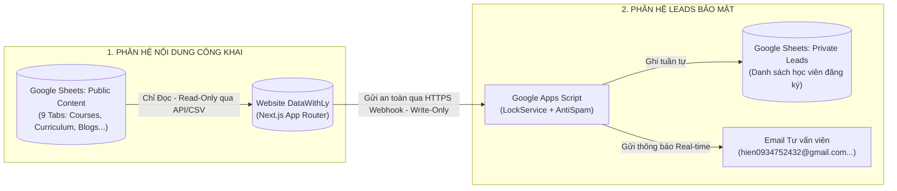

# Tác nhân và vai trò — DataWithLy

- **Mục đích:** Xác định rõ ràng các nhóm người sử dụng website, các vai trò vận hành dữ liệu nội bộ và các vai trò phát triển dự án; thiết lập ranh giới bảo mật và phân quyền truy cập thông tin.
- **Trạng thái:** Approved — đã thống nhất theo kế hoạch và trao đổi ngày 2026-11-03.
- **Người duyệt:** Chủ dự án.
- **Ngày cập nhật:** 2026-11-03.
- **Nguồn tham khảo:** 
  - [Product Overview](product-overview.md);
  - [Problem Statement](problem-statement.md);
  - Bảng yêu cầu nội dung `Website LY DATA - content to fill.xlsx`;
  - Slide bài giảng `[LYDATA] Data Analytics Courses.pptx.pdf`;
  - [Báo cáo giải pháp](../references/solution-and-scope-report.md);
  - [Customer Requirements Notes](../08-project/customer-requirements-notes.md);
  - Hướng dẫn biên soạn: [Writing Guide](WRITING-GUIDE.md).

---

## 1. Tác nhân người dùng cuối (End-Users / External Actors)

| Tác nhân | Mục tiêu chính | Hành động trên Website | Dữ liệu được tiếp cận |
|---|---|---|---|
| **Người xem khóa học (Visitor)** | Tìm hiểu lộ trình học, xem xét độ uy tín của Mentor Hứa Thảo Ly và mức độ phù hợp của 3 khóa học | Xem trang chủ, duyệt danh mục khóa học, xem syllabus chi tiết, xem sản phẩm dashboard của học viên khóa trước | Tiếp cận 100% nội dung công khai (không cần đăng nhập). |
| **Người đăng ký tư vấn / Học viên tiềm năng (Lead)** | Muốn được tư vấn lộ trình 1-1, kiểm tra đầu vào hoặc đăng ký giữ chỗ khóa học sắp khai giảng | Bấm các nút CTA (`[Nhận tư vấn]`, `[Đăng ký ngay]`), điền biểu mẫu Modal (Họ tên, SĐT, Email, Khóa quan tâm, Khung giờ hẹn gọi, Ghi chú) | Nhận thông báo xác nhận trạng thái nộp form trên màn hình và email cảm ơn. |
| **Độc giả kiến thức (Blog Reader)** | Nâng cao kiến thức chuyên môn, học mẹo truy vấn SQL, quy trình thiết kế dashboard | Đọc các bài viết chia sẻ, lọc bài theo chủ đề, sao chép các đoạn code SQL/Python | Toàn bộ nội dung bài viết công khai được xuất bản trên website. |

---

## 2. Vai trò vận hành phía DataWithLy (Internal Operations Roles)

Để bảo vệ dữ liệu cá nhân theo quy định pháp lý (Nghị định 13/2023/NĐ-CP) và tránh rò rỉ danh sách học viên, hệ thống áp dụng nguyên tắc **phân quyền tối thiểu (Least Privilege)** và **tách biệt 2 nguồn dữ liệu**:

| Vai trò nội bộ | Nhân sự đảm nhiệm | Trách nhiệm chính | Quyền hạn dữ liệu & Thao tác |
|---|---|---|---|
| **Founder & Lead Mentor** | **Chị Hứa Thảo Ly** | Quản lý toàn diện thương hiệu, quyết định nội dung đào tạo, học phí, lịch khai giảng và tiếp nhận danh sách học viên | - Toàn quyền truy cập cả 2 file Google Sheets: `Public Content Sheet` và `Private Leads Sheet`. - Toàn quyền chỉnh sửa giá bán, mở/ẩn khóa học và xuất bản nội dung lên website. |
| **Đội ngũ Tư vấn viên (Consultants)** | Nhân sự tư vấn do Chị Ly chỉ định | Tiếp nhận thông tin học viên, gọi điện tư vấn lộ trình 1-1 và chăm sóc học viên trước nhập học | - Được cấp quyền truy cập file `Private Leads Sheet` để xem thông tin liên hệ và cập nhật trạng thái tư vấn. - Nhận email cảnh báo real-time khi có lượt đăng ký mới. *(Môi trường demo/test sử dụng danh sách email đã duyệt: `hien0934752432@gmail.com`, `hien.truong230214@vnuk.edu.vn`).* |
| **Người biên tập nội dung (Content Editors)** | Chị Ly hoặc cộng tác viên hỗ trợ | Cập nhật bài viết blog, bổ sung phản hồi (testimonials) học viên, chỉnh sửa văn bản giới thiệu | - Chỉ được cấp quyền chỉnh sửa trên file `Public Content Sheet`. - **Hoàn toàn KHÔNG được truy cập file `Private Leads Sheet`** (tránh rò rỉ dữ liệu cá nhân của học viên). |
| **Người quản trị Workspace & Hệ thống** | Chủ dự án / Quản trị viên kỹ thuật | Quản lý triển khai mã nguồn, cấu hình Webhook Google Apps Script, quản lý domain và hạ tầng máy chủ | - Quản trị kho mã nguồn GitHub, cấu hình tài khoản Vercel và kiểm soát các mã bí mật môi trường (Environment Variables). |

---

## 3. Ranh giới bảo mật dữ liệu giữa Website và Google Sheets

> [!IMPORTANT]
> **Nguyên tắc bảo vệ dữ liệu:**
> 1. Mã nguồn Website và người xem bên ngoài **hoàn toàn không có quyền đọc (No Read Access)** đối với file `Private Leads Sheet`. Ngay cả khi kiểm tra mã nguồn hoặc API client, không ai có thể truy xuất danh sách số điện thoại hay email của học viên đã đăng ký.
> 2. Giao thức nộp form là giao tiếp một chiều qua Webhook Apps Script (`Write-Only`), được bảo vệ bằng token định danh và cơ chế khóa hàng đợi (`LockService`) để đảm bảo không mất mát dữ liệu.

---

## 4. Vai trò phát triển và nghiệm thu dự án

| Vai trò dự án | Nhân sự / Thực thể | Trách nhiệm trong dự án |
|---|---|---|
| **Chủ dự án (Project Owner)** | Người đặt yêu cầu / Đại diện khách hàng | Phê duyệt phạm vi sản phẩm, nội dung công bố chính thức, nghiệm thu kết quả kiểm thử và duyệt phát hành. |
| **TechLead (Trợ lý kỹ thuật)** | Agent TechLead | Rà soát tính khả thi kỹ thuật, đối soát yêu cầu khách hàng, thiết kế kiến trúc hệ thống, hoàn thiện bộ tài liệu chuẩn và giao việc cho Agent Code. |
| **Agent Code (Codegen Agent)** | AI Coding Agent | Nhận chỉ thị từ bộ tài liệu `docs/`, thực hiện viết mã nguồn Next.js, tạo components, kết nối Google Sheets API và tuân thủ tuyệt đối các quy tắc kỹ thuật. |

---

[Điểm bắt đầu của bộ docs](../README.md)
