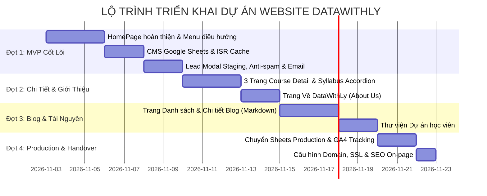

# Phạm vi sản phẩm — DataWithLy

- **Mục đích:** Quy hoạch ranh giới tính năng, phân kỳ các đợt phát hành (Phased Delivery) và xác lập tiêu chí hoàn thành cụ thể cho từng giai đoạn triển khai dự án website DataWithLy.
- **Trạng thái:** Approved — đã thống nhất theo kế hoạch và trao đổi ngày 2026-11-03.
- **Người duyệt:** Chủ dự án.
- **Ngày cập nhật:** 2026-11-03.
- **Nguồn tham khảo:** 
  - [Product Overview](product-overview.md);
  - [Problem Statement](problem-statement.md);
  - [Goals and Non-goals](goals-and-non-goals.md);
  - [Actors and Roles](actors-and-roles.md);
  - Bảng yêu cầu nội dung `Website LY DATA - content to fill.xlsx`;
  - Slide bài giảng `[LYDATA] Data Analytics Courses.pptx.pdf`;
  - Hướng dẫn biên soạn: [Writing Guide](WRITING-GUIDE.md).

---

## 1. Bản đồ phân hệ & Nhóm chức năng sản phẩm

| Nhóm module | Tên phân hệ | Vai trò trong hệ thống | Đợt phát hành dự kiến |
|---|---|---|:---:|
| **M01** | **HomePage** | Trang chủ giới thiệu thương hiệu DataWithLy, 3 khóa học, USP, dự án học viên và điểm kích hoạt tư vấn | **Đợt 1 (MVP)** |
| **M04** | **Lead Capture** | Biểu mẫu Modal thu thập thông tin đăng ký tư vấn, chống spam 3 lớp, bảo toàn dữ liệu và gửi email thông báo | **Đợt 1 (Staging)** |
| **M05** | **Content Management** | Cơ chế đọc dữ liệu từ Google Sheets, hiển thị ra web và làm mới bộ nhớ đệm (ISR On-demand Revalidation) | **Đợt 1 (MVP)** |
| **M02** | **Course Details** | 3 trang độc lập chi tiết hóa mục tiêu, visual flow và Accordion giáo trình (Syllabus) của từng khóa học | **Đợt 2** |
| **M06** | **About Us** | Trang câu chuyện thương hiệu, hồ sơ và thành tích của Founder & Lead Mentor Hứa Thảo Ly | **Đợt 2** |
| **M03** | **Blog & Resources** | Trang danh sách bài viết theo chuyên mục, trang đọc bài viết chi tiết hỗ trợ Markdown, và thư viện dự án | **Đợt 3** |
| **M07** | **Production & Analytics** | Chuyển đổi sang Sheets Production, gắn mã GA4, cấu hình tên miền chính thức và SEO toàn diện | **Đợt 4** |

---

## 2. Chi tiết phạm vi theo từng đợt phát hành

### 2.1. Đợt 1 — MVP: CMS Content & HomePage (Trọng tâm ưu tiên)

**Mục tiêu đợt 1:** Hoàn thiện toàn bộ trải nghiệm Trang chủ (HomePage) chuẩn nhận diện thương hiệu DataWithLy, kiểm chứng luồng quản trị dữ liệu từ Google Sheets và luồng thu thập lead trên môi trường Google Sheets Staging.

| Thành phần HomePage | Phạm vi thực hiện cụ thể trong Đợt 1 | Nguồn dữ liệu & Ghi chú |
|---|---|---|
| **Header & Top Bar** | - Thông báo ưu đãi hoặc lịch khai giảng gần nhất (có thể cấu hình bật/tắt). - Logo thương hiệu **DataWithLy**. - Menu điều hướng đa tầng:   + *Trang chủ*   + *Khóa học ▾* (Dropdown dẫn tới 3 khóa học)   + *Tài nguyên ▾* (Dropdown: Kiến thức & Chia sẻ, Dự án học viên)   + *Về DataWithLy*   + Nút CTA nổi bật `[Nhận tư vấn]` kích hoạt mở Lead Modal. - Menu Drawer cho phiên bản Mobile. | Nạp cấu hình từ tab `SiteConfig` trên Google Sheets. |
| **Hero Section** | - Headline chuẩn hóa: *"Học Data Analytics từ tư duy đến thực hành"*. - Sub-headline: *"Lộ trình bài bản từ cơ bản đến nâng cao, dự án thực tế, hỗ trợ tận tâm"*. - Nút CTA kép: `[Nhận tư vấn lộ trình 1-1]` (mở modal) và `[Khám phá khóa học]` (cuộn xuống khối khóa học). - Ảnh chân dung Mentor Hứa Thảo Ly và các chứng nhận chuyên môn. | Dữ liệu chuẩn hóa từ file `content to fill.xlsx` và slide bài giảng. |
| **USP 3 Cards (Vì sao chọn DataWithLy)** | - Headline: *"Vì sao nên học cùng DataWithLy?"*. - Sub-headline: *"Không chỉ học công cụ, bạn sẽ được rèn luyện tư duy phân tích và thực hành trên những bài toán gần với công việc Data Analyst thực tế"*. - 3 Card giá trị:   1. *Lộ trình bài bản* (icon Roadmap/Book): Hiểu bản chất thay vì học vẹt công cụ.   2. *Dự án thực tế* (icon Case Study/Project): Dữ liệu thực chiến từ E-commerce và Ngân hàng.   3. *Mentor đồng hành & feedback* (icon Feedback/Mentor): Kèm cặp trực tiếp, sửa bài tập 1-1. | Thay thế 4 card cũ; cập nhật icon và câu chữ đúng yêu cầu. |
| **Lưới Khóa học tại DataWithLy** | - Trưng bày 3 thẻ khóa học chính thức:   1. `SQL for Data Analytics` (12 buổi | 2.990.000 VNĐ | Live Online).   2. `Analytical Thinking & Dashboard Design` (16 buổi + CV | 3.790.000 VNĐ | Live Online).   3. `End-to-End Analytics with SQL & Dashboard Design` (25 buổi + CV | 5.690.000 VNĐ | Live Online). - Thẻ hiển thị: Ảnh bìa sắc nét, thời lượng theo số buổi, học phí rõ ràng, tóm tắt đầu ra và 2 nút CTA: `[Xem chi tiết]` và `[Đăng ký ngay]`. | Nạp từ tab `Courses` trên Google Sheets. |
| **Thư viện Dự án học viên** | Trưng bày các sản phẩm phân tích dữ liệu thực tế: Dashboard Phân tích phim (Film), Bán lẻ (AdventureWork), Giáo dục (EduTech), Thương mại điện tử (Ecommerce) và các bài thuyết trình slide mẫu của học viên. | Thay thế khối "Tài liệu miễn phí" cũ theo yêu cầu khách hàng. |
| **Feedback học viên (Testimonials)** | - Lưới nhận xét thực tế từ học viên các khóa trước. - Chuẩn hóa chiều cao các card (3 - 4 dòng nhận xét, bố cục cân đối, loại bỏ màu nền tương phản gay gắt). | Nạp từ tab `Testimonials` trên Google Sheets. |
| **Kiến thức & Chia sẻ mới nhất** | - Cụm 3 bài viết nổi bật gần nhất. - Tên tác giả ghi chuẩn: **DataWithLy**, kèm ngày tháng đăng bài; bỏ hiển thị view count; có nút `[Xem tất cả bài viết]`. | Nạp từ tab `Blogs` trên Google Sheets. |
| **Footer Toàn cục** | Logo DataWithLy, sứ mệnh đào tạo, thông tin liên hệ chính thức (Hotline, Zalo OA, kênh TikTok, Facebook, LinkedIn, Threads) và bản quyền thương hiệu. | Nạp từ tab `SiteConfig`. |
| **Lead Modal & Chống Spam** | - Biểu mẫu popup mở khi bấm bất kỳ nút CTA nào. - Tự động điền trước khóa học tương ứng nếu học viên bấm từ thẻ khóa học. - Tự động bắt tham số `utm_source`, `utm_medium`, `utm_campaign`. - **Chống spam 3 lớp:** Honeypot field, Idempotency token, Rate limiting theo IP. - **Cơ chế lưu:** Gửi về Google Sheets Staging (Môi trường test). - **Bảo toàn form & Auto-retry:** Giữ nguyên dữ liệu người dùng khi gặp lỗi kết nối. - **Email cảnh báo demo:** Kích hoạt gửi email từ `hientruongthmh@gmail.com` đến `hien0934752432@gmail.com` và `hien.truong230214@vnuk.edu.vn`. | Mã nguồn Next.js API Route + Apps Script Webhook Staging. |

---

### 2.2. Đợt 2 — Chi Tiết Khóa Học (Course Detail) & Về DataWithLy (About Us)

- **3 Trang chi tiết khóa học lẻ (`/courses/[slug]`):**
  - Khóa 1: `/courses/sql-for-data-analytics`
  - Khóa 2: `/courses/analytical-thinking-dashboard-design`
  - Khóa 3: `/courses/end-to-end-analytics-sql-dashboard`
  - Mỗi trang bao gồm: Khối Hero khóa học, Thanh Sticky Card đăng ký nhanh, Visual flow bài toán (`Business Problem → Metrics → Analysis → Insight → Dashboard`), Khối đối tượng phù hợp và kết quả đầu ra, và **Accordion giáo trình (Syllabus)** chi tiết 12 - 25 buổi với tính năng Expand/Collapse All.
- **Trang Giới thiệu Về DataWithLy (`/about`):**
  - Câu chuyện sáng lập và triết lý đào tạo thực chiến của Mentor Hứa Thảo Ly.
  - Cột mốc sự nghiệp (ACB -> Tiki -> MoMo -> DataWithLy) và các giải thưởng đạt được.

---

### 2.3. Đợt 3 — Blog Kiến Thức & Tài Nguyên (Blog & Resources)

- **Trang Danh mục Blog (`/blog`):**
  - Bộ lọc bài viết theo chuyên mục (*SQL Tips*, *Dashboard Design*, *Tư duy Phân tích*, *Kỹ năng Phỏng vấn*).
  - Lưới bài viết chuẩn SEO có ảnh thumbnail, tiêu đề, tóm tắt và ngày xuất bản.
- **Trang Đọc bài viết chi tiết (`/blog/[slug]`):**
  - Trình render nội dung Markdown hỗ trợ Syntax Highlighting cho đoạn mã SQL/Python kèm nút bấm `Copy Code` 1-click.
  - Thanh tiến trình đọc bài (Reading Progress Bar).
  - Khối tác giả Mentor Hứa Thảo Ly và nút kêu gọi nhận tài liệu / tư vấn khóa học cuối bài.
- **Trang Thư viện Dự án học viên (`/projects`):**
  - Trưng bày đầy đủ các bộ Dashboard tương tác trực tiếp (Power BI Web / Tableau) và slide báo cáo phân tích kinh doanh của học viên.

---

### 2.4. Đợt 4 — Production Transition, SEO & Bàn Giao (Final Release)

- **Chuyển đổi hạ tầng dữ liệu:** Chuyển đổi Webhook nộp lead từ Google Sheets Staging sang file Google Sheets Private Leads chính thức của Chị Hứa Thảo Ly.
- **Tối ưu hóa SEO & Tracking:**
  - Cấu hình thẻ OpenGraph preview (ảnh lớn `1200x630px` hiển thị đẹp khi gửi link trên Zalo/Facebook).
  - Tự động sinh `sitemap.xml` và `robots.txt`.
  - Cấu hình mã Google Analytics 4 (GA4) / Google Tag Manager (GTM) và theo dõi các sự kiện chuyển đổi (`click_cta_hero`, `submit_lead_success`).
- **Nghiệm thu & Bàn giao:** Bàn giao quyền sở hữu kho mã nguồn GitHub, tài khoản máy chủ Vercel và tài liệu hướng dẫn vận hành Google Sheets CMS.

---

## 3. Điều kiện nghiệm thu hoàn thành Đợt 1 (MVP Criteria)

Đợt 1 được coi là hoàn thành xuất sắc và sẵn sàng chuyển tiếp sang Đợt 2 khi đáp ứng đủ 5 tiêu chí:
1. **Giao diện chuẩn nhận diện:** Toàn bộ trang HomePage hiển thị đúng màu Đỏ Mận, logo DataWithLy, dải menu điều hướng mới, và không còn bất kỳ claim ảo nào.
2. **Dữ liệu 3 khóa học chuẩn xác:** Hiển thị đúng 3 khóa học cốt lõi với thời lượng và học phí đã niêm yết.
3. **Quản trị CMS hoạt động:** Chỉnh sửa văn bản trên Google Sheets công khai -> Kích hoạt revalidate -> Mở website thấy nội dung đổi sau 1-2 giây.
4. **Lead Capture Staging an toàn:** Điền form trên web -> Dữ liệu lưu thành công vào Sheets Staging kèm tham số UTM; spam bot bị chặn; ngắt mạng form không bị mất chữ.
5. **Email cảnh báo gửi thành công:** Email demo gửi tới `hien0934752432@gmail.com` và `hien.truong230214@vnuk.edu.vn`.

---

[Điểm bắt đầu của bộ docs](../README.md)
