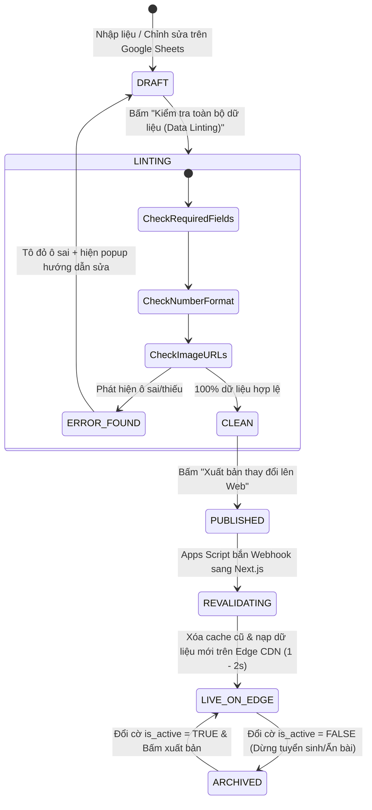
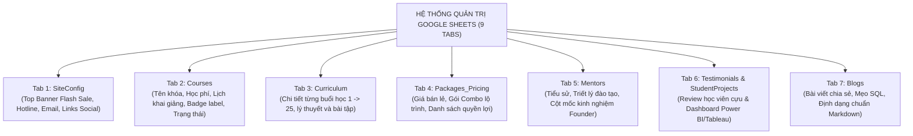

# Vòng đời quản trị nội dung — DataWithLy (Content Lifecycle)

- **Mục đích:** Đặc tả quy trình vòng đời của các mục dữ liệu nội dung trên Google Sheets Headless CMS (khóa học, lộ trình từng buổi, bảng giá, bài viết blog, review học viên), từ lúc biên tập nháp, kiểm tra lỗi định dạng (Data Linting), kích hoạt xuất bản (On-demand ISR Revalidation) đến khi hiển thị mượt mà trên website hoặc tạm ẩn khi dừng tuyển sinh.
- **Trạng thái:** Approved — đã thống nhất theo kế hoạch nghiệp vụ ngày 2026-11-03.
- **Người duyệt:** Chủ dự án & TechLead.
- **Ngày cập nhật:** 2026-11-03.
- **Nguồn tham khảo:** 
  - [Domain Overview](domain-overview.md);
  - [Course Model](course-model.md);
  - [Báo cáo giải pháp](../references/solution-and-scope-report.md);
  - [WF-05 Publish Content](../04-workflows/WF-05-publish-content.md).

---

## 1. Sơ đồ vòng đời nội dung (Content State Machine)

Toàn bộ các mục nội dung hiển thị trên website DataWithLy đều trải qua 5 giai đoạn trong vòng đời:

---

## 2. Bảng định nghĩa 5 Giai đoạn Vòng đời Nội dung

| Giai đoạn | Mô tả trạng thái | Nơi lưu trữ / Hiển thị | Ai thực hiện |
|:---:|---|---|:---:|
| **`DRAFT`** (Bản nháp) | Người quản trị đang thêm mới hoặc chỉnh sửa câu chữ, học phí, ngày khai giảng trực tiếp trên ô tính Google Sheets. Nội dung này **chưa hiển thị ngay ra ngoài web** để tránh học viên nhìn thấy nội dung đang sửa dở. | File `Public Content Sheet` | Chị Hứa Thảo Ly hoặc Cộng tác viên biên tập. |
| **`LINTED`** (Đã kiểm duyệt) | Dữ liệu đã vượt qua bộ quét kiểm tra tính toàn vẹn (Data Linting): không có ô bắt buộc bị bỏ trống, cột số đúng định dạng số nguyên, link ảnh chuẩn CDN. | File `Public Content Sheet` | Script tự động chạy khi bấm menu. |
| **`PUBLISHED`** (Đã kích hoạt) | Người quản trị bấm nút *"Xuất bản thay đổi lên Web"*. Google Apps Script gửi tín hiệu HTTPS POST kèm Secret Token sang API Route `/api/revalidate` của máy chủ Next.js. | Kênh truyền thông Webhook | Chị Hứa Thảo Ly kích hoạt qua 1 cú click. |
| **`LIVE_ON_EDGE`** (Hiển thị trực tuyến) | Máy chủ Next.js làm mới bộ nhớ đệm (ISR Revalidation), biên dịch lại các trang tĩnh liên quan và phân phối trên mạng lưới máy chủ toàn cầu (Vercel Edge Network) trong vòng 1 - 2 giây. | Trình duyệt của Học viên | Hệ thống Next.js tự động xử lý. |
| **`ARCHIVED`** (Tạm ẩn / Lưu trữ) | Khóa học đã đủ sĩ số, dừng tuyển sinh hoặc bài blog cần gỡ tạm thời. Chỉ cần đổi cột `is_active = FALSE` và bấm xuất bản. Khóa học tự động ẩn khỏi Slider trang chủ nhưng lịch sử trong bảng tính vẫn được bảo lưu vĩnh viễn. | Lưu trữ trong Sheets, ẩn trên Web | Chị Hứa Thảo Ly thực hiện khi đổi cờ. |

---

## 3. Phân loại 7 Nhóm Nội dung Quản trị trên Google Sheets

Hệ thống cho phép Chị Ly tự chủ 100% việc quản lý nội dung trên 9 tabs của `Public Content Sheet`:

---

## 4. Bộ quy tắc vàng khi thao tác trên Google Sheets CMS

Để đảm bảo hệ thống website luôn vận hành ổn định và không bao giờ gặp lỗi biên dịch dữ liệu, người quản trị cần ghi nhớ bộ quy tắc **"3 NÊN"** và **"3 KHÔNG"**:

### [!TIP] 3 NÊN:
1. **NÊN dùng phím `Alt + Enter` để xuống dòng trong một ô tính:**
   - Khi viết các gạch đầu dòng nội dung buổi học (Tab `Curriculum`) hoặc các quyền lợi của gói combo (Tab `Packages_Pricing`), phím `Alt + Enter` sẽ tạo dòng mới. Hệ thống Next.js sẽ tự động chuyển các dòng này thành từng bullet points đẹp mắt có icon tick xanh trên website.
2. **NÊN chạy tính năng "Kiểm tra toàn bộ dữ liệu" trước khi bấm "Xuất bản":**
   - Giúp Chị Ly hoàn toàn an tâm rằng website không bị sót thông tin quan trọng. Nếu có ô nào nhập sai (ví dụ: gõ chữ vào ô học phí), script sẽ tô đỏ ngay ô đó kèm thông báo nhắc nhở cụ thể.
3. **NÊN tải ảnh lên kho Cloudinary/R2 và dán link chuẩn CDN:**
   - Ảnh nạp từ CDN luôn hiển thị sắc nét, tải tức thì dưới 0.3 giây và không bao giờ bị Google chặn băng thông như khi dùng link Google Drive cá nhân.

### [!CAUTION] 3 KHÔNG:
1. **KHÔNG đổi tên hoặc xóa dòng tiêu đề số 1 của bất kỳ Tab nào:**
   - Dòng 1 chứa các khóa kỹ thuật (`course_id`, `sale_price`, `session_title`...). Nếu đổi tên dòng này, hệ thống sẽ không tìm thấy cột dữ liệu để hiển thị.
2. **KHÔNG gộp ô (Merge Cells):**
   - Tính năng gộp ô làm sai lệch chỉ số dòng và cột của API đọc dữ liệu bảng tính.
3. **KHÔNG dán link ảnh trực tiếp từ Google Drive:**
   - Tránh kích hoạt tính năng bóp nghẹt băng thông (Bandwidth Throttling) của Google làm lỗi ảnh trên web.

---

[Điểm bắt đầu của bộ docs](../README.md)
