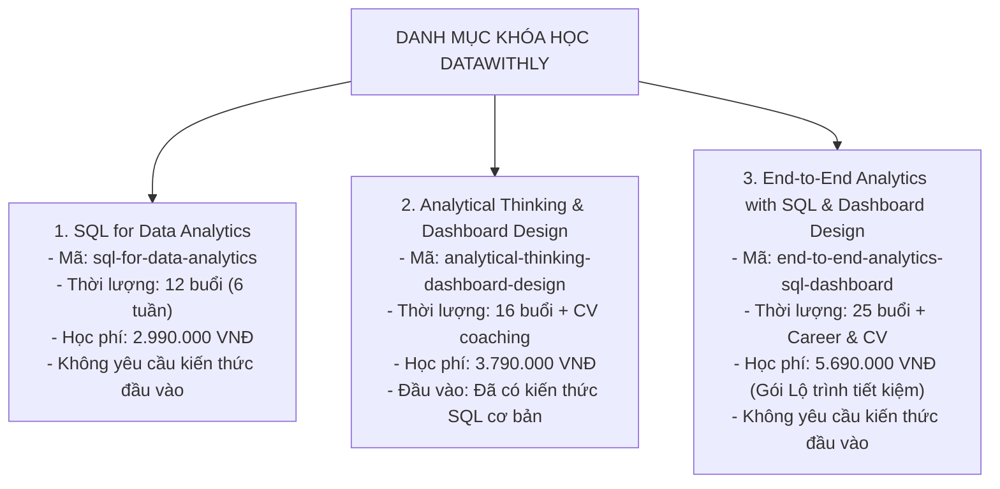
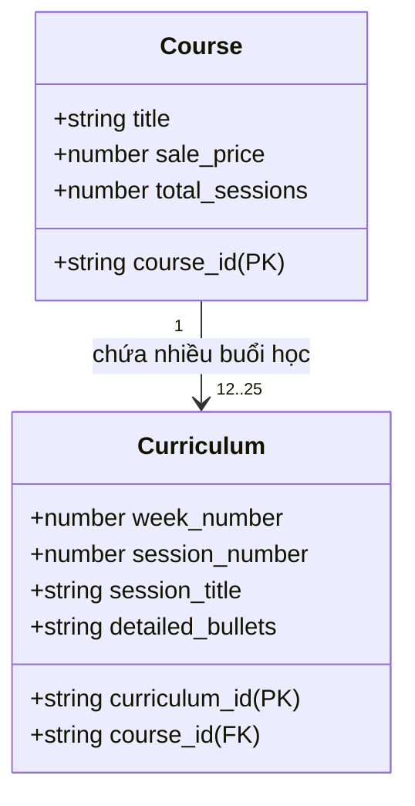

# Mô hình khóa học & Lộ trình đào tạo — DataWithLy (Course Domain Model)

- **Mục đích:** Đặc tả chi tiết mô hình dữ liệu của 3 khóa học thực tế tại DataWithLy, cấu trúc quan hệ 1-Nhiều với giáo trình từng buổi học (Curriculum Accordion) và các gói học phí (Packages & Pricing). Tài liệu này là cơ sở trực tiếp để cấu hình Google Sheets CMS và viết Zod Schema trong mã nguồn Next.js.
- **Trạng thái:** Approved — đã chuẩn hóa theo dữ liệu bài giảng và yêu cầu khách hàng ngày 2026-11-03.
- **Người duyệt:** Chủ dự án & TechLead.
- **Ngày cập nhật:** 2026-11-03.
- **Nguồn tham khảo:** 
  - Slide bài giảng: `[LYDATA] Data Analytics Courses.pptx.pdf`;
  - Bảng yêu cầu nội dung: `Website LY DATA - content to fill.xlsx` (Sheet Main & Sheet Syllabus);
  - [Domain Overview](domain-overview.md);
  - [Báo cáo ban đầu](../references/initial-product-report.md).

---

## 1. Danh mục 3 Khóa học cốt lõi tại DataWithLy

Website DataWithLy quản lý và hiển thị 3 chương trình đào tạo chính thức:



---

## 2. Đặc tả thực thể Khóa học (`Courses` - Tab 2 trên Google Sheets)

Mỗi khóa học được biểu diễn bằng 1 dòng trong tab `Courses` với các thuộc tính nghiệp vụ sau:

| Tên Cột (Column Name) | Kiểu dữ liệu | Bắt buộc | Ý nghĩa nghiệp vụ & Ràng buộc | Dữ liệu mẫu (Sample Data) |
|:---|:---:|:---:|:---|:---|
| `course_id` | String | Có | Khóa chính duy nhất, dạng chuỗi không dấu (Slug ID) dùng để liên kết với các tab khác | `sql-for-data-analytics` |
| `slug` | String | Có | Đường dẫn URL thân thiện trên trình duyệt (`/courses/[slug]`) | `sql-for-data-analytics` |
| `title` | String | Có | Tên khóa học đầy đủ hiển thị trên thẻ và tiêu đề H1 | `SQL for Data Analytics` |
| `summary` | String | Có | Đoạn mô tả ngắn gọn (1 - 2 câu) hiển thị trên card | `Xây dựng nền tảng SQL và thực hành truy vấn, xử lý, tổng hợp dữ liệu để giải quyết các bài toán phân tích.` |
| `description` | String | Không | Đoạn giới thiệu mục tiêu toàn diện ở trang chi tiết | `Khóa học giúp bạn từng bước làm quen với Database và SQL, xây dựng khả năng truy vấn, biến đổi và làm sạch dữ liệu qua Case Study thực tế.` |
| `thumbnail_url` | String (URL) | Có | Link ảnh bìa khóa học trên CDN Cloudinary/R2 (định dạng WebP/AVIF) | `https://res.cloudinary.com/datawithly/courses/sql-hero.webp` |
| `badge_label` | String | Không | Huy hiệu linh hoạt trên góc thẻ card (theo Q-1: chị Ly tự gõ chữ hiển thị) | `Bán Chạy Nhất` / `Khai Giảng K11` |
| `level` | String | Có | Trình độ đối tượng học viên | `Người Mới Bắt Đầu` |
| `total_sessions` | Number | Có | Tổng số buổi học trực tiếp qua Zoom | `12` |
| `learning_format` | String | Có | Hình thức học tập | `Live Online qua Zoom` |
| `original_price` | Number | Có | Giá gốc niêm yết (VNĐ, dạng số nguyên) | `4500000` |
| `sale_price` | Number | Có | Giá bán thực tế đang ưu đãi (VNĐ) | `2990000` |
| `next_cohort_date` | String | Có | Ngày khai giảng dự kiến đợt gần nhất | `2026-11-15` |
| `cohort_tags` | String | Không | Thẻ ngày viết tắt hiển thị trên card | `TH11 15, TH11 30` |
| `is_featured` | Boolean | Có | Đánh dấu ưu tiên xuất hiện tại Slider Trang chủ | `TRUE` |
| `is_active` | Boolean | Có | Bật/Tắt tuyển sinh (`TRUE`: hiển thị; `FALSE`: tạm ẩn) | `TRUE` |
| `order_index` | Number | Có | Thứ tự sắp xếp hiển thị (số nhỏ xếp trước: 1, 2, 3) | `1` |

---

## 3. Quan hệ 1-Nhiều với Giáo trình chi tiết (`Curriculum` - Tab 3)

Mỗi khóa học có từ **12 đến 25 buổi học**. Mỗi buổi học là một dòng trong tab `Curriculum` và được liên kết với khóa học cha thông qua cột `course_id`:



### Cấu trúc cột Tab `Curriculum`:

| Tên Cột | Kiểu dữ liệu | Bắt buộc | Ý nghĩa & Quy tắc định dạng | Ví dụ thực tế từ Giáo trình |
|:---|:---:|:---:|:---|:---|
| `curriculum_id` | String | Có | Mã buổi học duy nhất | `cur-sql-b01` |
| `course_id` | String | Có | Khóa ngoại nối với `course_id` của tab `Courses` | `sql-for-data-analytics` |
| `week_number` | Number | Có | Tuần học (1, 2, 3... 6) để gom nhóm Accordion | `1` |
| `week_title` | String | Có | Tiêu đề của tuần học | `Tuần 1: Nền tảng Database & Nhập môn SQL` |
| `session_number` | Number | Có | Số thứ tự buổi học (1 đến 25) | `1` |
| `session_title` | String | Có | Tiêu đề bài học hiển thị trên Accordion Header | `Introduction to SQL` |
| `session_summary` | String | Có | Tóm tắt mục tiêu cốt lõi bài học | `Xây dựng nền tảng về Data, Database và SQL` |
| `detailed_bullets` | String (Multiline) | Có | Các gạch đầu dòng chi tiết lý thuyết và bài tập. **Xuống dòng bằng tổ hợp phím `Alt + Enter`** | `- Tổng quan về DBMS\n- Cú pháp SELECT, WHERE, LIMIT\n- Thực hành truy vấn dữ liệu thực tế` |
| `order_index` | Number | Có | Thứ tự sắp xếp tuần tự | `1` |

---

## 4. Bảng học phí & Gói Combo (`Packages_Pricing` - Tab 4)

Phục vụ hiển thị bảng so sánh giá thông minh *"Đầu tư thông minh cho sự nghiệp"* tại trang chi tiết khóa học:

| Thuộc tính | Kiểu dữ liệu | Ý nghĩa nghiệp vụ |
|:---|:---:|:---|
| `package_id` | String (PK) | Mã định danh gói (`pkg-sql-single`, `pkg-combo-fullstack`) |
| `course_id` | String (FK) | Nối với khóa học lẻ (để trống nếu là gói Combo lộ trình) |
| `package_name` | String | Tên gói hiển thị (`Khóa Lẻ SQL`, `Combo Lộ Trình Toàn Diện DA + BA`) |
| `subtitle` | String | Lời dẫn phù hợp đối tượng (`Dành cho người muốn đi làm ngay`) |
| `original_price` | Number | Giá gốc gạch ngang (VNĐ) |
| `sale_price` | Number | Giá bán ưu đãi thực tế (VNĐ) |
| `is_popular` | Boolean | Đánh dấu gói nổi bật nhất (hiển thị viền gradient và badge "Phổ biến nhất") |
| `features_included` | Multiline Text | Danh sách quyền lợi có (`✓`) — mỗi dòng 1 ý (xuống dòng bằng `Alt + Enter`) |
| `features_excluded` | Multiline Text | Danh sách quyền lợi không có (`✗`) |
| `cta_text` | String | Chữ hiển thị trên nút bấm (`Đăng Ký Gói Combo Ngay`) |

---

## 5. Zod Schema Thẩm định Mô hình Khóa học (TypeScript Model)

Đoạn mã Zod Schema chuẩn hóa dùng trực tiếp trong tầng Data Access của Next.js:

```typescript
import { z } from "zod";

export const CourseSchema = z.object({
  course_id: z.string().min(1, "course_id bắt buộc"),
  slug: z.string().min(1, "slug bắt buộc"),
  title: z.string().min(1, "title bắt buộc"),
  summary: z.string().min(1, "summary bắt buộc"),
  description: z.string().optional(),
  thumbnail_url: z.string().url("thumbnail_url phải là đường dẫn URL hợp lệ"),
  badge_label: z.string().optional(),
  level: z.string().default("Mọi trình độ"),
  total_sessions: z.coerce.number().int().positive("total_sessions phải là số nguyên dương"),
  learning_format: z.string().default("Live Online qua Zoom"),
  original_price: z.coerce.number().positive("original_price phải > 0"),
  sale_price: z.coerce.number().positive("sale_price phải > 0"),
  next_cohort_date: z.string().min(1, "next_cohort_date bắt buộc"),
  cohort_tags: z.string().optional(),
  is_featured: z.coerce.boolean().default(false),
  is_active: z.coerce.boolean().default(true),
  order_index: z.coerce.number().default(0),
});

export type Course = z.infer<typeof CourseSchema>;

export const CurriculumSchema = z.object({
  curriculum_id: z.string().min(1),
  course_id: z.string().min(1, "Phải liên kết với course_id"),
  week_number: z.coerce.number().int().positive(),
  week_title: z.string().min(1),
  session_number: z.coerce.number().int().positive(),
  session_title: z.string().min(1),
  session_summary: z.string().min(1),
  detailed_bullets: z.string().min(1, "detailed_bullets không được để trống"),
  order_index: z.coerce.number().default(0),
});

export type Curriculum = z.infer<typeof CurriculumSchema>;
```

---

[Điểm bắt đầu của bộ docs](../README.md)
