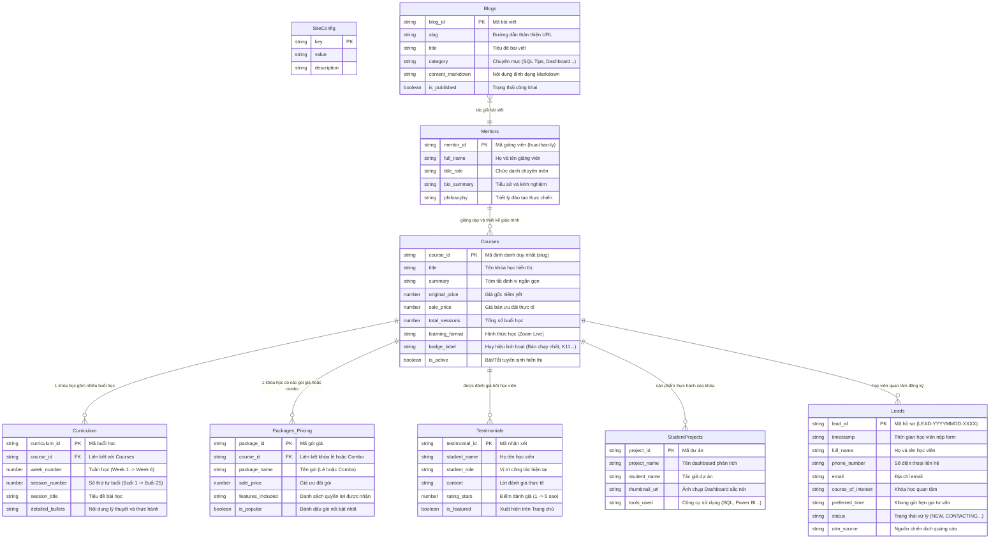

# Tổng quan nghiệp vụ — DataWithLy (Domain Overview)

- **Mục đích:** Đặc tả bức tranh toàn cảnh về mô hình nghiệp vụ, bản đồ thực thể (Domain Entities), các mối quan hệ dữ liệu và ranh giới nghiệp vụ của nền tảng website DataWithLy. Tài liệu này đóng vai trò là "Nguồn sự thật nghiệp vụ" (Business Source of Truth) dành cho Product Owners, TechLeads, lập trình viên và những người tiếp quản, vận hành hệ thống sau này.
- **Trạng thái:** Approved — đã thống nhất theo kế hoạch nghiệp vụ ngày 2026-11-03.
- **Người duyệt:** Chủ dự án & TechLead.
- **Ngày cập nhật:** 2026-11-03.
- **Nguồn tham khảo:** 
  - [Product Overview](../01-product/product-overview.md);
  - [Product Scope](../01-product/product-scope.md);
  - Slide bài giảng: `[LYDATA] Data Analytics Courses.pptx.pdf`;
  - Bảng yêu cầu nội dung: `Website LY DATA - content to fill.xlsx`;
  - [System Context](../07-architecture/system-context.md);
  - [Security Design](../07-architecture/security-design.md).

---

## 1. Bối cảnh & Giá trị nghiệp vụ cốt lõi

**DataWithLy** là mô hình đào tạo phân tích dữ liệu thực chiến (Data Analytics - DA & Business Analysis - BA) kết hợp tư vấn lộ trình 1-1 do **Mentor Hứa Thảo Ly** (Ex Senior DA tại MoMo, cựu DA tại Tiki, ACB) trực tiếp sáng lập và giảng dạy.

Nghiệp vụ của hệ thống vận hành xoay quanh **2 luồng giá trị cốt lõi**:
1. **Luồng giá trị giáo dục & Tiếp cận học viên (Public Educational Value):** Cung cấp thông tin minh bạch, trực quan về lộ trình đào tạo, chi tiết giáo trình từng buổi học (Syllabus Accordion), bảng học phí niêm yết, các sản phẩm Dashboard thực tế của học viên và bài viết chia sẻ kiến thức chuyên môn.
2. **Luồng giá trị chuyển đổi & Vận hành tuyển sinh (Lead Ingestion & Conversion):** Thu thập nhu cầu tư vấn từ học viên tiềm năng một cách an toàn, tự động đối soát nguồn chiến dịch marketing (UTM Parameters), bảo toàn dữ liệu khi có sự cố mạng và gửi thông báo tức thì đến đội ngũ tuyển sinh để Chị Ly chủ động liên hệ hỗ trợ học viên.

---

## 2. Bản đồ thực thể nghiệp vụ (Domain Entity-Relationship Map)

Toàn bộ hệ thống dữ liệu nghiệp vụ của DataWithLy được mô hình hóa qua các thực thể sau:

---

## 3. Ranh giới giữa 2 Phân hệ Nghiệp vụ (Bounded Contexts)

Hệ thống DataWithLy phân định ranh giới nghiêm ngặt giữa 2 phân hệ nghiệp vụ độc lập để bảo đảm tính toàn vẹn và an toàn thông tin:

```mermaid
graph TB
    subgraph Public_Content_Context["PHÂN HỆ NỘI DUNG CÔNG KHAI (PUBLIC CONTENT DOMAIN)"]
        direction TB
        C1["Quản lý Danh mục Khóa học & Lộ trình (Courses & Curriculum)"]
        C2["Quản lý Gói học phí & Combo ưu đãi (Packages & Pricing)"]
        C3["Quản lý Bài viết chia sẻ kiến thức (Blogs & Markdown)"]
        C4["Quản lý Bằng chứng xã hội (Testimonials, Projects, Mentors)"]
        C5["Cấu hình chung & Top Banner Khuyến mãi (SiteConfig)"]
        Note_Public["Quy tắc: Website chỉ có quyền ĐỌC (Read-Only)<br/>Mọi thay đổi được lưu tại File 1: Public Content Sheet"]
    end

    subgraph Private_Lead_Context["PHÂN HỆ THU THẬP & XỬ LÝ HỌC VIÊN (PRIVATE LEAD INGESTION DOMAIN)"]
        direction TB
        L1["Tiếp nhận biểu mẫu đăng ký tư vấn (Form Ingestion)"]
        L2["Chống spam 3 lớp & Chống ghi trùng (Deduplication)"]
        L3["Bảo toàn dữ liệu form & Auto-retry khi mạng chậm"]
        L4["Lưu trữ hồ sơ học viên & Đối soát nguồn Marketing (UTM Tracking)"]
        L5["Kích hoạt Email cảnh báo 2 chiều tức thì"]
        Note_Private["Quy tắc: Website chỉ có quyền GHI một chiều (Write-Only via Webhook)<br/>Tuyệt đối không phơi bày dữ liệu học viên ra ngoài mã nguồn"]
    end
```

---

## 4. Vai trò của tài liệu Nghiệp vụ trong Vòng đời Dự án

Đối với những người nắm giữ và vận hành hệ thống DataWithLy sau này:
1. **Khi cần thêm khóa học mới hoặc đổi giá bán:** Tham chiếu [Mô hình khóa học](course-model.md) và [Vòng đời nội dung](content-lifecycle.md) để biết cách nhập tab `Courses`, `Curriculum` và `Packages_Pricing` mà không làm sai lệch cấu trúc dữ liệu.
2. **Khi tiếp nhận và chăm sóc học viên:** Tham chiếu [Vòng đời Lead](lead-lifecycle.md) để hiểu ý nghĩa 6 trạng thái xử lý hồ sơ (`NEW` ➔ `CONTACTING` ➔ `CONSULTED` ➔ `ENROLLED`...).
3. **Khi cần kiểm tra hành vi hệ thống:** Tham chiếu [Quy tắc nghiệp vụ](business-rules.md) (BR-01 đến BR-12) để giải thích tại sao hệ thống từ chối số điện thoại, tại sao chỉ ghi nhận 1 dòng khi học viên bấm nhiều lần, hoặc cách hoạt động của đồng hồ đếm ngược Flash Sale.

---

[Điểm bắt đầu của bộ docs](../README.md)
