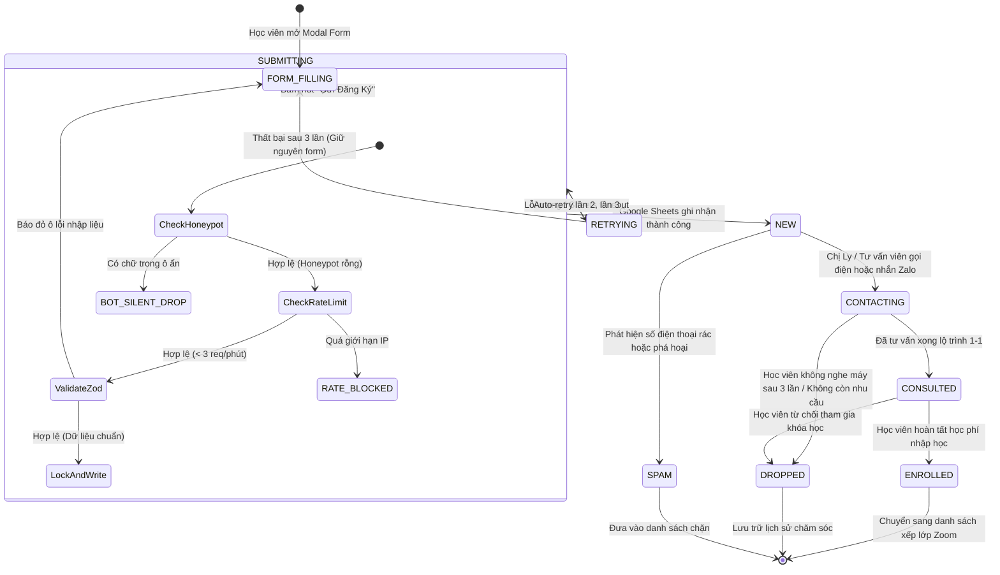

# Vòng đời đăng ký tư vấn — DataWithLy (Lead Lifecycle)

- **Mục đích:** Đặc tả toàn diện vòng đời của một hồ sơ học viên đăng ký tư vấn (Lead), từ thời điểm người học điền biểu mẫu trên website, qua các bước thẩm định chống spam, ghi nhận an toàn vào Google Sheets, gửi email thông báo, đến các trạng thái chăm sóc và ghi danh của đội ngũ tuyển sinh.
- **Trạng thái:** Approved — đã thống nhất theo kế hoạch nghiệp vụ ngày 2026-11-03.
- **Người duyệt:** Chủ dự án & TechLead.
- **Ngày cập nhật:** 2026-11-03.
- **Nguồn tham khảo:** 
  - [Domain Overview](domain-overview.md);
  - [Security Design](../07-architecture/security-design.md);
  - [Lead Protection and Errors](../07-architecture/lead-protection-and-errors.md);
  - [WF-03 Submit Consultation](../04-workflows/WF-03-submit-consultation.md);
  - [Customer Requirements Notes](../08-project/customer-requirements-notes.md).

---

## 1. Sơ đồ trạng thái vòng đời Lead (State Machine Diagram)

Một hồ sơ khách hàng tiềm năng (Lead) chuyển dịch qua các trạng thái tuần tự như sau:

---

## 2. Bảng định nghĩa 6 Trạng thái Xử lý Nội bộ (Internal Lead States)

Trong tệp `Private Leads Sheet`, cột `status` được thiết lập bộ lọc Dropdown với 6 giá trị chuẩn:

| Mã Trạng Thái | Tên hiển thị | Định nghĩa & Ý nghĩa nghiệp vụ | Bên chịu trách nhiệm |
|:---:|:---|:---|:---|
| **`NEW`** | **Mới tiếp nhận** | Hồ sơ vừa được website ghi nhận thành công vào bảng tính. Hệ thống tự động gán trạng thái này ngay khi tạo dòng mới. | Hệ thống Next.js & Google Apps Script tự động gán. |
| **`CONTACTING`** | **Đang liên hệ** | Tư vấn viên hoặc Chị Ly đã tiếp nhận thông tin, đang thực hiện cuộc gọi điện thoại lần 1 hoặc gửi lời mời kết bạn qua Zalo theo khung giờ hẹn. | Chị Ly / Tư vấn viên cập nhật sau khi liên hệ. |
| **`CONSULTED`** | **Đã tư vấn** | Đã trao đổi trực tiếp 1-1 với học viên về lộ trình học, giải đáp thắc mắc về giáo trình, học phí và lịch khai giảng. Học viên đang cân nhắc thời gian nhập học. | Chị Ly / Tư vấn viên cập nhật sau cuộc gọi. |
| **`ENROLLED`** | **Đã ghi danh** | Học viên đã xác nhận tham gia khóa học và hoàn tất chuyển khoản học phí (đóng lẻ hoặc combo). Đủ điều kiện nhận link lớp học Zoom và bộ tài liệu độc quyền. | Chị Ly cập nhật khi tài khoản ngân hàng nhận học phí. |
| **`DROPPED`** | **Hủy / Tạm dừng** | Học viên không còn nhu cầu học trong đợt này, không phù hợp trình độ đầu vào, hoặc không thể liên lạc sau 3 lần gọi/nhắn tin. | Tư vấn viên cập nhật kèm lý do vào cột `admin_notes`. |
| **`SPAM`** | **Spam / Chặn** | Số điện thoại ảo, thông tin trêu đùa hoặc các lượt gửi lặp lại mang tính chất quấy rối. | Tư vấn viên cập nhật để loại bỏ khỏi báo cáo chuyển đổi. |

---

## 3. Điều kiện & Trách nhiệm chuyển trạng thái (State Transitions)

### 3.1. Từ nộp form sang trạng thái `NEW`:
- **Điều kiện kích hoạt:**
  1. Trường ẩn `honeypot` bắt buộc phải rỗng.
  2. Địa chỉ IP không vượt quá 3 lần gửi/phút.
  3. Dữ liệu Họ tên, Số điện thoại (10 số VN) và Email thỏa mãn `LeadSubmissionSchema`.
  4. Google Apps Script giành được khóa `LockService` và ghi dòng mới thành công.
- **Hành động tự động đi kèm:**
  + Gửi email thông báo real-time tới hộp thư của tư vấn viên (`hien0934752432@gmail.com`, `hien.truong230214@vnuk.edu.vn`).
  + Gửi email thư cảm ơn và tài liệu học thử tự động cho học viên.
  + Bắn sự kiện chuyển đổi `submit_lead_success` lên Google Analytics 4.

### 3.2. Từ trạng thái `NEW` sang `CONTACTING`:
- **Chính sách hỗ trợ (SLA):**
  + Cam kết hỗ trợ: Theo phản hồi của khách hàng, Chị Ly và đội ngũ tư vấn sẽ **chủ động liên hệ học viên trong thời gian sớm nhất** (ưu tiên trong vòng 15 - 30 phút trong giờ làm việc, hoặc tối đa 12 giờ nếu nộp form vào ban đêm).
  + Ưu tiên liên lạc theo đúng trường `preferred_time` (Sáng, Chiều, hoặc Tối) mà học viên đã chọn trên form.

---

## 4. Xử lý các tình huống biên & Sự cố mạng (Edge Cases)

| Tình huống sự cố | Cơ chế xử lý của Hệ thống | Kết quả đối với Học viên |
|:---|:---|:---|
| **Người dùng bấm liên tục 2 - 3 lần (Double-click)** | Mã `submission_id` UUIDv4 được tạo từ lúc mở form giữ nguyên cho các lần bấm. Google Apps Script kiểm tra nếu `submission_id` đã tồn tại thì bỏ qua lệnh chèn dòng. | Trình duyệt chỉ hiển thị 1 màn hình thành công; Google Sheets chỉ có duy nhất 1 dòng. |
| **Mạng chập chờn / Google Sheets timeout > 6s** | Tầng Service kích hoạt thuật toán **Auto-retry 3 lần** với khoảng cách tăng dần (1s, 2.5s). | Nút bấm vẫn hiển thị Loading Spinner, học viên không cảm nhận thấy sự gián đoạn mạng ngầm. |
| **Mất kết nối hoàn toàn sau 3 lần retry** | Hệ thống giữ nguyên 100% thông tin học viên đã nhập trong `React State / SessionStorage`; hiển thị alert màu vàng nhẹ nhàng kèm nút *"Bấm để thử lại"*. | Học viên **không phải nhập lại bất kỳ chữ nào**, chỉ cần bấm nút để gửi lại khi có mạng. |
| **Bot tự động điền trường Honeypot** | API Next.js nhận diện bot, thực hiện chiến thuật Silent Drop: trả về HTTP 200 giả vờ thành công nhưng không ghi vào Sheets. | Bot rút lui, bảo vệ hộp thư tuyển sinh và dung lượng bảng tính Google Sheets luôn sạch rác 100%. |

---

[Điểm bắt đầu của bộ docs](../README.md)
