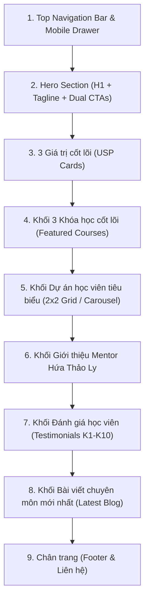

# PRD M01 — HomePage (Trang Chủ)

- **Mục đích:** Đặc tả yêu cầu sản phẩm, hành vi giao diện, tương tác và tiêu chí nghiệm thu cho Module Trang Chủ (`/`).
- **Trạng thái:** Sẵn sàng triển khai (Approved for Implementation)
- **Người duyệt:** TechLead & Client Review
- **Ngày cập nhật:** 2026-11-03
- **Nguồn tham khảo:** 
  - [Mô tả sản phẩm (Product Overview)](../../01-product/product-overview.md)
  - [Workflow Khám phá khóa học (WF-01)](../../04-workflows/WF-01-explore-courses.md)
  - [Quy tắc thiết kế 4-Point Spacing & Design System](../../07-architecture/design-system-rules.md)
  - [Figma Canvas: node 0:1](https://www.figma.com/design/epfQwa5s3iMO6toM4Fmmpu/Hien-Ed_TECH?node-id=0-1&m=dev)
  - Slide bài giảng: `[LYDATA] Data Analytics Courses.pptx.pdf`
  - Bảng nội dung: `Website LY DATA - content to fill.xlsx`

---

## 1. Người dùng và mục tiêu (Users & Goals)

| Tác nhân | Mục tiêu / Nhu cầu | Kết quả mong đợi |
|---|---|---|
| **Khách vãng lai (Visitor)** | Tìm hiểu nhanh chương trình đào tạo Data Analytics, năng lực giảng viên và uy tín thương hiệu DataWithLy. | Nắm rõ lộ trình đào tạo, mức học phí công khai và dự án thực tế; cảm thấy tin tưởng và không bị choáng ngợp. |
| **Học viên tiềm năng (Lead)** | Muốn được tư vấn lộ trình học phù hợp nhất với xuất phát điểm cá nhân (chưa biết gì, sinh viên, người đi làm muốn chuyển ngành). | Nhấn CTA tư vấn dễ dàng, mở Modal điền thông tin nhanh gọn (< 1 phút), không gặp rào cản kỹ thuật. |
| **Người dùng Mobile** | Đang lướt web trên điện thoại qua chia sẻ Facebook/LinkedIn/Zalo. | Trải nghiệm vuốt chạm mượt mà, menu trượt trực quan, có thể nhấn gọi điện thoại hoặc nhắn tin Zalo ngay lập tức. |

---

## 2. Bố cục và Yêu cầu chức năng chi tiết

### Bố cục 8 phần (8 Page Sections)

### Bảng yêu cầu chức năng (Functional Requirements)

| Mã | Hạng mục | Hành vi mong muốn & Đặc tả kỹ thuật | Quy tắc BR | Ưu tiên |
|---|---|---|---|---|
| **REQ-M01-01** | Header Sticky & Logo | Thanh điều hướng cố định khi cuộn trang (Sticky với `backdrop-blur-md`). Logo **DataWithLy** liên kết về `/`. Menu bao gồm 4 liên kết: *Khóa học, Về Mentor, Dự án học viên, Góc chia sẻ*. Nút CTA chính: `[Nhận tư vấn lộ trình]`. | BR-08, BR-09 | P0 |
| **REQ-M01-02** | Mobile Drawer & Quick Contact | Trên thiết bị `< 768px`, hiển thị nút Hamburger. Mở ra Navigation Drawer bên phải. Trong Drawer có menu link và **2 nút hành động nhanh**: Nút **[Gọi Hotline]** (`tel:0934752432`) và nút **[Chat Zalo]** mở Zalo OA/Chat. | BR-08 | P0 |
| **REQ-M01-03** | Hero Section | - Tagline pill badge: `"ONLINE DATA ANALYTICS COURSE"` với tone nền `crimson-50` và viền `crimson-200`. - H1 Heading: `"Học Data Analytics từ tư duy đến thực hành."` (Font: Be Vietnam Pro, Weight 700, size 36px mobile / 56px desktop). - Subtitle: `"Lộ trình bài bản từ cơ bản đến nâng cao, dự án thực tế, hỗ trợ tận tâm"`. - Dual CTAs: Nút Primary `[Nhận tư vấn lộ trình]` mở Modal Lead (M04); Nút Secondary `[Khám phá khóa học]` cuộn êm xuống section khóa học (`smooth-scroll`). | BR-08, BR-09 | P0 |
| **REQ-M01-04** | 3 Core Cards (USP) | 3 Thẻ giá trị cốt lõi áp dụng Spacing `p-6` (24px) và hiệu ứng hover nhẹ (`hover:translate-y-[-4px]`): 1. *Thực chiến từ bài toán kinh doanh* (Business Context First). 2. *1-on-1 Mentorship & Review Code* (Hỗ trợ giải đáp tận tình). 3. *Xây dựng Portfolio chuẩn tuyển dụng* (Dự án End-to-End). | BR-08 | P0 |
| **REQ-M01-05** | Featured Courses Grid | Hiển thị 3 thẻ khóa học lấy từ Sheet `courses`: 1. **SQL for Data Analytics** (12 buổi \| 2.990.000 VNĐ). 2. **Analytical Thinking & Dashboard Design** (16 buổi + CV \| 3.790.000 VNĐ). 3. **End-to-End Analytics with SQL & Dashboard Design** (25 buổi + CV \| 5.690.000 VNĐ). Mỗi thẻ khóa học bắt buộc có 2 nút CTA: `[Xem chi tiết]` (dẫn link đến `/courses/[slug]`) và `[Tư vấn ngay]` (mở Modal Lead M04 với trường khóa học được chọn sẵn). Hỗ trợ badge `badge_label` linh hoạt ("Bán chạy nhất", "Đang tuyển sinh"). | BR-01, BR-02, BR-03 | P0 |
| **REQ-M01-06** | Student Projects Showcase | Khối Dự án học viên tiêu biểu thay thế hoàn toàn khối Free Resources cũ. Bố cục 2x2 card trên Desktop và lướt ngang (Scroll Snap) trên Mobile. Gồm 4 dự án: 1. *Phân tích Doanh thu Điện ảnh (Film Industry Analytics)*. 2. *Phân tích Bán hàng Xe đạp & Phụ kiện (AdventureWorks)*. 3. *Tối ưu Trải nghiệm Học tập Nền tảng EdTech*. 4. *Hiệu quả Hoạt động Sàn Thương mại Điện tử (E-commerce)*. Mỗi card hiển thị ảnh mockup dashboard, tag công cụ (Power BI, SQL, Python), tóm tắt kết quả bài toán kinh doanh. | BR-08, BR-09 | P1 |
| **REQ-M01-07** | Mentor Profile | Giới thiệu Mentor **Hứa Thảo Ly** (Ex Senior DA tại MoMo, Tiki, ACB). Nêu bật 3 trụ cột phương pháp: *Tư duy kinh doanh (Business Domain) - Kỹ thuật chuẩn chỉ (Clean SQL) - Trực quan hóa dữ liệu (Impactful Dashboard)*. Tuyệt đối không chứa claim chưa kiểm chứng. | BR-08, BR-09 | P0 |
| **REQ-M01-08** | Testimonials Carousel | Hiển thị trích dẫn đánh giá thực tế từ học viên các khóa K1 đến K10 (trích từ slide bài giảng). Hiển thị tên, vị trí công việc/ngành nghề sau khóa học. | BR-08 | P1 |
| **REQ-M01-09** | Latest Blog Preview | Hiển thị 3 bài viết chuyên ngành mới nhất từ Sheet `blog_posts`. Mỗi bài gồm ảnh thumbnail, thể loại tag, tiêu đề, ngày đăng và thời gian đọc ước tính. | BR-06, BR-07 | P1 |
| **REQ-M01-10** | Footer & Quick Access | Hiển thị thông tin thương hiệu DataWithLy, Hotline, Email liên hệ, đường dẫn Zalo OA/Facebook/LinkedIn `@datawithly`, liên kết chính sách bảo mật và thông tin bản quyền. | BR-08 | P0 |

---

## 3. Quy chuẩn Trạng thái giao diện (5 UI States)

Theo triết lý thiết kế Zero White Screen và khả năng chịu lỗi AP:

| Trạng thái | Điều kiện kích hoạt | Giao diện hiển thị | Hành vi người dùng / Hệ thống |
|---|---|---|---|
| **1. Bình thường (Normal)** | Dữ liệu từ ISR Cache hoặc Google Sheets fetch thành công trong < 1.2s. | Hiển thị đầy đủ 8 section trang chủ với hình ảnh, văn bản và các nút CTA hoạt động mượt mà. | Người dùng cuộn trang, xem khóa học, nhấn CTA mở Lead Form Modal. |
| **2. Đang tải (Loading)** | Chuyển trang lần đầu hoặc đang tải client island. | Hiển thị bộ Skeleton Loader tương ứng cấu trúc 8 section (khối xám nhạt có hiệu ứng `pulse`, kích thước chuẩn 4-point spacing). | Ngăn layout shift (CLS < 0.1). Không dùng spinner xoay toàn màn hình. |
| **3. Dữ liệu rỗng (Empty)** | Sheet `courses` hoặc `student_projects` tạm thời chưa có dữ liệu hợp lệ (`is_active = TRUE`). | Thay vì để trống section, hiển thị Fallback Card thân thiện: *"Chương trình đào tạo khóa mới đang được cập nhật. Nhấn [Tư vấn] để nhận thông tin sớm nhất!"*. | Nút CTA hướng người dùng về Lead Form thay vì rời bỏ website. |
| **4. Lỗi (Error)** | Sự cố mạng hoặc Next.js ISR fetch throw exception. | Error Boundary cấp độ Section bắt lỗi. Hiển thị UI Fallback cục bộ: *"Không thể tải danh sách khóa học lúc này"*, kèm nút `[Tải lại]` (`location.reload()`). Các section tĩnh khác vẫn hiển thị bình thường. | Trang không bị crash (Zero White Screen). Hệ thống tự fallback về bộ dữ liệu tĩnh lưu tại local JSON. |
| **5. Thành công (Success)** | Áp dụng cho tương tác Modal Form trên Trang chủ. | Modal chuyển sang màn hình Success: tích xanh SVG, lời cảm ơn từ Mentor Hứa Thảo Ly, nút `[Tham gia Cộng đồng DataWithLy]`. | Trả lại quyền điều khiển cho người dùng đóng Modal và tiếp tục xem Trang chủ. |

---

## 4. Đặc tả Đáp ứng Màn hình & Token Thiết kế (Design Tokens)

Áp dụng tuyệt đối [Quy tắc Design System 4-Point Spacing](../../07-architecture/design-system-rules.md):

- **Desktop (>= 1024px):**
  - Container tối đa: `max-w-7xl` (`1280px`), căn giữa với `mx-auto`, padding ngang `px-6` (24px) hoặc `px-8` (32px).
  - Khoảng cách giữa các Section: `py-16` (64px) hoặc `py-20` (80px).
  - Lưới khóa học: `grid grid-cols-3 gap-8` (32px).
  - Lưới dự án học viên: `grid grid-cols-2 gap-8` (32px).
- **Tablet (768px - 1023px):**
  - Lưới khóa học: `grid grid-cols-2 gap-6` (card thứ 3 căn giữa full-width).
  - Lưới dự án học viên: `grid grid-cols-2 gap-6`.
  - Spacing giữa Section: `py-12` (48px).
- **Mobile (< 768px):**
  - Header ẩn menu ngang, hiển thị nút Hamburger.
  - Hero H1 giảm còn `text-3xl` (`30px`) hoặc `text-4xl` (`36px`), line-height `leading-tight`.
  - Khối khóa học: `flex flex-col gap-6` (24px).
  - Khối dự án học viên: `flex overflow-x-auto snap-x snap-mandatory gap-4 pb-4` cho phép vuốt ngang tự nhiên.
  - Spacing giữa Section: `py-10` (40px).

---

## 5. Tiêu chí nghiệm thu (Acceptance Criteria)

| Mã AC | Yêu cầu tương ứng | Given (Điều kiện tiên quyết) | When (Hành động người dùng) | Then (Kết quả kỳ vọng) |
|---|---|---|---|---|
| **AC-M01-01** | REQ-M01-01, 02 | Người dùng truy cập Trang chủ trên điện thoại di động (`width < 768px`). | Nhấn vào biểu tượng Menu Hamburger ở góc phải Header. | Drawer Menu trượt từ phải ra mượt mà (< 200ms), hiển thị đủ 4 link menu, nút **[Gọi Hotline: 0934752432]** và nút **[Chat Zalo]**. Bấm vào nền tối bên ngoài thì Drawer đóng lại. |
| **AC-M01-02** | REQ-M01-03 | Người dùng truy cập Trang chủ trên máy tính. | Quan sát Hero Section. | Thấy Tagline `"ONLINE DATA ANALYTICS COURSE"`, H1 `"Học Data Analytics từ tư duy đến thực hành."`, màu Crimson chuẩn `#8B1D2C`, không có lỗi vỡ layout hoặc phông chữ. |
| **AC-M01-03** | REQ-M01-03 | Người dùng ở Hero Section. | Nhấn nút CTA thứ hai `[Khám phá khóa học]`. | Trình duyệt cuộn mượt mà (`smooth scroll`) trực tiếp đến phần `#featured-courses`. |
| **AC-M01-04** | REQ-M01-05 | Người dùng đang xem Khối Khóa học nổi bật. | Quan sát danh sách khóa học. | Hiển thị chính xác 3 khóa học thực tế: *SQL (12 buổi - 2.990.000đ)*, *Dashboard Design (16 buổi - 3.790.000đ)*, *End-to-End Analytics (25 buổi - 5.690.000đ)*. Học phí hiển thị định dạng VNĐ chuẩn có dấu chấm phân cách. |
| **AC-M01-05** | REQ-M01-05 | Người dùng bấm nút `[Tư vấn ngay]` tại Card khóa học *SQL for Data Analytics*. | Nhấn click nút. | Modal Lead Form (M04) mở lên ngay lập tức, trường Khóa học quan tâm được chọn sẵn giá trị `"sql-for-data-analytics"`. |
| **AC-M01-06** | REQ-M01-05 | Người dùng bấm nút `[Xem chi tiết]` tại Card khóa học. | Nhấn click nút. | Trình duyệt chuyển hướng mượt mà đến trang `/courses/[slug]` tương ứng. |
| **AC-M01-07** | REQ-M01-06 | Người dùng cuộn xuống phần Dự án học viên tiêu biểu. | Quan sát nội dung và hình ảnh. | Hiển thị lưới 4 dự án thực tế (Film, AdventureWorks, EdTech, E-commerce). Tất cả ảnh chụp dashboard hiển thị qua `SafeImage`, có fallback nếu link ảnh ngoài bị hỏng, không có layout shift. |
| **AC-M01-08** | REQ-M01-07 | Người dùng đọc thông tin Mentor Hứa Thảo Ly. | Đọc tiểu sử và hồ sơ kinh nghiệm. | Không tìm thấy bất kỳ claim ảo nào như "offer tại Harvard/Google/Tokopedia". Chỉ hiển thị đúng năng lực thật: Ex Senior DA MoMo, Tiki, ACB và 3 trụ cột phương pháp đào tạo. |

---

[Điểm bắt đầu của bộ docs](../../README.md) | [Quay lại README M01](README.md)
