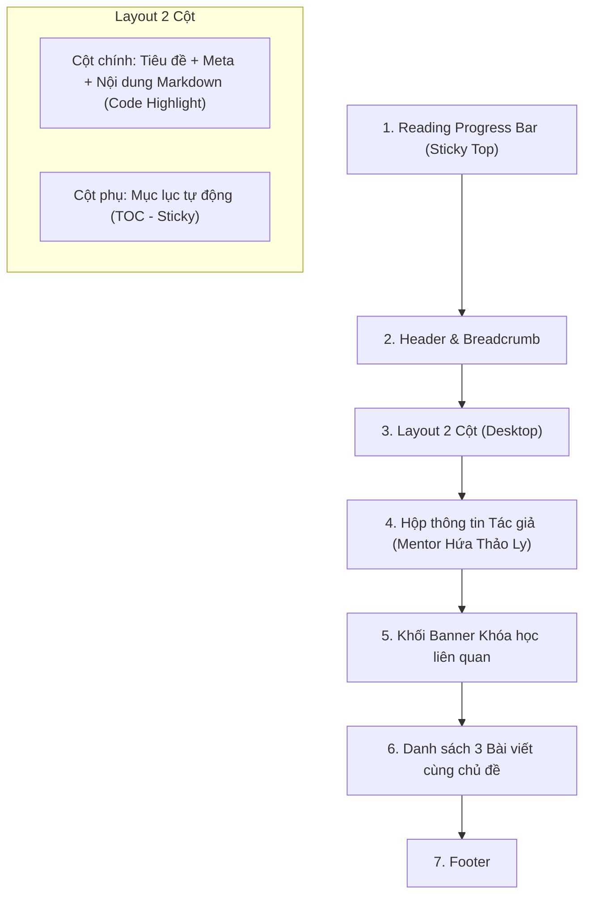

# PRD M03 — Góc chia sẻ kiến thức (Blog & Knowledge Sharing)

- **Mục đích:** Đặc tả giao diện, cấu trúc bài viết, tính năng đọc và tiêu chí nghiệm thu cho phân hệ Blog (`/blog` và `/blog/[slug]`).
- **Trạng thái:** Sẵn sàng triển khai (Approved for Implementation)
- **Người duyệt:** TechLead & Client Review
- **Ngày cập nhật:** 2026-11-03
- **Nguồn tham khảo:** 
  - [Vòng đời nội dung (Content Lifecycle)](../../02-domain/content-lifecycle.md)
  - [Quy tắc Design System 4-Point Spacing](../../07-architecture/design-system-rules.md)
  - [Mô hình CAP và Thiết kế Kiến trúc](../../07-architecture/system-context.md)

---

## 1. Người dùng và mục tiêu (Users & Goals)

| Tác nhân | Mục tiêu / Nhu cầu | Kết quả mong đợi |
|---|---|---|
| **Độc giả / Người tự học DA** | Tìm kiếm tài liệu tự học SQL, cách viết truy vấn tối ưu, cách chọn biểu đồ đúng trong Power BI. | Đọc bài viết mạch lạc, xem code SQL/Python có màu phân biệt dễ nhìn, sao chép code nhanh chóng bằng 1 click. |
| **Người tìm kiếm từ Google (SEO)** | Tìm kiếm các từ khóa chuyên môn như *"lộ trình học data analyst cho người trái ngành"*, *"cách dùng window function trong sql"*. | Trang tải ngay lập tức (< 1.2s), nội dung chất lượng, có link dẫn đến khóa học bài bản nếu muốn học chuyên sâu. |
| **Biên tập viên / Mentor Ly** | Đăng tải các bài viết tâm huyết trực tiếp từ Google Sheets. | Bài viết tự động dàn trang chuẩn Markdown, hiển thị mục lục tự động mà không cần can thiệp code HTML. |

---

## 2. Bố cục & Yêu cầu Chức năng Trang Danh sách (`/blog`)

### 1. Header & Bộ lọc Phân loại (Category Filter)
- **Tiêu đề trang:** `"Góc Chia Sẻ Kiến Thức Data Analytics"`.
- **Mô tả:** Lời tựa từ Mentor Hứa Thảo Ly về hành trình học tập, kinh nghiệm dự án và các mẹo thực hành dữ liệu.
- **Thanh Filter Tabs:**
  - `Tất cả` (Mặc định).
  - `SQL thực chiến` (Các kỹ thuật query, tối ưu hiệu năng cơ sở dữ liệu).
  - `Dashboard & BI` (Tư duy trực quan hóa dữ liệu, Power BI, DAX).
  - `Tư duy kinh doanh` (Cách định nghĩa chỉ số, phân tích nguyên nhân gốc rễ).
  - `Định hướng nghề nghiệp` (Kinh nghiệm phỏng vấn, chuẩn bị CV ngành DA).
- **Hành vi tương tác:** Khi nhấn chọn tab, danh sách lọc lập tức lọc tức thì (Client-side filtering nếu danh sách < 50 bài, hoặc kích hoạt URL query param `?category=...`).

### 2. Lưới hiển thị bài viết (Blog Post Grid)
- **Bố cục:** Lưới 3 cột trên Desktop (`grid-cols-3 gap-8`), 2 cột trên Tablet, 1 cột trên Mobile.
- **Thành phần mỗi Card:**
  - Ảnh Thumbnail tỉ lệ `16:9`, hiển thị qua `SafeImage` có hiệu ứng zoom nhẹ khi hover (`group-hover:scale-105 transition-transform`).
  - Badge Thể loại (Category Badge) với tone màu Crimson nhạt (`bg-crimson-50 text-crimson-700 font-medium`).
  - Thời lượng đọc ước tính (ví dụ: `5 phút đọc`).
  - Tiêu đề bài viết (H3, tối đa 2 dòng, cắt đuôi `line-clamp-2`).
  - Tóm tắt nội dung (tối đa 3 dòng `line-clamp-3`).
  - Chân thẻ: Tên tác giả (*Hứa Thảo Ly*), ngày đăng (`DD/MM/YYYY`) và link dẫn tới `/blog/[slug]`.

---

## 3. Bố cục & Yêu cầu Chức năng Trang Chi tiết (`/blog/[slug]`)



### Chi tiết các thành phần:
1. **Thanh tiến độ đọc (Reading Progress Bar):**
   - Một thanh chỉ báo mảnh (chiều cao 3px) dính chặt ở mép trên cùng của màn hình (`top-0 left-0 w-full z-50`).
   - Màu sắc: Đỏ Mận Gradient (`bg-gradient-to-r from-crimson-600 to-crimson-800`).
   - Tự động tính toán phần trăm cuộn trang của phần thân bài viết (`(scrollTop / articleHeight) * 100%`).
2. **Trình hiển thị cú pháp Markdown (Markdown Rendering):**
   - Hỗ trợ đầy đủ các thẻ Heading (H2, H3, H4) với ID tự động sinh để phục vụ liên kết mục lục.
   - Hỗ trợ Markdown Tables có thanh cuộn ngang khi đọc trên điện thoại di động (`overflow-x-auto`).
   - **Tô màu cú pháp Code Block (Syntax Highlighting):**
     - Nhận diện các ngôn ngữ: `sql`, `python`, `dax`, `json`, `bash`.
     - Phông chữ Monospace chuẩn (`font-mono`), nền tối tương phản cao (`bg-slate-900 text-slate-100`).
     - Tích hợp nút bấm **[Sao chép mã] (Copy Code)** ở góc trên bên phải của mỗi code block; khi bấm đổi sang *"Đã chép!"* trong 2 giây.
3. **Mục lục tự động (Table of Contents - TOC):**
   - Tự động trích xuất tất cả các thẻ H2 và H3 trong bài viết.
   - Hiển thị cố định ở sidebar bên phải trên màn hình Desktop (ẩn trên Mobile/Tablet).
   - Tự động làm nổi bật (Highlight) mục tương ứng khi người dùng cuộn đến vị trí đó (Scrollspy).
4. **Hộp thông tin Tác giả & CTA Khóa học liên quan:**
   - Cuối bài viết có avatar Mentor Hứa Thảo Ly kèm lời kết tâm huyết và link dẫn đến trang thông tin giảng viên.
   - Banner nổi bật gợi ý khóa học phù hợp với chủ đề bài viết (ví dụ: bài viết về SQL Window Function sẽ gợi ý khóa học *SQL for Data Analytics* kèm nút `[Xem khóa học]`).
5. **Bài viết liên quan (Related Articles):**
   - Hiển thị 3 bài viết ngẫu nhiên hoặc cùng thể loại để giữ chân độc giả tiếp tục tìm hiểu.

---

## 4. Quản lý trạng thái giao diện (5 UI States)

| Trạng thái | Điều kiện kích hoạt | Giao diện hiển thị | Hành vi hệ thống |
|---|---|---|---|
| **1. Bình thường (Normal)** | Bài viết tồn tại với `is_active = TRUE`. | Dựng hoàn chỉnh bài viết với định dạng Markdown đẹp mắt, TOC hoạt động, code block có màu sắc. | Cho phép độc giả đọc, copy code, nhấn vào mục lục để nhảy tới phần tương ứng. |
| **2. Đang tải (Loading)** | Chuyển trang hoặc route đang fetch. | Hiển thị Skeleton Loader cho tiêu đề, các khối văn bản giả lập và khung code giả lập. | Giữ ổn định bố cục (CLS = 0). |
| **3. Thể loại rỗng (Empty Category)** | Người dùng chọn một tab thể loại chưa có bài viết nào được publish. | Hiển thị màn hình rỗng tinh tế: *"Chủ đề này đang được Mentor Hứa Thảo Ly biên soạn nội dung. Bạn có thể xem các chủ đề khác nhé!"* kèm nút `[Xem tất cả bài viết]`. | Không để giao diện trống trải kỳ quặc. |
| **4. Không tìm thấy (Not Found / 404)** | `slug` bài viết không khớp hoặc đã bị ẩn (`is_active = FALSE`). | Kích hoạt hàm `notFound()`. Hiển thị trang 404: *"Bài viết bạn tìm kiếm không tồn tại hoặc đã được chuyển địa chỉ"*, kèm nút `[Về trang Blog]`. | Trả về HTTP Status 404 chuẩn. |
| **5. Lỗi (Error)** | Sự cố phân tích cú pháp Markdown hoặc mạng lỗi. | Error Boundary bắt lỗi cục bộ. Hiển thị thông báo: *"Không thể hiển thị nội dung bài viết này"* kèm nút `[Tải lại]`. | Đảm bảo trang web không bao giờ bị trắng màn hình. |

---

## 5. Tối ưu hóa SEO & Chia sẻ Mạng xã hội

Mỗi bài viết tự động sinh thẻ Meta chuẩn mực:
```html
<title>[Tiêu đề bài viết] | Blog DataWithLy</title>
<meta name="description" content="[Tóm tắt bài viết tối đa 160 ký tự]" />
<meta property="og:title" content="[Tiêu đề bài viết] | DataWithLy" />
<meta property="og:description" content="[Tóm tắt bài viết]" />
<meta property="og:image" content="[thumbnail_url]" />
<meta property="og:type" content="article" />
<meta name="twitter:card" content="summary_large_image" />
<link rel="canonical" href="https://datawithly.edu.vn/blog/[slug]" />
```

---

## 6. Tiêu chí nghiệm thu (Acceptance Criteria)

| Mã AC | Yêu cầu | Given | When | Then |
|---|---|---|---|---|
| **AC-M03-01** | Danh sách bài viết | Người dùng truy cập trang `/blog`. | Trang tải xong. | Hiển thị tiêu đề, thanh lọc thể loại và danh sách các bài viết đang active. Mỗi thẻ hiển thị đầy đủ ảnh, tag thể loại, tiêu đề, tóm tắt và thời gian đọc. |
| **AC-M03-02** | Lọc theo Thể loại | Người dùng đang ở trang `/blog`. | Nhấn chọn tab `SQL thực chiến`. | Danh sách bài viết ngay lập tức chỉ hiển thị các bài thuộc chủ đề SQL thực chiến. Tab được kích hoạt hiển thị nổi bật với nền màu Crimson. |
| **AC-M03-03** | Đọc bài chi tiết | Người dùng nhấn vào một thẻ bài viết. | Trình duyệt chuyển hướng đến `/blog/[slug]`. | Trang chi tiết tải nhanh (< 1.2s), hiển thị đúng tiêu đề, ngày đăng, tác giả và nội dung Markdown chuẩn chỉnh. |
| **AC-M03-04** | Reading Progress Bar | Người dùng đang đọc bài viết chi tiết. | Cuộn chuột hoặc vuốt màn hình từ từ xuống dưới. | Thanh tiến độ ở đỉnh màn hình tăng dần từ 0% lên 100% tỷ lệ thuận với độ dài nội dung đã cuộn. |
| **AC-M03-05** | Syntax Highlighting & Copy | Bài viết chứa đoạn mã truy vấn SQL. | Quan sát và nhấn nút `[Sao chép mã]`. | Mã SQL được tô màu cú pháp rõ ràng (SELECT, FROM, WHERE có màu riêng); nút chuyển sang chữ *"Đã chép!"* và toàn bộ đoạn mã được lưu vào Clipboard của máy tính. |
| **AC-M03-06** | Mục lục tự động (TOC) | Người dùng xem bài viết trên máy tính màn hình lớn (`width >= 1024px`). | Click vào một mục trong danh sách Mục lục ở sidebar. | Trình duyệt cuộn mượt mà đến đúng đoạn tiêu đề H2/H3 tương ứng. |
| **AC-M03-07** | Bảng Markdown Responsive | Bài viết chứa bảng số liệu Markdown với nhiều cột. | Đọc trên điện thoại màn hình nhỏ. | Bảng dữ liệu tự động có thanh cuộn ngang mượt mà, không làm vỡ hoặc phình to chiều rộng của toàn bộ trang web. |
| **AC-M03-08** | URL bài viết không tồn tại | Người dùng truy cập một URL slug ngẫu nhiên không có thật `/blog/bai-viet-ao`. | Gửi request. | Nhận mã HTTP 404 và hiển thị trang Not Found của DataWithLy kèm gợi ý quay lại danh sách bài viết. |

---

[Điểm bắt đầu của bộ docs](../../README.md) | [Quay lại README M03](README.md)
