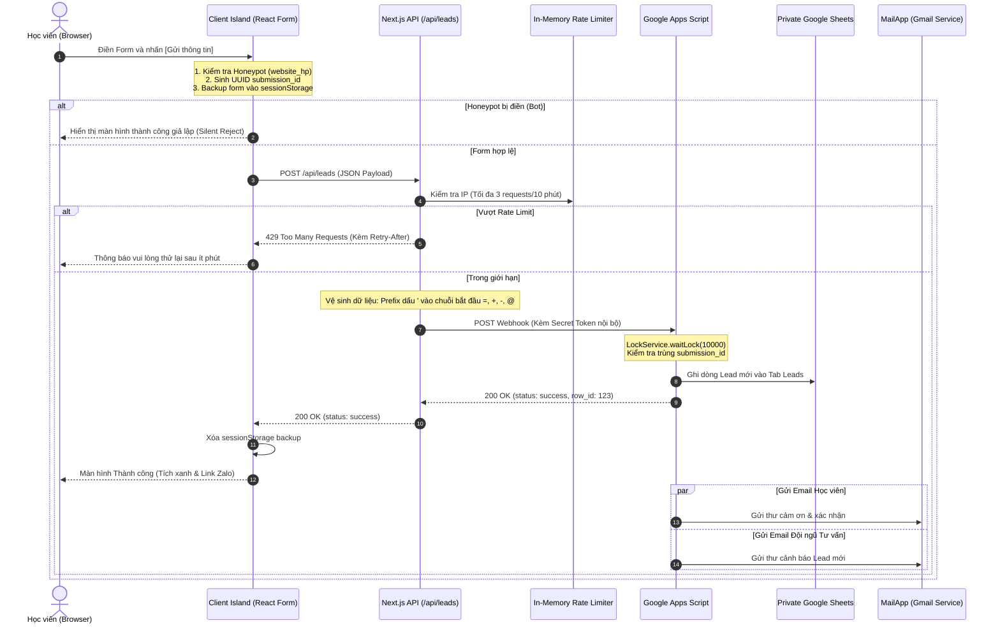

# PRD M04 — Thu thập thông tin tư vấn (Lead Capture)

- **Mục đích:** Đặc tả chi tiết yêu cầu kỹ thuật, schema dữ liệu, cơ chế bảo vệ PII, chống spam và quy chuẩn phản hồi cho Module Thu thập Lead.
- **Trạng thái:** Sẵn sàng triển khai (Approved for Implementation)
- **Người duyệt:** TechLead & Client Review
- **Ngày cập nhật:** 2026-11-03
- **Nguồn tham khảo:** 
  - [Ghi chú lưu lead & email retry](email-and-retry-notes.md)
  - [Workflow Đăng ký tư vấn (WF-03)](../../04-workflows/WF-03-submit-consultation.md)
  - [Thiết kế an toàn & Chống spam 3 lớp](../../07-architecture/security-design.md)
  - [Bảo vệ dữ liệu Lead & Chịu lỗi Client](../../07-architecture/lead-protection-and-errors.md)
  - [Đặc tả API Endpoint](../../07-architecture/api-design.md)

---

## 1. Người dùng và mục tiêu (Users & Goals)

| Tác nhân | Mục tiêu / Nhu cầu | Kết quả mong đợi |
|---|---|---|
| **Học viên tiềm năng (Lead)** | Đăng ký nhận tư vấn lộ trình học Data Analytics từ Mentor Hứa Thảo Ly. | Điền thông tin dễ dàng, nhận phản hồi xác nhận tiếp nhận ngay (< 5 giây), nhận email xác nhận kèm tài liệu định hướng. |
| **Đội ngũ tư vấn / Mentor** | Nhận thông tin lead chính xác, không bị trùng lặp, không bị spam bot phá hoại. | Dữ liệu lead xuất hiện đầy đủ trong Google Sheets Private, có email báo ngay về hộp thư để kịp thời liên hệ tư vấn. |
| **Hệ thống (Web App)** | Bảo vệ tính toàn vẹn của dữ liệu và uy tín thương hiệu. | Ngăn chặn rò rỉ PII, kháng lỗi Formula Injection, đảm bảo không bao giờ làm mất dữ liệu đã điền của học viên. |

---

## 2. Đặc tả Trường dữ liệu & Validation Schema (Zod)

Tất cả dữ liệu nhập từ người dùng bắt buộc phải vượt qua bộ kiểm tra hợp lệ nghiêm ngặt:

```typescript
// lib/validation/lead-schema.ts
import { z } from 'zod';

export const LeadSubmissionSchema = z.object({
  submission_id: z.string().uuid("submission_id phải là định dạng UUID hợp lệ"),
  full_name: z
    .string()
    .trim()
    .min(2, "Họ và tên tối thiểu 2 ký tự")
    .max(100, "Họ và tên tối đa 100 ký tự"),
  email: z
    .string()
    .trim()
    .toLowerCase()
    .email("Email không đúng định dạng chuẩn"),
  phone: z
    .string()
    .trim()
    .regex(/^(0|\+84)(3|5|7|8|9)[0-9]{8}$/, "Số điện thoại di động Việt Nam không hợp lệ (10 chữ số, đầu 03, 05, 07, 08, 09)"),
  course_id: z.enum([
    "sql-for-data-analytics",
    "analytical-thinking-dashboard-design",
    "end-to-end-analytics",
    "all-courses",
    "general-consultation"
  ], {
    errorMap: () => ({ message: "Vui lòng chọn khóa học hoặc nhu cầu tư vấn phù hợp" })
  }),
  learning_goal: z
    .string()
    .trim()
    .max(500, "Mục tiêu học tập tối đa 500 ký tự")
    .optional()
    .or(z.literal("")),
  utm_source: z.string().optional(),
  utm_medium: z.string().optional(),
  utm_campaign: z.string().optional(),
  // Honeypot Field - Bắt buộc phải rỗng
  website_hp: z.string().max(0, "Spam detected").optional().or(z.literal(""))
});

export type LeadSubmissionInput = z.infer<typeof LeadSubmissionSchema>;
```

---

## 3. Hàng rào bảo mật 3 lớp & Vệ sinh dữ liệu



### Chi tiết các lớp bảo vệ:
1. **Lớp 1 — Honeypot:** Trường input ẩn `website_hp` có `tabIndex={-1}`, `aria-hidden="true"`, được định vị ẩn ngoài màn hình (`opacity-0 absolute -left-[9999px]`). Người dùng thật không nhìn thấy và không thể điền. Bot spam tự động quét DOM và điền giá trị sẽ bị bắt ngay lập tức.
2. **Lớp 2 — Khóa chống trùng lặp (`submission_id`):** Tạo ngẫu nhiên bằng UUIDv4 trên client khi mở form. Khi bấm nút, nút lập tức chuyển sang trạng thái Disable để tránh click đúp. Tại Apps Script, nếu `submission_id` đã tồn tại trong cột `A` của Sheet, hệ thống trả về `200 OK` mà không ghi thêm dòng mới.
3. **Lớp 3 — Giới hạn tần suất gửi (Rate Limiting):** Áp dụng theo địa chỉ IP của Client tại Next.js Middleware/API Route. Giới hạn: **Tối đa 3 lượt gửi trong 10 phút**. Nếu vượt quá, trả về mã HTTP `429 Too Many Requests`.
4. **Vệ sinh chống Formula Injection:** Mọi trường văn bản (`full_name`, `learning_goal`) trước khi ghi vào Google Sheets đều được kiểm tra ký tự đầu tiên. Nếu bắt đầu bằng `=`, `+`, `-`, `@`, tự động thêm dấu nháy đơn `'` ở đầu (ví dụ: `=SUM(A1:B1)` -> `'=SUM(A1:B1)`).

---

## 4. Quản lý trạng thái giao diện & Chịu lỗi Client (Resilience)

| Trạng thái | Điều kiện kích hoạt | Giao diện hiển thị | Hành vi hệ thống |
|---|---|---|---|
| **1. Khởi tạo (Idle)** | Modal vừa mở lên hoặc form nhúng vừa hiển thị. | Form sạch sẽ với các trường thông tin. Nếu có dữ liệu trong `sessionStorage`, tự động điền lại (Auto-restore) kèm thông báo nhỏ: *"Đã khôi phục thông tin bạn vừa nhập"*. | Sẵn sàng nhận thao tác nhập từ người dùng. |
| **2. Đang gửi (Submitting)** | Người dùng nhấn nút `[Gửi thông tin tư vấn]`. | Nút gửi bị vô hiệu hóa (`disabled`), hiển thị spinner xoay nhẹ cùng văn bản *"Đang tiếp nhận thông tin..."*. Các trường input chuyển sang `readOnly`. | Kích hoạt API call `POST /api/leads`. Bắt đầu tính timeout 15 giây. |
| **3. Thành công (Success)** | API trả về mã HTTP `200` và `{ status: "success" }`. | Hiển thị màn hình cảm ơn rực rỡ với icon tích xanh SVG: *"Cảm ơn bạn [Tên học viên]! DataWithLy đã tiếp nhận yêu cầu."*<br>- Thông điệp: Mentor Hứa Thảo Ly sẽ liên hệ tư vấn trong vòng 15-30 phút (giờ hành chính) hoặc tối đa 12h.<br>- Nút bấm phụ: `[Tham gia Nhóm Zalo Học tập]` và `[Đóng]`. | Xóa dữ liệu form trong `sessionStorage`. Gửi event GA4 `lead_submitted` (không kèm PII). |
| **4. Lỗi có thể thử lại (Recoverable Error)** | Mạng rớt hoặc API trả về lỗi 5xx / Timeout. | Hệ thống tự động thực hiện **3 lần gửi lại (Auto-retry)** với độ trễ lũy thừa (1s, 2s, 4s). Nếu cả 3 lần đều lỗi, hiển thị banner cảnh báo màu hổ phách/đỏ: *"Hệ thống tạm thời gián đoạn. Dữ liệu của bạn đã được lưu an toàn. Vui lòng nhấn Thử lại."* kèm nút nổi bật **[Thử lại ngay]**. | Giữ nguyên 100% dữ liệu đã điền trên form và trong `sessionStorage`. Người dùng không phải gõ lại một từ nào. |
| **5. Từ chối âm thầm (Silent Reject)** | Honeypot bị điền hoặc dính Spam Pattern rõ rệt. | Hiển thị màn hình thành công như bình thường (để bot tưởng đã gửi thành công và dừng spam). | Không gọi API ghi vào Google Sheets, không gửi email. |

---

## 5. Cấu hình Email 2 chiều (Demo & Production)

Theo quyết định đã duyệt, hệ thống thiết lập gửi email thông báo 2 chiều không đồng bộ qua Google Apps Script (MailApp / GmailApp):

### 1. Email xác nhận gửi Học viên
- **Tiêu đề:** `[DataWithLy] Xác nhận yêu cầu tư vấn khóa học Data Analytics`
- **Người gửi:** `DataWithLy by Hứa Thảo Ly <hientruongthmh@gmail.com>`
- **Nội dung tóm tắt:** Lời chào từ Mentor Hứa Thảo Ly, xác nhận khóa học học viên đang quan tâm, cam kết thời gian liên hệ (trong 15-30 phút giờ hành chính), đính kèm cẩm nang lộ trình học DA cho người mới bắt đầu.

### 2. Email thông báo gửi Đội ngũ Tư vấn (Admin Alert)
- **Tiêu đề:** `🔥 [LEAD MỚI] [DataWithLy] - [Tên học viên] - Khóa: [Tên khóa]`
- **Danh sách nhận cảnh báo:**
  - `hien0934752432@gmail.com`
  - `hien.truong230214@vnuk.edu.vn`
- **Nội dung:** Thông tin chi tiết Lead (Họ tên, Số điện thoại, Email, Khóa học quan tâm, Mục tiêu, Nguồn UTM, Thời gian đăng ký) kèm đường dẫn mở nhanh Google Sheets.

> [!NOTE]
> Việc gửi email là tác vụ phi đồng bộ (Eventual Consistency). Nếu hạn ngạch MailApp tạm thời hết, lead vẫn được lưu an toàn vào Google Sheets; cột `Email_Status` sẽ được đánh dấu `PENDING_RETRY` để kịch bản tự động gửi lại sau mà không làm ảnh hưởng đến trải nghiệm người dùng.

---

## 6. Tiêu chí nghiệm thu (Acceptance Criteria)

| Mã AC | Yêu cầu | Given | When | Then |
|---|---|---|---|---|
| **AC-M04-01** | Validation Form | Người dùng mở Modal Lead Form. | Bỏ trống các trường và nhấn nút `[Gửi thông tin]`. | Form không gửi đi; các trường báo lỗi đỏ theo chuẩn tiếng Việt: *"Họ và tên tối thiểu 2 ký tự"*, *"Số điện thoại di động Việt Nam không hợp lệ"*, *"Email không đúng định dạng chuẩn"*. |
| **AC-M04-02** | Số điện thoại VN | Người dùng nhập số điện thoại `0123456789` (đầu số cũ không còn sử dụng) hoặc `12345`. | Rời khỏi ô input (`onBlur`). | Hiển thị cảnh báo lỗi số điện thoại không hợp lệ; chỉ chấp nhận các đầu số di động hiện hành `03, 05, 07, 08, 09` đủ 10 số. |
| **AC-M04-03** | Honeypot Anti-Spam | Bot tự động điền giá trị `http://spam-link.com` vào trường ẩn `website_hp`. | Nhấn Submit. | Client/Server kích hoạt cơ chế Silent Reject, giả lập màn hình thành công nhưng không ghi dòng mới vào Google Sheets Private. |
| **AC-M04-04** | Rate Limiting IP | Một client gửi form liên tục 4 lần trong vòng 3 phút. | Lần gửi thứ 4 được thực hiện. | Server trả về mã lỗi HTTP `429 Too Many Requests`. Giao diện hiển thị thông báo thân thiện: *"Bạn đã gửi quá nhiều yêu cầu. Vui lòng đợi 5 phút trước khi thử lại."* |
| **AC-M04-05** | Form State Recovery | Người dùng điền xong họ tên, email, số điện thoại nhưng vô tình bấm F5 (Reload) hoặc đóng tab và mở lại trong cùng phiên. | Mở lại Modal Lead Form. | Toàn bộ thông tin vừa nhập được tự động khôi phục từ `sessionStorage`. |
| **AC-M04-06** | Auto-retry & Manual Retry | Giả lập đường truyền mạng rớt (Offline) khi người dùng bấm Gửi. | Hệ thống gặp lỗi kết nối. | Hệ thống tự động thực hiện 3 lần gửi lại. Khi thất bại hoàn toàn, hiển thị nút `[Thử lại]` và không xóa dữ liệu người dùng đã gõ. |
| **AC-M04-07** | Formula Sanitization | Người dùng nhập vào ô Họ tên hoặc Mục tiêu chuỗi `=cmd|' /C calc'!A0` hoặc `=1+1`. | Dữ liệu được gửi lên và ghi vào Sheets. | Dữ liệu trong Sheets được chuyển hóa thành `'=cmd|' /C calc'!A0`, hiển thị dưới dạng văn bản thuần, không thực thi công thức tính toán. |
| **AC-M04-08** | Email Dispatch | Người dùng gửi form thành công với email hợp lệ. | Đăng ký được ghi nhận thành công. | Cả học viên và danh sách email tư vấn (`hien0934752432@gmail.com`, `hien.truong230214@vnuk.edu.vn`) nhận được email thông báo trong vòng < 60 giây. |
| **AC-M04-09** | Privacy & Secret Shield | Kiểm tra Network tab và Source code bundle trên trình duyệt client. | Tìm kiếm chuỗi bí mật Webhook URL hoặc ID file Google Sheets. | Không có bất kỳ URL private hoặc secret key nào bị lộ ra mã nguồn phía Client (100% proxy qua `/api/leads`). |

---

[Điểm bắt đầu của bộ docs](../../README.md) | [Quay lại README M04](README.md)
