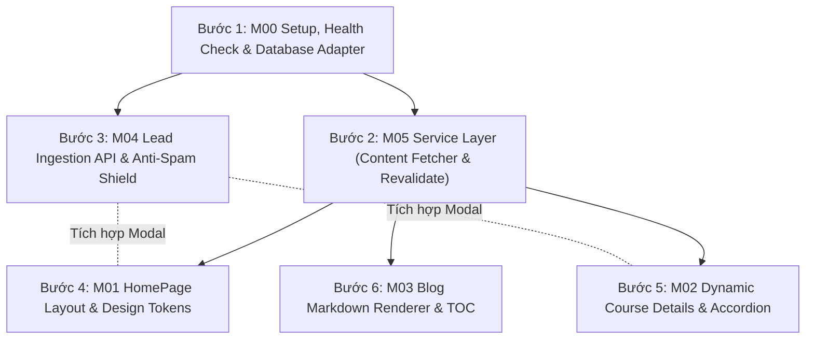

# Bản Đồ Bố Cục Module Toàn Hệ Thống (Modules Architecture Map)

- **Mục đích:** Định vị ranh giới, ma trận phụ thuộc, thứ tự triển khai và trạng thái của toàn bộ 6 phân hệ nghiệp vụ thuộc nền tảng **DataWithLy**.
- **Trạng thái:** Sẵn sàng triển khai (Approved for Implementation)
- **Người quản lý:** TechLead & Project Assistant
- **Ngày cập nhật:** 2026-11-04
- **Nguồn tham khảo:** 
  - [Nguồn chân lý dữ liệu (Database Schema SQL)](../references/database-schema.sql)
  - [Quy tắc nghiệp vụ BR-01 đến BR-13](../02-domain/business-rules.md)
  - [Thiết kế API & Swagger OpenAPI](../07-architecture/api-design.md)
  - [Sổ tay vận hành cho Khách hàng](../09-handover/client-operations-guide.md)

---

## 1. Danh mục 6 Phân hệ Nghiệp vụ (The 6 Core Modules)

```
[M00: Setup & Health Check] ──> Hạ tầng kết nối, Swagger UI & CRUD Scripts
         │
         ├───> [M05: CMS & Content Ops] ──> Service Layer, Revalidate & Linter
         │              │
         │              ├───> [M01: HomePage] ───────> Trang chủ & Trải nghiệm cốt lõi
         │              ├───> [M02: Course Details] ─> Trang chi tiết & Đề cương tương tác
         │              └───> [M03: Blog] ───────────> Bài viết, SEO & Syntax Highlight
         │
         └───> [M04: Lead Capture] ───────> Form Modal, Anti-Spam & Ghi Lead an toàn
```

| Mã Module | Tên Phân Hệ | Trọng tâm chức năng | Tài liệu chi tiết | Trạng thái |
|:---:|---|---|:---:|:---:|
| **M00** | **Thiết lập Kết nối, Health Check & CRUD Scripts** | Cấu hình biến môi trường Staging/Prod; endpoint `/api/health/sheets`; Swagger OpenAPI UI (`/api-docs`); Bộ kịch bản CRUD Khóa học & Lộ trình (có Soft Delete). | [README](M00-setup-and-connectivity/README.md)<br>[PRD](M00-setup-and-connectivity/prd.md) | ✅ Sẵn sàng |
| **M01** | **Trang Chủ (HomePage)** | Bố cục 8 phần chuẩn Figma; Tagline & Hero H1; Lưới 3 khóa học thực tế; Lưới 4 dự án học viên (2x2 grid / mobile carousel); Hồ sơ Mentor Ly; Nút gọi Hotline & Zalo trên Mobile Drawer. | [README](M01-homepage/README.md)<br>[PRD](M01-homepage/prd.md) | ✅ Sẵn sàng |
| **M02** | **Chi Tiết Khóa Học (Course Details)** | Dynamic route `/courses/[slug]`; Sơ đồ tư duy 5 bước; Đề cương tương tác 12-25 buổi kèm [Mở rộng/Thu gọn tất cả]; Bảng Combo End-to-End Upsell; Form nhúng tư vấn. | [README](M02-course-details/README.md)<br>[PRD](M02-course-details/prd.md) | ✅ Sẵn sàng |
| **M03** | **Góc Chia Sẻ (Blog & Knowledge Sharing)** | Danh sách bài viết `/blog` có tab lọc tức thì; Chi tiết `/blog/[slug]` với Reading Progress Bar, Mục lục tự động (TOC), Trình phân tích Markdown có tô màu cú pháp (Syntax Highlighting) cho SQL/Python/DAX. | [README](M03-blog/README.md)<br>[PRD](M03-blog/prd.md) | ✅ Sẵn sàng |
| **M04** | **Thu Thập Tư Vấn (Lead Capture)** | Hàng rào chống spam 3 lớp (Honeypot, Idempotency UUID, Rate Limit IP); Chống chèn công thức; Chịu lỗi Client (SessionStorage backup + Auto-retry 3x); Gửi mail 2 chiều. | [README](M04-lead-capture/README.md)<br>[PRD](M04-lead-capture/prd.md) | ✅ Sẵn sàng |
| **M05** | **Quản Lý Nội Dung (Content Management)** | Schema 9 tab Google Sheets; On-demand ISR Revalidation Webhook (`POST /api/revalidate`); 1-Click Data Linter; Quy tắc "3 Nên & 3 Không" kết hợp quy tắc BR-13; SafeImage Fallback. | [README](M05-content-management/README.md)<br>[PRD](M05-content-management/prd.md) | ✅ Sẵn sàng |

---

## 2. Ma trận Phụ thuộc & Thứ tự Triển khai (Execution Order)

Để đảm bảo các Agent lập trình thực thi một cách trơn tru, mã nguồn được khuyến nghị phát triển theo thứ tự phân tầng từ dưới lên trên:



1. **Giai đoạn Hạ tầng & Tích hợp (Foundation):**
   - Triển khai **M00**: Cấu hình kết nối Google Sheets, viết endpoint `GET /api/health/sheets`, tích hợp Swagger UI `/api-docs`.
   - Triển khai **M05**: Xây dựng tầng Service `lib/cms/content-fetcher.ts` đọc dữ liệu có cache ISR và file dữ liệu dự phòng cục bộ `lib/cms/fallbacks/`.
2. **Giai đoạn Giao dịch & An toàn (Transaction & Resilience):**
   - Triển khai **M04**: Xây dựng API `POST /api/leads` với bộ lọc 3 lớp (Honeypot, Idempotency, Rate Limit) và cơ chế lưu tạm `sessionStorage` phía Client.
3. **Giai đoạn Giao diện & Trải nghiệm Người dùng (UI & User Experience):**
   - Triển khai **M01**: Trang chủ hoàn chỉnh với hệ thống 4-point spacing, palette màu Crimson, và các nút CTA mở Lead Modal.
   - Triển khai **M02**: Trang chi tiết 3 khóa học với Accordion đề cương và bảng so sánh combo.
   - Triển khai **M03**: Trang chia sẻ kiến thức blog với trình render Markdown chuyên nghiệp.

---

[Quay lại Mục lục Chính](../../README.md) | [Đến Module M00](M00-setup-and-connectivity/README.md)

