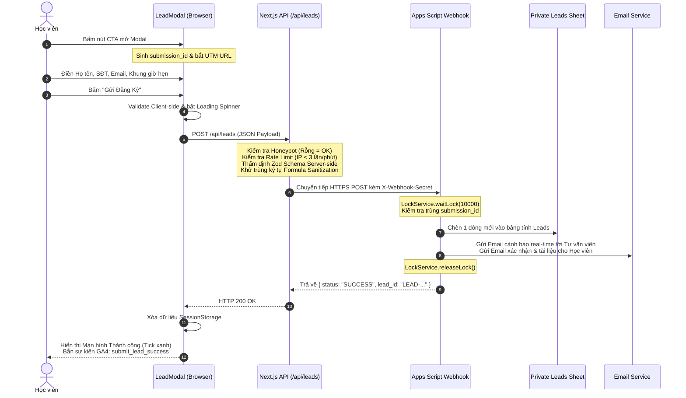

# WF-03 — Nộp form đăng ký tư vấn (Submit Consultation & Lead Ingestion)

- **Mục đích:** Đặc tả hành trình người học điền và nộp biểu mẫu đăng ký tư vấn, luồng kiểm tra chống spam 3 lớp, cơ chế bảo toàn dữ liệu khi có sự cố mạng, quy trình ghi tuần tự vào Google Sheets và kích hoạt email cảnh báo 2 chiều.
- **Trạng thái:** Approved — đã thống nhất theo kế hoạch kiến trúc ngày 2026-11-03.
- **Người duyệt:** Chủ dự án & TechLead.
- **Ngày cập nhật:** 2026-11-03.
- **Nguồn tham khảo:** 
  - [Security Design](../07-architecture/security-design.md);
  - [Lead Protection and Errors](../07-architecture/lead-protection-and-errors.md);
  - [API Design](../07-architecture/api-design.md);
  - PRD liên quan: [PRD M04 Lead Capture](../03-modules/M04-lead-capture/prd.md);
  - [Additional Requirements](../references/additional-requirements.md).

---

## 1. Phân tích định lý CAP áp dụng cho Workflow này

> [!IMPORTANT]
> **LỰA CHỌN CAP: CP (Consistency & Partition Tolerance) kết hợp Client-side Resilience**
> - **Mục tiêu tối thượng:** **Tuyệt đối không làm mất dữ liệu học viên (No Data Loss)** và **Tuyệt đối không ghi trùng lặp (Strict Idempotency)**. Mỗi lượt nộp form là một cơ hội kinh doanh quý giá (Lead) của DataWithLy.
> - **Cơ chế tại Tầng Lưu Trữ (Storage - CP):** Google Apps Script Webhook sử dụng thuật toán khóa hàng đợi độc quyền `LockService.getScriptLock()` chờ tối đa 10 giây. Hệ thống kiểm tra mã `submission_id` duy nhất trước khi ghi. Đảm bảo tính nhất quán mạnh (Strong Consistency): chỉ có đúng 1 dòng được ghi vào bảng tính cho dù có nhiều người cùng bấm nộp trong 1 giây.
> - **Cơ chế bù đắp Tính Sẵn Sàng tại Tầng Trình duyệt (Client-side Resilience - A):** Khi xảy ra phân vùng mạng (Partition) hoặc timeout giữa Next.js và Google Sheets, hệ thống không bỏ rơi người dùng mà kích hoạt:
>   1. Thuật toán **Auto-retry 3 lần** trong nền với Exponential Backoff.
>   2. **Bảo toàn 100% dữ liệu đã gõ** trong `React State / SessionStorage` (không bao giờ reset form).
>   3. Cung cấp nút *"Thử lại"* 1-click thân thiện.

---

## 2. Tác nhân & Điều kiện kích hoạt

- **Tác nhân chính:** Học viên tiềm năng (Prospect).
- **Điểm bắt đầu:** Bấm vào bất kỳ nút CTA nào (`[Nhận tư vấn]`, `[Đăng ký ngay]`, `[Nhận tư vấn lộ trình 1-1]`).
- **Dữ liệu chuẩn bị sẵn:** Tự động sinh mã `submission_id` UUIDv4 và tự động đọc tham số URL `utm_source`, `utm_medium`, `utm_campaign`.

---

## 3. Luồng chính (Happy Path)

---

## 4. Bảng chi tiết các bước thực hiện

| Bước | Hành động tác nhân | Phản hồi của Hệ thống | Quy tắc bảo mật & Nghiệp vụ |
|:---:|---|---|---|
| **1** | Bấm nút CTA mở Modal | Modal hiển thị mượt mà; ô trường ẩn Honeypot được nhúng vào DOM; mã `submission_id` được sinh mới. | Không ảnh hưởng đến tốc độ trang. |
| **2** | Nhập Họ tên, SĐT, Email | Inline validation kiểm tra trực tiếp. Nếu số điện thoại sai định dạng, hiển thị chữ đỏ nhắc nhở ngay dưới ô. | Regex 10 chữ số di động VN. |
| **3** | Bấm nút `[Gửi Đăng Ký]` | Nút bấm chuyển sang biểu tượng xoay (Loading Spinner), các ô nhập liệu bị khóa tạm thời để tránh sửa đổi trong khi gửi. | Tránh người dùng bấm liên tục. |
| **4** | Hệ thống xử lý Backend | Next.js API kiểm tra 3 lớp phòng vệ, khử trùng dấu `=`, chuyển sang Google Apps Script ghi tuần tự vào Google Sheets Staging/Production. | Shared Secret Authentication. |
| **5** | Hoàn tất nộp form | Modal chuyển sang màn hình chúc mừng: *"Đăng ký thành công! Mentor Hứa Thảo Ly và đội ngũ tư vấn sẽ liên hệ với bạn trong vòng 15 phút tới."*, kèm nút tham gia nhóm Zalo hỗ trợ. | Gửi email thông báo chạy bất đồng bộ trong nền. |

---

## 5. Xử lý các tình huống lỗi & Ngoại lệ (Exceptions)

- **Trường hợp Bot Spam điền Honeypot:**
  - Hệ thống âm thầm hủy request, trả về HTTP 200 giả mạo để bot rút lui, không ghi vào Google Sheets.
- **Trường hợp gửi quá 3 lần/phút từ 1 IP:**
  - Trả về HTTP 429 kèm thông báo: *"Bạn đang gửi thông tin quá nhanh, vui lòng chờ 1 phút hoặc liên hệ Hotline"*. Dữ liệu form của học viên được giữ nguyên.
- **Trường hợp mạng chập chờn / Google Sheets timeout:**
  - Hệ thống tự động retry 3 lần với Exponential Backoff.
  - Nếu sau 3 lần vẫn lỗi: Form giữ nguyên 100% dữ liệu đã nhập, hiển thị thông báo lỗi màu vàng nhẹ nhàng kèm nút *"BẤM ĐỂ THỬ LẠI"* (1-click retry).

---

[Điểm bắt đầu của bộ docs](../README.md)
