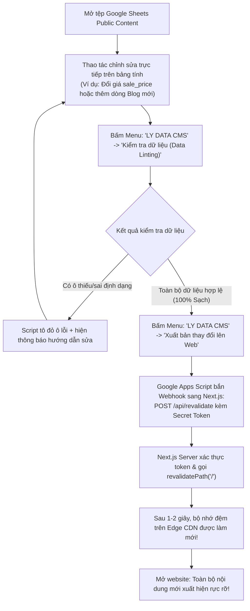

# WF-05 — Quản trị & Xuất bản nội dung qua Google Sheets (Publish Content)

- **Mục đích:** Đặc tả quy trình dành cho Chị Hứa Thảo Ly và đội ngũ biên tập nội dung thực hiện chỉnh sửa khóa học, cập nhật lịch khai giảng, thay đổi học phí hoặc đăng bài viết mới trực tiếp trên Google Sheets và kích hoạt xuất bản lên website mà không cần lập trình viên can thiệp.
- **Trạng thái:** Approved — đã thống nhất theo kế hoạch kiến trúc ngày 2026-11-03.
- **Người duyệt:** Chủ dự án & TechLead.
- **Ngày cập nhật:** 2026-11-03.
- **Nguồn tham khảo:** 
  - [System Context](../07-architecture/system-context.md);
  - [API Design](../07-architecture/api-design.md);
  - PRD liên quan: [PRD M05 Content Management](../03-modules/M05-content-management/prd.md);
  - [Báo cáo giải pháp](../references/solution-and-scope-report.md).

---

## 1. Phân tích định lý CAP áp dụng cho Workflow này

> [!IMPORTANT]
> **LỰA CHỌN CAP: AP (Availability & Partition Tolerance) với On-demand Revalidation**
> - **Mục tiêu ưu tiên:** Website phải luôn luôn hiển thị nội dung hợp lệ cho học viên xem 24/7 (High Availability).
> - **Cơ chế đồng bộ nội dung:**
>   1. Khi người quản trị sửa dữ liệu trên Google Sheets, dữ liệu này chưa lập tức hiển thị ra ngoài nếu chưa bấm *"Xuất bản"* (tránh việc học viên nhìn thấy nội dung đang sửa dở).
>   2. Trước khi xuất bản, script chạy tính năng **Data Linting** để kiểm tra tính hợp lệ của từng ô dữ liệu.
>   3. Khi bấm *"Xuất bản lên Web"*, script bắn một Webhook bảo mật sang `POST /api/revalidate` của Next.js để làm mới bộ nhớ đệm trang tĩnh (ISR On-demand Invalidation).
>   4. Nếu quá trình bắn Webhook bị nghẽn mạng (Partition), website **vẫn tiếp tục phục vụ bản sao tĩnh trước đó** cho đến khi Webhook được gửi lại thành công.

---

## 2. Tác nhân & Điều kiện kích hoạt

- **Tác nhân chính:** Founder Hứa Thảo Ly hoặc Người biên tập nội dung được phân quyền.
- **Điểm bắt đầu:** Mở file Google Sheets `Public Content Sheet` trên trình duyệt máy tính.
- **Điều kiện trước:** Đã cài đặt menu tùy chỉnh `LY DATA CMS` qua Google Apps Script.

---

## 3. Luồng chính (Happy Path)

---

## 4. Bảng chi tiết các bước thực hiện

| Bước | Hành động của Quản trị viên | Phản hồi của Hệ thống | Quy tắc nghiệp vụ |
|:---:|---|---|---|
| **1** | Mở file `Public Content Sheet` | Thanh menu tùy chỉnh `LY DATA CMS` xuất hiện tự động trên thanh công cụ của Google Sheets. | Kích hoạt bởi hàm `onOpen()` của Apps Script. |
| **2** | Nhập hoặc chỉnh sửa thông tin | - Thêm khóa học mới: Nhập vào tab `Courses`. - Ẩn khóa học cũ: Đổi cột `is_active = FALSE`. - Sửa học phí: Click đúp vào ô `sale_price` để sửa số tiền. | Không đổi tên dòng tiêu đề số 1; không gộp ô (Merge Cells). |
| **3** | Rà soát lỗi dữ liệu (Data Linting) | Bấm menu `LY DATA CMS` -> `Kiểm tra toàn bộ dữ liệu`. Script duyệt qua tất cả các tab, kiểm tra định dạng số, ngày tháng, link ảnh URL. | Nếu có lỗi, tô đỏ ô sai để người dùng nhận biết ngay lập tức. |
| **4** | Kích hoạt xuất bản | Bấm menu `LY DATA CMS` -> `Xuất bản thay đổi lên Web`. Script gửi Webhook mã hóa sang máy chủ Next.js. | Secret Token bảo vệ trong Script Properties. |
| **5** | Website cập nhật | Next.js xóa bản cache cũ, fetch dữ liệu mới nhất từ Sheets và render lại trang tĩnh trên CDN toàn cầu trong vòng 1.5 giây. | Không cần redeploy mã nguồn; không tốn chi phí máy chủ. |

---

## 5. Các quy tắc "3 NÊN" & "3 KHÔNG" cho Quản trị viên

> [!TIP]
> **3 NÊN:**
> 1. **NÊN dùng phím Alt + Enter để xuống dòng trong 1 ô:** Khi viết danh sách gạch đầu dòng (nội dung chi tiết buổi học, quyền lợi khóa học), việc xuống dòng sẽ tự động được website chuyển thành các bullet points đẹp mắt.
> 2. **NÊN chạy tính năng "Kiểm tra dữ liệu" trước khi xuất bản:** Giúp bạn hoàn toàn an tâm rằng website không bao giờ bị lỗi do nhập thiếu dữ liệu.
> 3. **NÊN tải ảnh lên kho Cloudinary/R2 và dán link chuẩn CDN:** Giúp hình ảnh tải siêu tốc dưới 0.3s, không bị Google chặn băng thông như khi dùng link Google Drive.

> [!CAUTION]
> **3 KHÔNG:**
> 1. **KHÔNG đổi tên hoặc xóa dòng tiêu đề số 1 của bất kỳ Tab nào:** Dòng 1 chứa các khóa kỹ thuật (`course_id`, `sale_price`...). Đổi tên sẽ khiến hệ thống không tìm thấy dữ liệu.
> 2. **KHÔNG gộp ô (Merge Cells):** Gộp ô làm sai lệch chỉ số dòng và cột của API đọc dữ liệu.
> 3. **KHÔNG dán link ảnh trực tiếp từ Google Drive cá nhân.**

---

[Điểm bắt đầu của bộ docs](../README.md)
