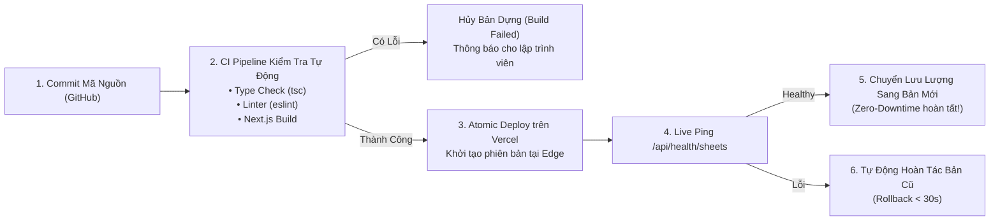

# Tiêu Chuẩn NFR: Triển Khai & Vận Hành Hệ Thống (Deployment & CI/CD)

- **Mục đích:** Đặc tả các tiêu chuẩn kỹ thuật về quy trình triển khai không gián đoạn (Zero-Downtime Deployment), cách ly môi trường Staging/Production, kiểm tra tự động trước khi đóng gói bản dựng và quy trình bàn giao kỹ thuật.
- **Trạng thái:** Sẵn sàng triển khai (Approved for Implementation)
- **Người quản lý:** TechLead & DevOps Engineer
- **Ngày cập nhật:** 2026-11-04
- **Nguồn tham khảo:** 
  - [Checklist bàn giao kỹ thuật](../09-handover/technical-handover-checklist.md)
  - [Sổ tay vận hành cho Khách hàng](../09-handover/client-operations-guide.md)
  - [Tùy chọn hạ tầng & Hosting](../07-architecture/hosting-options.md)

---

## 1. Bảng Tiêu Chuẩn Triển Khai Chi Tiết (NFR-DEPLOY-001 đến NFR-DEPLOY-006)

| Mã NFR | Tiêu chuẩn chất lượng | Phạm vi áp dụng | Ngưỡng cam kết (SLA) & Hành vi hệ thống | Phương pháp kiểm tra | Mức ưu tiên |
|:---:|---|---|---|---|:---:|
| **NFR-DEPLOY-001** | **Triển Khai Không Gián Đoạn (Zero-Downtime)** | Môi trường Production | Quá trình phát hành phiên bản mới tuyệt đối không làm gián đoạn người dùng đang duyệt web hoặc nộp form. Sử dụng cơ chế Atomic Deployment của Vercel (bản dựng mới chỉ nhận traffic sau khi vượt qua kiểm tra sức khỏe). | Đang duyệt web liên tục trong lúc kích hoạt lệnh Deploy phiên bản mới. | **P0** |
| **NFR-DEPLOY-002** | **Cách Ly Môi Trường Tuyệt Đối (Environment Isolation)** | Staging vs Production | Tách biệt 100% giữa 2 môi trường: • *Staging (`staging.datawithly.edu.vn`):* Sử dụng file Google Sheets Staging mẫu và danh sách email test. • *Production (`datawithly.edu.vn`):* Sử dụng file Google Sheets chính thức và danh sách tư vấn viên thật của Chị Ly. Dữ liệu test tuyệt đối không làm bẩn môi trường thật. | Kiểm tra các biến môi trường `GOOGLE_SHEETS_CONTENT_ID` và `GOOGLE_SHEETS_LEADS_ID` trên từng môi trường. | **P0** |
| **NFR-DEPLOY-003** | **Kiểm Tra Bản Dựng Tự Động (Build Pre-check)** | CI/CD Pipeline | Lệnh `npm run build` tự động chạy kiểm tra Type Checking (`tsc --noEmit`) và ESLint. Nếu phát sinh bất kỳ lỗi cú pháp, sai kiểu dữ liệu hoặc vi phạm quy tắc AGENTS.md, hệ thống lập tức hủy bỏ tiến trình build và từ chối xuất bản. | Cố tình tạo 1 lỗi kiểu dữ liệu TypeScript và chạy `npm run build`. | **P0** |
| **NFR-DEPLOY-004** | **Khả Năng Hoàn Tác Tức Thì (Instant Rollback)** | Quản trị phiên bản Vercel | Khi phiên bản mới phát sinh lỗi nghiêm trọng sau khi triển khai, quản trị viên có khả năng hoàn tác (Rollback) về phiên bản ổn định trước đó trong vòng **dưới 30 giây** chỉ bằng 1 thao tác nhấn chuột trên Vercel Dashboard. | Bấm nút "Instant Rollback" trên Vercel và kiểm tra phiên bản website. | **P0** |
| **NFR-DEPLOY-005** | **Cấu Hình Google Apps Script Chuẩn Mực** | Webhook Gateway | Kịch bản Google Apps Script nhận lead bắt buộc triển khai dưới dạng Web App với cấu hình: • *Execute as:* **Tôi (Địa chỉ email của Chị Ly - Me)**. • *Who has access:* **Bất kỳ ai (Anyone)**. Đảm bảo Next.js Serverless gọi được Webhook mà không bị chặn xác thực Google OAuth. | Gửi request POST thử nghiệm vào Webhook URL qua cURL / Swagger UI. | **P0** |
| **NFR-DEPLOY-006** | **Nghiệm Thu Trước Khi Chạy Chiến Dịch (Promotion Checklist)** | Bàn giao chính thức | Trước khi bàn giao hệ thống phục vụ chiến dịch tuyển sinh, bắt buộc hoàn thành 100% các tiêu chí trong [Checklist Bàn giao Kỹ thuật](../09-handover/technical-handover-checklist.md) (Kiểm tra 2 Sheets, Health Check xanh, thử form, test anti-spam và 1-click revalidate). | Rà soát từng ô kiểm tử trong biên bản bàn giao có xác nhận của TechLead. | **P0** |

---

## 2. Quy Trình CI/CD & Luồng Phát Hành Tự Động

---

## 3. Kịch Bản Nghiệm Thu Triển Khai (Deployment Acceptance Criteria)

| Mã AC | Kịch bản kiểm tra | Hành động thực hiện | Tiêu chí nghiệm thu Đạt |
|---|---|---|---|
| **AC-DEPLOY-01** | Kiểm tra Zero-Downtime | Thực hiện lệnh phát hành phiên bản mới trong lúc một máy tính khác đang tải và đọc đề cương khóa học liên tục. | Người dùng không nhận thấy bất kỳ giây gián đoạn nào; không có trang trắng, không có lỗi HTTP 502/503. |
| **AC-DEPLOY-02** | Thử nghiệm chặn build khi có lỗi | Thêm 1 dòng mã TypeScript bị lỗi vào component ➔ Kích hoạt tiến trình build. | CI Pipeline báo lỗi đỏ và dừng ngay lập tức; phiên bản đang chạy trên Production không bị thay đổi. |
| **AC-DEPLOY-03** | Thử nghiệm Rollback < 30 giây | Chọn một bản triển khai cũ trên Vercel Dashboard và bấm nút **"Instant Rollback"**. | Website lập tức chuyển về phiên bản cũ thành công trong vòng < 15 giây; không phát sinh thời gian chết. |
| **AC-DEPLOY-04** | Kiểm tra cách ly môi trường | Gửi một form tư vấn thử nghiệm trên `staging.datawithly.edu.vn`. | Dòng dữ liệu thử nghiệm chỉ xuất hiện trong file Google Sheets Staging; file Google Sheets thật của Chị Ly hoàn toàn sạch sẽ, không có dữ liệu rác. |

---

[Quay lại Mục lục NFR](README.md) | [Đến Sổ tay Vận hành](../09-handover/client-operations-guide.md)
