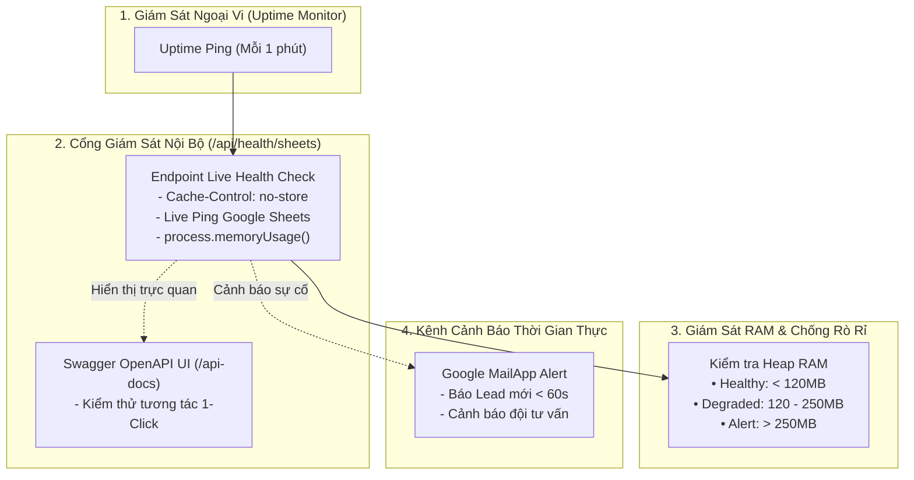

# Tiêu Chuẩn NFR: Khả Năng Quan Sát & Giám Sát Hệ Thống (Observability & Monitoring)

- **Mục đích:** Đặc tả các tiêu chuẩn kỹ thuật về giám sát sức khỏe kết nối Google Sheets thời gian thực, đo lường độ trễ mạng, kiểm soát bộ nhớ RAM máy chủ, cảnh báo tức thì khi có Lead mới và tài liệu thử nghiệm Swagger OpenAPI.
- **Trạng thái:** Sẵn sàng triển khai (Approved for Implementation)
- **Người quản lý:** TechLead & SRE Engineer
- **Ngày cập nhật:** 2026-11-04
- **Nguồn tham khảo:** 
  - [Module Nền tảng M00](../03-modules/M00-setup-and-connectivity/README.md)
  - [Thiết kế API & Swagger OpenAPI](../07-architecture/api-design.md)
  - [Kiến trúc Caching Đa Tầng & Chống Memory Leak](../07-architecture/caching-and-memory-optimization.md)
  - [Sổ tay vận hành cho Khách hàng](../09-handover/client-operations-guide.md)

---

## 1. Bảng Tiêu Chuẩn Khả Năng Quan Sát (NFR-OBS-001 đến NFR-OBS-006)

| Mã NFR | Tiêu chuẩn chất lượng | Phạm vi áp dụng | Ngưỡng cam kết (SLA) & Hành vi hệ thống | Phương pháp kiểm tra | Mức ưu tiên |
|:---:|---|---|---|---|:---:|
| **NFR-OBS-001** | **Endpoint Giám Sát Kết Nối Thời Gian Thực** | Endpoint `GET /api/health/sheets` | Đo lường độ trễ mạng (Live Ping) và trạng thái hoạt động của cả 2 file Sheets. Bắt buộc gắn header `Cache-Control: no-store` để không cache kết quả cũ. Tiêu chuẩn độ trễ: • Đọc Public Sheets: **< 800 miligiây**. • Ping Private Leads: **< 1.500 miligiây**. | Gửi request `GET /api/health/sheets` và kiểm tra giá trị trường `latency_ms`. | **P0** |
| **NFR-OBS-002** | **Thử Nghiệm API Tương Tác (Swagger UI)** | Route `/api-docs` | Tích hợp giao diện Swagger / OpenAPI 3.0 UI trực quan. Cho phép lập trình viên, tester và khách hàng bấm nút **"Try it out"** và **"Execute"** để kiểm tra trực tiếp các API (`/api/health/sheets`, `/api/leads`, `/api/revalidate`) ngay trên trình duyệt mà không cần cài đặt phần mềm ngoài. | Mở đường dẫn `https://datawithly.edu.vn/api-docs` và chạy thử endpoint. | **P0** |
| **NFR-OBS-003** | **Giám Sát Bộ Nhớ Máy Chủ (Memory Heap SLA)** | Tiến trình Node.js Server | Đo lường bộ nhớ RAM thời gian thực qua `process.memoryUsage()`. Báo cáo các chỉ số `heap_used_mb`, `heap_total_mb`, `rss_mb` vào JSON health check. Ngưỡng cảnh báo an toàn: • Khỏe mạnh (Healthy): **< 120 MB**. • Cảnh báo (Degraded): **120 MB - 250 MB**. • Nguy hiểm (Critical): **> 250 MB**. | Kiểm tra trường `memory.status` trên endpoint `/api/health/sheets`. | **P0** |
| **NFR-OBS-004** | **Cảnh Báo Email Tức Thì Khi Có Lead Mới** | Kênh thông báo Đội ngũ tư vấn | Ngay khi học viên nộp form thành công, hệ thống tự động gửi email thông báo kèm đầy đủ thông tin (Họ tên, SĐT, Email, Khóa học quan tâm, Nguồn UTM) tới danh sách tư vấn viên (`hien0934752432@gmail.com`, `hien.truong230214@vnuk.edu.vn`) trong vòng **dưới 60 giây**. | Điền thử form trên website và bấm đồng hồ đo thời gian nhận email trong hộp thư đến. | **P0** |
| **NFR-OBS-005** | **Rà Soát Lỗi Dữ Liệu Nhanh (Data Linting Speed)** | Công cụ quản trị Sheets | Kịch bản Data Linter quét toàn bộ 9 tab dữ liệu, kiểm tra trùng lặp slug, thiếu trường bắt buộc, link ảnh hỏng và tô màu cảnh báo trực tiếp trên Google Sheets trong vòng **dưới 2 giây**. | Chạy lệnh `[DataWithLy CMS] > 🔍 Kiểm Tra Lỗi Dữ Liệu` trên Sheets. | **P1** |
| **NFR-OBS-006** | **Ghi Nhật Ký Máy Chủ Chuẩn Cấu Trúc (Structured Logging)** | Serverless Console Log | Mọi lỗi phát sinh tại các API routes bắt buộc phải ghi log dưới dạng JSON có cấu trúc: `{ timestamp, level, endpoint, error_code, message }`. Tuyệt đối **không log thông tin định danh cá nhân (PII)** của học viên. | Xem Vercel Runtime Logs / Server Console khi có lỗi giả lập. | **P1** |

---

## 2. Kiến Trúc Giám Sát & Quan Sát Hệ Thống

---

## 3. Kịch Bản Nghiệm Thu Khả Năng Quan Sát (Observability Acceptance Criteria)

| Mã AC | Kịch bản kiểm tra | Hành động kích hoạt | Tiêu chí nghiệm thu Đạt |
|---|---|---|---|
| **AC-OBS-01** | Kiểm tra Health Check qua Swagger UI | Mở `/api-docs` ➔ Chọn `GET /api/health/sheets` ➔ Bấm "Try it out" ➔ "Execute". | Kết quả trả về HTTP 200 trong vòng < 800ms; hiển thị chi tiết trạng thái online của cả 2 file Sheets, dung lượng RAM `heap_used_mb` và số lượng email quota còn lại trong ngày. |
| **AC-OBS-02** | Đo lường thời gian nhận email cảnh báo | Học viên nộp form tư vấn khóa học SQL. | Đồng hồ đo thời gian: Trong vòng < 60 giây, hòm thư của tư vấn viên (`hien0934752432@gmail.com`, `hien.truong230214@vnuk.edu.vn`) nhận được email cảnh báo có tiêu đề `🔥 [LEAD MỚI] [DataWithLy] - [Tên học viên]`. |
| **AC-OBS-03** | Thử nghiệm Data Linter trên Sheets | Cố tình xóa ô giá học phí và nhập sai link ảnh trên Sheets ➔ Bấm `[DataWithLy CMS] > 🔍 Kiểm Tra Lỗi Dữ Liệu`. | Script chạy xong trong < 2 giây; ô thiếu giá và ô link ảnh sai được tự động tô màu vàng/đỏ cảnh báo kèm thông báo hướng dẫn sửa cụ thể. |
| **AC-OBS-04** | Kiểm tra cấu trúc Log máy chủ | Gửi một request lỗi vào `/api/leads` (SĐT sai định dạng). | Vercel Console ghi nhận dòng log JSON chuẩn: có mã lỗi `INVALID_PHONE_NUMBER`, không chứa thông tin nhạy cảm. |

---

[Quay lại Mục lục NFR](README.md) | [Đến NFR Triển khai](deployment.md)
