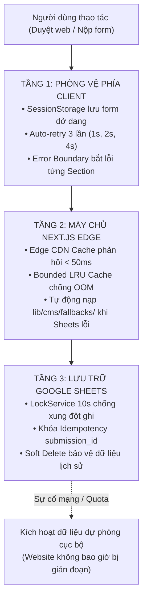

# Tiêu Chuẩn NFR: Độ Tin Cậy & Khả Năng Chịu Lỗi (Reliability & Fault Tolerance)

- **Mục đích:** Đặc tả các tiêu chuẩn kỹ thuật về độ sẵn sàng cao (Uptime 99.9%), khả năng tự phục hồi khi có sự cố mạng, bảo vệ an toàn dữ liệu học viên và cam kết triết lý **Zero White Screen** (Không bao giờ sập trắng màn hình).
- **Trạng thái:** Sẵn sàng triển khai (Approved for Implementation)
- **Người quản lý:** TechLead & SRE Engineer
- **Ngày cập nhật:** 2026-11-04
- **Nguồn tham khảo:** 
  - [Bảo vệ dữ liệu Lead & Xử lý lỗi](../07-architecture/lead-protection-and-errors.md)
  - [Kiến trúc Caching Đa Tầng & Chống Memory Leak](../07-architecture/caching-and-memory-optimization.md)
  - [Ghi chú lưu lead và email retry](../03-modules/M04-lead-capture/email-and-retry-notes.md)
  - [Sổ tay vận hành cho Khách hàng](../09-handover/client-operations-guide.md)

---

## 1. Bảng Tiêu Chuẩn Độ Tin Cậy Chi Tiết (NFR-RELIABILITY-001 đến NFR-RELIABILITY-008)

| Mã NFR | Tiêu chuẩn chất lượng | Phạm vi áp dụng | Ngưỡng cam kết (SLA) & Hành vi hệ thống | Phương pháp kiểm tra | Mức ưu tiên |
|:---:|---|---|---|---|:---:|
| **NFR-RELIABILITY-001** | **Cô Lập Lỗi (Zero White Screen)** | Toàn bộ các trang và component | Bọc `ErrorBoundary` tại từng Section độc lập (Hero, Khóa học, Đề cương, Testimonials, Projects). Nếu một component bị lỗi dữ liệu từ Google Sheets, chỉ phần đó hiển thị giao diện fallback lịch sự; **tuyệt đối không làm sập trắng toàn bộ website**. | Ném ngoại lệ nhân tạo (`throw new Error()`) trong một component con và kiểm tra trang web. | **P0** |
| **NFR-RELIABILITY-002** | **Tự Động Thử Lại (Client Auto-Retry)** | Nộp form Lead (M04) | Khi gặp sự cố mạng chập chờn hoặc timeout, Client tự động thực hiện **3 lần gửi lại (Auto-retry)** với khoảng cách lũy thừa (1s, 2s, 4s). Nếu cả 3 lần đều lỗi, hiển thị nút **[Thử lại ngay]** và giữ nguyên 100% dữ liệu đã gõ. | Chặn request mạng trong Chrome DevTools Network (Offline) khi bấm Submit. | **P0** |
| **NFR-RELIABILITY-003** | **Dữ Liệu Dự Phòng Cục Bộ (Static Fallback)** | Tầng Service Fetcher | Khi kết nối đến Google Sheets bị đứt hoặc vượt quá thời gian chờ (Timeout > 3.000ms), hệ thống tự động nạp bản snapshot dữ liệu chuẩn từ đĩa `lib/cms/fallbacks/*.json`. Website tiếp tục phục vụ bình thường. | Tắt mạng máy tính hoặc đổi sai Google Sheets ID để kích hoạt fallback. | **P0** |
| **NFR-RELIABILITY-004** | **Phòng Hộ Link Ảnh Hỏng (SafeImage Shield)** | Toàn bộ hình ảnh | Khi đường link ảnh lưu trên host ngoài (Imgur, Cloudinary, Drive) bị xóa hoặc lỗi HTTP 404, component `SafeImage` tự động bắt sự kiện `onError` và thay thế bằng ảnh placeholder/logo DataWithLy chuẩn màu Crimson. Không bao giờ hiển thị icon ảnh vỡ của trình duyệt. | Nhập một link ảnh không tồn tại (`https://invalid-url.com/404.jpg`) vào Sheets. | **P0** |
| **NFR-RELIABILITY-005** | **Kháng Trùng Lặp Lead (Idempotency)** | Ghi nhận hồ sơ tư vấn | Mỗi lượt mở form được gắn mã UUID `submission_id`. Khi người dùng click đúp hoặc mạng gửi trùng request, Google Apps Script sử dụng `LockService.waitLock(10000)` đối soát và **chỉ ghi nhận đúng 1 dòng duy nhất** vào Google Sheets Private. | Dùng script gửi 5 request có cùng `submission_id` trong 1 giây. | **P0** |
| **NFR-RELIABILITY-006** | **Cam Kết Sẵn Sàng (Uptime SLA)** | Hệ thống Web Application | Độ sẵn sàng hoạt động đạt **>= 99.9% hàng tháng** (tương đương thời gian gián đoạn tối đa < 43 phút/tháng) nhờ nền tảng Edge CDN Serverless đa vùng (Multi-zone). | Giám sát liên tục 24/7 bằng UptimeRobot / BetterStack ping mỗi 1 phút. | **P0** |
| **NFR-RELIABILITY-007** | **Xóa Mềm An Toàn (Safe Soft Delete)** | Quản lý Khóa học | Khi Chị Ly muốn xóa một khóa học, hệ thống thực hiện Soft Delete (chuyển `is_active = FALSE` và trạng thái `ARCHIVED`). **Tuyệt đối không xóa dòng vật lý**, bảo toàn 100% đề cương liên kết lịch sử. Đường link cũ hiển thị thông báo tạm dừng tuyển sinh lịch sự. | Kích hoạt thao tác Soft Delete trên Sheets và kiểm tra tính toàn vẹn của bảng `curriculum`. | **P0** |
| **NFR-RELIABILITY-008** | **Hàng Đợi Email Bất Đồng Bộ (Async Queue)** | Thông báo Email (M04) | Việc gửi email thông báo học viên và tư vấn viên là tác vụ phi đồng bộ (Eventual Consistency). Sự cố tạm thời hết hạn ngạch MailApp **không bao giờ làm thất bại lượt đăng ký của học viên**. Cột `email_status` đánh dấu `PENDING_RETRY` để kịch bản tự gửi lại sau. | Giả lập MailApp hết hạn ngạch (Quota 0) và kiểm tra dòng Lead vẫn ghi thành công vào Sheets. | **P1** |

---

## 2. Mô Hình Chịu Lỗi & Phục Hồi 3 Tầng (3-Tier Resilience Architecture)

---

## 3. Kịch Bản Nghiệm Thu Độ Tin Cậy (Reliability Acceptance Criteria)

| Mã AC | Kịch bản kiểm thử | Hành động kích hoạt | Tiêu chí nghiệm thu Đạt |
|---|---|---|---|
| **AC-RELIABILITY-01** | Bắt lỗi Zero White Screen | Giả lập lỗi cú pháp trong khối Component `Testimonials`. | Chỉ riêng khối Testimonials hiển thị thông báo: *"Khối đánh giá học viên đang được làm mới"* kèm nút Thử lại. Toàn bộ Trang chủ (Hero, Khóa học, Mentor, Lead Form) vẫn hoạt động bình thường 100%. |
| **AC-RELIABILITY-02** | Thử lại tự động khi rớt mạng | Điền form tư vấn ➔ Ngắt kết nối mạng ➔ Nhấn nút [Gửi thông tin tư vấn]. | Giao diện hiển thị: *"Đang thử kết nối lại (Lần 1/3)..."*. Khi bật mạng trở lại, form tự động gửi thành công mà người dùng không phải bấm lại. |
| **AC-RELIABILITY-03** | Kháng trùng lặp khi click đúp | Nhấn nút nộp form liên tục 3 lần trong vòng 0.5 giây. | Nút gửi lập tức chuyển sang trạng thái disabled; Google Sheets chỉ tăng đúng 1 dòng dữ liệu mới duy nhất. |
| **AC-RELIABILITY-04** | Fallback khi Sheets bị ngắt kết nối | Ngắt token truy cập Google Sheets và mở trang xem chi tiết khóa học. | Trang web tự động nạp dữ liệu từ `lib/cms/fallbacks/courses.json`. Học viên vẫn xem được đề cương và mức học phí chuẩn xác mà không gặp lỗi 500. |

---

[Quay lại Mục lục NFR](README.md) | [Đến NFR An toàn thông tin](security.md)
