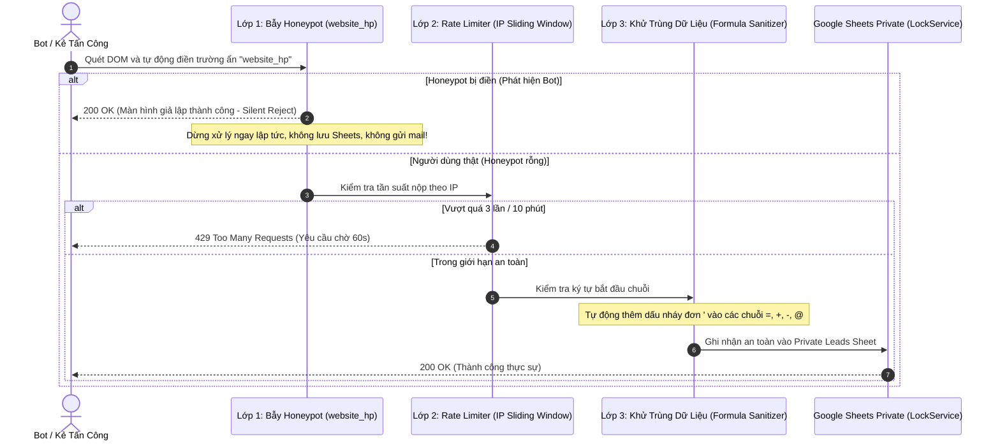

# Tiêu Chuẩn NFR: An Toàn Thông Tin & Bảo Vệ Dữ Liệu (Security & Privacy)

- **Mục đích:** Đặc tả các yêu cầu an ninh mạng nghiêm ngặt: hệ thống phòng vệ chống spam 3 lớp, bảo vệ thông tin cá nhân (PII) tuân thủ Nghị định 13/2023/NĐ-CP, khử trùng dữ liệu chống chèn công thức Google Sheets, và cô lập bí mật hệ thống.
- **Trạng thái:** Sẵn sàng triển khai (Approved for Implementation)
- **Người quản lý:** TechLead & Security Engineer
- **Ngày cập nhật:** 2026-11-04
- **Nguồn tham khảo:** 
  - [Thiết kế an toàn & Chống spam 3 lớp](../07-architecture/security-design.md)
  - [Quy tắc nghiệp vụ BR-01, BR-02, BR-03, BR-08, BR-09](../02-domain/business-rules.md)
  - [Biên bản yêu cầu bổ sung](../references/additional-requirements.md)
  - Nghị định số 13/2023/NĐ-CP về Bảo vệ Dữ liệu Cá nhân tại Việt Nam

---

## 1. Bảng Tiêu Chuẩn An Toàn Chi Tiết (NFR-SEC-001 đến NFR-SEC-008)

| Mã NFR | Tiêu chuẩn bảo mật | Phạm vi áp dụng | Ngưỡng cam kết & Hành vi bắt buộc | Phương pháp & Công cụ kiểm tra | Mức ưu tiên |
|:---:|---|---|---|---|:---:|
| **NFR-SEC-001** | **Hàng Rào Chống Spam 3 Lớp** | Form Tư vấn (M04) | Tích hợp đồng thời 3 lớp phòng vệ: 1. *Honeypot ẩn (`website_hp`):* Đánh lừa bot tự động điền form ➔ kích hoạt Silent Reject. 2. *Khóa chống trùng (`submission_id`):* Ngăn chặn gửi lặp. 3. *Rate Limiting theo IP:* Giới hạn **tối đa 3 submissions / 10 phút / IP**. Vượt quá trả về HTTP 429. | Script tự động giả lập điền bẫy honeypot và gửi liên tục 5 request từ 1 IP. | **P0** |
| **NFR-SEC-002** | **Bảo Vệ Dữ Liệu Cá Nhân (PII Compliance)** | Toàn bộ hệ thống & Analytics | Tuân thủ Nghị định 13/2023/NĐ-CP: • **Tuyệt đối không gửi** số điện thoại, email, hoặc họ tên học viên vào thanh địa chỉ URL, cookie công khai hoặc sự kiện đo lường (GA4, GTM, Meta Pixel). • Chỉ gửi các thông số phi định danh (`course_id`, `package_id`, `value`). | Bật Network tab kiểm tra payload gửi lên GA4 (`https://www.google-analytics.com/g/collect`). | **P0** |
| **NFR-SEC-003** | **Khử Trùng Công Thức (Formula Sanitization)** | Dữ liệu đầu vào Google Sheets | Mọi chuỗi văn bản người dùng nhập bắt đầu bằng một trong các ký tự `=`, `+`, `-`, `@`, `\t`, `\r` bắt buộc phải được tự động chèn thêm dấu nháy đơn `'` ở đầu (vd: `=SUM(...)` ➔ `'=SUM(...)`) để ngăn chặn tấn công CSV/Formula Injection trên Google Sheets của Chị Ly. | Nhập thử họ tên `=cmd|' /C calc'!A0` và kiểm tra dữ liệu lưu trên Google Sheets. | **P0** |
| **NFR-SEC-004** | **Cô Lập Bí Mật Hệ Thống (Secret Shield)** | Biến môi trường & API | Khóa `REVALIDATION_SECRET`, Webhook Secret và Service Account Private Key bắt buộc chỉ lưu trữ tại biến môi trường máy chủ (Server-side Environment Variables); **100% không bao giờ xuất hiện trong mã nguồn Client JavaScript bundle**. | Quét source code client bundle trên trình duyệt tìm kiếm từ khóa `REVALIDATION_SECRET`. | **P0** |
| **NFR-SEC-005** | **Kiến Trúc Tách Biệt 2 File Sheets** | Tầng lưu trữ dữ liệu | Tách biệt hoàn toàn 2 file Google Sheets: 1. *File Public Content Sheet:* Chỉ cấp quyền ĐỌC công khai qua CSV/API. 2. *File Private Leads Sheet:* Quyền riêng tư nội bộ của Chị Ly, website không có quyền đọc công khai, chỉ ghi qua Webhook bảo mật. | Kiểm tra URL Sheets của bảng Leads ở chế độ ẩn danh (bắt buộc phải yêu cầu đăng nhập Google). | **P0** |
| **NFR-SEC-006** | **Tiêu Đầu Bảo Mật HTTP (Security Headers)** | Next.js Server & Edge | Cấu hình đầy đủ các HTTP Security Headers trong `next.config.ts`: • `X-Frame-Options: DENY` (Chống Clickjacking). • `X-Content-Type-Options: nosniff` (Chống MIME-type sniffing). • `Referrer-Policy: strict-origin-when-cross-origin`. • `Permissions-Policy: camera=(), microphone=(), geolocation=()`. | Kiểm tra điểm số bảo mật trên `securityheaders.com` (Đạt điểm A hoặc A+). | **P1** |
| **NFR-SEC-007** | **Làm Sạch Nội Dung Blog (HTML Sanitization)** | Trình đọc Markdown (M03) | Loại bỏ hoàn toàn các thẻ HTML nguy hiểm (`` và kiểm tra trình duyệt không thực thi mã. | **P1** |
| **NFR-SEC-008** | **Bộ Giới Hạn Bộ Nhớ (Bounded Rate Limiter)** | Tầng Middleware / RAM | Bộ nhớ lưu trữ IP của Rate Limiter được giới hạn cứng dung lượng **dưới 5 MB RAM** thông qua Bounded LRU Cache (tối đa 3.000 IP gần nhất, tự động dọn dẹp sau 10 phút), ngăn chặn tấn công làm tràn bộ nhớ máy chủ (DDoS Heap Exhaustion). | Kiểm tra dung lượng RAM Node.js khi gửi hàng ngàn IP giả lập. | **P0** |

---

## 2. Mô Hình An Ninh 3 Lớp Bảo Vệ Lead Form

---

## 3. Kịch Bản Nghiệm Thu An Toàn Thông Tin (Security Acceptance Criteria)

| Mã AC | Kịch bản kiểm tra | Hành động kích hoạt | Tiêu chí nghiệm thu Đạt |
|---|---|---|---|
| **AC-SEC-01** | Bẫy Honeypot | Dùng công cụ cURL gửi POST payload có trường `website_hp: "http://bot-spam.com"`. | API trả về HTTP 200 giả lập nhưng file Google Sheets Private không ghi nhận bất kỳ dòng mới nào, không phát sinh email cảnh báo rác. |
| **AC-SEC-02** | Giới hạn IP Rate Limiting | Gửi liên tục 4 lượt nộp form từ cùng 1 địa chỉ IP trong vòng 2 phút. | Lượt gửi thứ 4 nhận về mã HTTP 429 Too Many Requests kèm thông báo: *"Bạn đang gửi quá nhanh, vui lòng chờ ít phút trước khi thử lại"*. |
| **AC-SEC-03** | Chống Formula Injection | Nhập chuỗi `=SUM(1,2)` vào ô Họ tên trên form và nộp. | Dữ liệu hiển thị trong ô Google Sheets của Chị Ly là `'=SUM(1,2)` dưới dạng chuỗi văn bản thuần túy, không bị tính toán thành số `3`. |
| **AC-SEC-04** | Kiểm tra rò rỉ PII trên Analytics | Hoàn tất nộp form và kiểm tra thẻ Network của trình duyệt. | Không có bất kỳ tham số nào chứa số điện thoại hoặc email học viên được gửi đến Google Analytics hoặc Facebook Pixel. |

---

[Quay lại Mục lục NFR](README.md) | [Đến NFR Tối ưu hóa tìm kiếm](seo.md)
