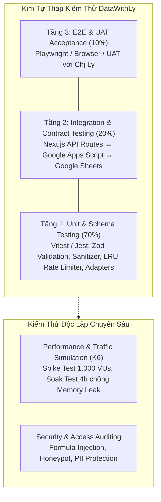
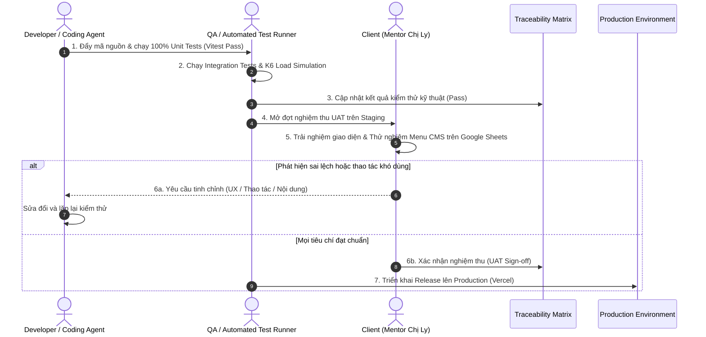

# Khung Kiểm Thử & Tiêu Chuẩn Nghiệm Thu (Acceptance Framework)

- **Mục đích:** Thiết lập khung tiêu chuẩn kiểm thử đa tầng, quy tắc nghiệm thu chất lượng (Quality Gates) và quy trình ký duyệt (Sign-off) cho toàn bộ nền tảng giáo dục DataWithLy.
- **Trạng thái:** Active / Production Ready
- **Người duyệt:** TechLead & Client Hứa Thảo Ly
- **Ngày cập nhật:** 2026-11-05
- **Nguồn tham khảo:** 
  - [Quy trình triển khai](../08-project/delivery-process.md)
  - [Quy tắc kinh doanh BR-01 đến BR-13](../02-domain/business-rules.md)
  - [Tiêu chuẩn phi chức năng NFR Specifications](../05-non-functional-requirements/README.md)
  - [Kiến trúc Caching & Tối ưu bộ nhớ](../07-architecture/caching-and-memory-optimization.md)

---

## 1. Tuyên Ngôn Chất Lượng (Quality Statement)

Hệ thống **DataWithLy** được xây dựng với mục tiêu mang lại trải nghiệm học tập và tiếp cận kiến thức mượt mà nhất cho học viên, đồng thời cung cấp công cụ quản trị nội dung an toàn, trực quan cho Mentor Hứa Thảo Ly trên nền tảng Google Sheets kết hợp Next.js App Router.

Tiêu chuẩn chất lượng của dự án dựa trên 4 trụ cột cốt lõi:
1. **Độ tin cậy & Ổn định (Reliability & Zero White Screen):** Hệ thống cam kết không bao giờ hiển thị "Màn hình trắng chết chóc" (White Screen of Death - BR-11). Mọi lỗi kết nối từ Google Sheets đều phải được cô lập bởi React Error Boundary và hiển thị thẻ Fallback Card thân thiện.
2. **Bảo mật & Toàn vẹn dữ liệu (Security & Data Integrity):** Tuyệt đối không rò rỉ dữ liệu cá nhân học viên (PII - BR-03, BR-09). Mọi dữ liệu ghi vào Google Sheets đều được làm sạch để chống tấn công Formula Injection (`=`, `+`, `-`, `@` - BR-10).
3. **Hiệu năng & Tối ưu tài nguyên (Performance & Memory Leak Prevention):** Tốc độ tải trang đạt chuẩn Core Web Vitals (LCP < 1.2s, TTFB < 50ms nhờ Edge CDN Cache). Bộ nhớ máy chủ Node.js được bảo vệ bằng cấu trúc LRU Cache giới hạn dung lượng (Bounded In-Memory Cache) nhằm triệt tiêu hoàn toàn nguy cơ rò rỉ bộ nhớ (Memory Leak).
4. **Trải nghiệm Quản trị Thân thiện (Admin Usability):** Hỗ trợ xuất bản tức thì qua On-demand ISR Revalidation (< 1-2s - BR-12) và thao tác song song an toàn qua Menu Google Apps Script hoặc chỉnh sửa trực tiếp trên Google Sheets (BR-13).

---

## 2. Kim Tự Tháp Kiểm Thử (Testing Pyramid)

Hệ thống áp dụng mô hình kiểm thử phân tầng nghiêm ngặt nhằm phát hiện lỗi sớm và tối ưu hóa chi phí phát triển:

### Chi tiết các tầng kiểm thử:
- **Tầng 1 - Unit Tests (70% số lượng tests):**
  - Thực thi cực nhanh (< 5 giây cho toàn bộ test suite).
  - Kiểm tra các hàm logic thuần túy (pure functions), bộ chuyển đổi dữ liệu (adapters), làm sạch chuỗi (sanitizers), biểu thức chính quy (Regex số điện thoại/email), và kiểm tra giới hạn bộ nhớ của thuật toán LRU Cache.
  - Xem chi tiết tại: [Kịch bản Unit Test chi tiết](unit-test-scenarios.md).
- **Tầng 2 - Integration Tests (20% số lượng tests):**
  - Kiểm tra sự tương tác giữa các thành phần: Route Handlers (`/api/health`, `/api/leads`, `/api/revalidate`), cơ chế Mutex Lock trên Google Apps Script (`LockService.waitLock(10000)`), và khả năng đọc/ghi Google Sheets API.
- **Tầng 3 - E2E & UAT Acceptance Tests (10% số lượng tests):**
  - Kiểm thử toàn diện hành trình người dùng thực tế trên các trình duyệt hiện đại (Chrome, Safari iOS, Firefox) và đa dạng kích thước màn hình (Mobile 375px, Tablet 768px, Desktop 1440px).
  - Xem chi tiết tại: [Kịch bản kiểm thử E2E & UAT](test-scenarios.md).
- **Kiểm thử Tải & Giả lập Lưu lượng (Traffic Simulation & Load Testing):**
  - Giả lập đột biến 1.000 người dùng ảo (VUs) khi chạy chiến dịch tuyển sinh, xác thực tỷ lệ Edge Cache Hit >= 95%, và kiểm thử ngâm tải (Soak test) 4 giờ để chứng minh không rò rỉ bộ nhớ.
  - Xem chi tiết tại: [Báo cáo & Kịch bản Giả lập lưu lượng](traffic-simulation-and-load-testing.md).

---

## 3. Hệ Thống Tài Liệu Trong Thư Mục

Thư mục `06-acceptance/` gồm 5 tài liệu thành phần tạo thành chu trình kiểm thử và nghiệm thu khép kín:

| STT | Tài liệu | Mô tả & Vai trò | Đối tượng sử dụng |
|:---:|---|---|---|
| 1 | [README.md](README.md) *(Hiện tại)* | Tổng quan khung kiểm thử, tuyên ngôn chất lượng và quy trình ký duyệt nghiệm thu. | Toàn bộ dự án |
| 2 | [traceability-matrix.md](traceability-matrix.md) | Ma trận truy vết 100% yêu cầu chức năng (M00-M05), Business Rules (BR-01..13), và 8 bộ NFRs sang Test Cases. | TechLead, QA, PM |
| 3 | [test-scenarios.md](test-scenarios.md) | Bộ kịch bản kiểm thử chấp nhận E2E & Functional Acceptance Test chi tiết theo từng module. | QA, Client (Chị Ly) |
| 4 | [unit-test-scenarios.md](unit-test-scenarios.md) | Bộ kịch bản Unit Test chi tiết với mã nguồn kiểm thử mẫu (Vitest/Jest), mocks và assertions. | Developers, Coding Agents |
| 5 | [traffic-simulation-and-load-testing.md](traffic-simulation-and-load-testing.md) | Báo cáo giả lập lưu lượng người dùng, kịch bản K6 Spike Test (1.000 VUs) và bài toán chống Memory Leak. | DevOps, TechLead |

---

## 4. Quy Ước Mã Định Danh & Trạng Thái Nghiệm Thu

### 4.1. Quy ước mã định danh:
- `REQ-Mxx-NNN`: Mã yêu cầu chức năng (Ví dụ: `REQ-M00-001` - Setup kết nối Google Sheets).
- `BR-NNN`: Mã quy tắc kinh doanh cốt lõi (Ví dụ: `BR-01` - Soft Delete, `BR-10` - Formula Injection).
- `NFR-<NHÓM>-NNN`: Mã tiêu chuẩn phi chức năng (Ví dụ: `NFR-PERF-001` - LCP < 1.2s).
- `AC-Mxx-NNN`: Tiêu chí chấp nhận chức năng (Acceptance Criteria).
- `TC-Mxx-NNN`: Mã ca kiểm thử chức năng / E2E (Ví dụ: `TC-M04-001` - Nộp form Lead).
- `TC-UNIT-NNN`: Mã ca kiểm thử Unit Test (Ví dụ: `TC-UNIT-001` - Regex số điện thoại).
- `TC-LOAD-NNN`: Mã ca kiểm thử tải (Ví dụ: `TC-LOAD-002` - Spike Test 1.000 VUs).

### 4.2. Quy chuẩn Trạng thái Kiểm thử (Test Execution Status):
- `Not Run`: Ca kiểm thử đã được thiết kế nhưng chưa được thực thi trong sprint hiện tại.
- `Pass`: Ca kiểm thử đã chạy trên môi trường Staging/Production và đạt 100% tiêu chí chấp nhận, có bằng chứng log/ảnh chụp màn hình đính kèm.
- `Fail`: Ca kiểm thử không đạt tiêu chí chấp nhận. Bắt buộc phải gắn kèm mã lỗi (Bug Issue ID) và mức độ nghiêm trọng (Severity: P0/P1/P2).
- `Blocked`: Ca kiểm thử không thể thực hiện do môi trường hoặc tính năng phụ thuộc chưa hoàn thành.

---

## 5. Quy Trình Ký Duyệt Nghiệm Thu 3 Bên (Sign-off Workflow)

### Tiêu chí đóng gói Release (Release Gate Checklist):
- [ ] 100% Unit Tests trong `unit-test-scenarios.md` đạt trạng thái `Pass`.
- [ ] 100% Functional Test Cases trong `test-scenarios.md` đạt trạng thái `Pass`.
- [ ] Báo cáo tải trong `traffic-simulation-and-load-testing.md` chứng minh Edge Cache Hit >= 95% và không có Memory Leak.
- [ ] Khách hàng (Chị Ly) xác nhận bằng văn bản/biên bản nghiệm thu về tính thân thiện và dễ dùng của giao diện quản trị Google Sheets CMS.

---

[Quay lại Điểm bắt đầu của bộ tài liệu](../README.md) | [Xem Ma trận truy vết](traceability-matrix.md) | [Xem Kịch bản Unit Test](unit-test-scenarios.md)
