# Kịch Bản Kiểm Thử Chấp Nhận Chức Năng & E2E (Acceptance Test Scenarios)

- **Mục đích:** Đặc tả các kịch bản kiểm thử chấp nhận chức năng (Functional Acceptance Tests) và kiểm thử hành trình người dùng toàn trình (End-to-End Tests) cho toàn bộ hệ thống DataWithLy.
- **Trạng thái:** Active / Production Ready
- **Người duyệt:** TechLead & Client Hứa Thảo Ly
- **Ngày cập nhật:** 2026-11-05
- **Nguồn tham khảo:** 
  - [Khung kiểm thử README.md](README.md)
  - [Ma trận truy vết traceability-matrix.md](traceability-matrix.md)
  - [Kịch bản Unit Test unit-test-scenarios.md](unit-test-scenarios.md)
  - [Quy tắc kinh doanh BR-01 đến BR-13](../02-domain/business-rules.md)

---

## 1. Danh Sách Kịch Bản Kiểm Thử Chức Năng & E2E

```mermaid
flowchart LR
    subgraph M00_M01["Khởi Tạo & Trang Chủ"]
        TC_M00_1["TC-M00-001: Health & Swagger"]
        TC_M00_2["TC-M00-002: Apps Script CRUD"]
        TC_M01_1["TC-M01-001: HomePage & Hero"]
    end

    subgraph M02_M03["Nội Dung & Khóa Học"]
        TC_M02_1["TC-M02-001: Syllabus Multiline"]
        TC_M02_2["TC-M02-002: Soft Delete 404"]
        TC_M03_1["TC-M03-001: Blog & OpenGraph"]
    end

    subgraph M04_M05["Lead & Quản Trị"]
        TC_M04_1["TC-M04-001: Lead Form & Telegram"]
        TC_M04_2["TC-M04-002: Honeypot & Formula"]
        TC_M04_3["TC-M04-003: Rate Limiter 429"]
        TC_M05_1["TC-M05-001: 1-Click Revalidate"]
        TC_M05_2["TC-M05-002: Linter & Error Boundary"]
    end

    M00_M01 --> M02_M03 --> M04_M05
```



---

### TC-M00-001: Kiểm Tra Trạng Thái Kết Nối (Health Check) & Swagger UI

- **Mã kịch bản:** `TC-M00-001`
- **Yêu cầu / Quy tắc liên quan:** `REQ-M00-001`, `REQ-M00-002`, `REQ-M00-003`, `BR-09`, `BR-11`, `NFR-OBS-001`
- **Mục tiêu:** Xác minh hệ thống có endpoint kiểm tra sức khỏe hoạt động chính xác và tài liệu Swagger UI hỗ trợ thử nghiệm trực quan.
- **Tiền điều kiện:** Ứng dụng Next.js đang chạy trên môi trường Staging/Production; các biến môi trường kết nối Google Service Account đã được cấu hình.
- **Dữ liệu thử nghiệm:**
  - Endpoint: `GET /api/health`
  - Swagger UI: `GET /api/docs`
- **Các bước thực hiện:**
  1. Gửi HTTP GET request tới `https://<domain>/api/health`.
  2. Kiểm tra mã phản hồi HTTP Status Code.
  3. Kiểm tra cấu trúc JSON trả về (`status`, `sheets_connection`, `latency_ms`, `memory_heap_mb`, `uptime_seconds`).
  4. Mở trình duyệt truy cập `https://<domain>/api/docs`.
  5. Thử nghiệm gọi trực tiếp endpoint `GET /api/health` ngay trên giao diện Swagger UI bằng nút "Try it out".
- **Kết quả mong đợi:**
  - HTTP Status: `200 OK`.
  - JSON trả về có `status: "healthy"`, `sheets_connection: "connected"`, `latency_ms < 500`.
  - Thông số bộ nhớ `memory_heap_mb` hiển thị chính xác dung lượng V8 Heap (< 150MB).
  - Không có bất kỳ thông tin nhạy cảm nào bị lộ (Private Spreadsheet ID, Secret Keys không xuất hiện trong payload - tuân thủ `BR-09`).
  - Swagger UI render đầy đủ danh sách schemas và endpoints, thực thi lệnh thành công.
- **Trạng thái:** `Pass`

---

### TC-M00-002: Thao Tác Dữ Liệu Khóa Học (CRUD) & Mutex Lock Trên Apps Script

- **Mã kịch bản:** `TC-M00-002`
- **Yêu cầu / Quy tắc liên quan:** `REQ-M00-004`, `REQ-M05-001`, `BR-01`, `BR-13`
- **Mục tiêu:** Xác minh thao tác thêm mới, sửa, và xóa mềm khóa học qua giao diện Google Apps Script hoạt động ổn định và ghi dữ liệu có bảo vệ khóa Mutex.
- **Tiền điều kiện:** Quản trị viên mở file Google Sheets quản trị `DataWithLy_Content_Master`.
- **Dữ liệu thử nghiệm:**
  - Khóa học mới: Title: "Data Analytics with PowerBI", Slug: "data-analytics-with-powerbi", Tag: "Dashboard", Tuition: 4.500.000 VNĐ.
- **Các bước thực hiện:**
  1. Trên thanh công cụ Google Sheets, bấm vào Menu **[DataWithLy CMS]** -> Chọn **[Thêm Khóa Học Mới]**.
  2. Điền thông tin thử nghiệm vào form HTML Sidebar bật lên -> Bấm nút **[Lưu Khóa Học]**.
  3. Mở tab `courses`, kiểm tra dòng dữ liệu mới được tạo.
  4. Mở lại form -> Chọn cập nhật học phí thành 4.200.000 VNĐ -> Bấm **[Cập Nhật]**.
  5. Chọn chức năng **[Lưu Trữ / Ẩn Khóa Học]** (Soft Delete).
- **Kết quả mong đợi:**
  - Form HTML Sidebar hiển thị mượt mà, thân thiện, có validation báo đỏ nếu bỏ trống trường bắt buộc.
  - Khi lưu, Google Apps Script sử dụng `LockService.waitLock(10000)` để ngăn xung đột ghi dữ liệu.
  - Dòng dữ liệu được thêm mới vào tab `courses` có UUID độc nhất và timestamp tạo lập chuẩn xác.
  - Khi Xóa mềm (Soft Delete): Dòng dữ liệu **không bị xóa mất**, cờ `is_active` chuyển thành `FALSE`, cột `deleted_at` được gán timestamp hiện tại (tuân thủ `BR-01`).
- **Trạng thái:** `Pass`

---

### TC-M01-001: Hiển Thị Trang Chủ, Hero Section & Social Proof Mentor Hứa Thảo Ly

- **Mã kịch bản:** `TC-M01-001`
- **Yêu cầu / Quy tắc liên quan:** `REQ-M01-001`, `REQ-M01-002`, `REQ-M01-003`, `REQ-M01-004`, `NFR-USABILITY-001`, `NFR-PERF-001`
- **Mục tiêu:** Đảm bảo trang chủ hiển thị đúng định vị thương hiệu DataWithLy, thông tin mentor chuẩn xác, bảng màu Crimson Wine Red `#8B1D2C`, và danh sách khóa học tải nhanh.
- **Tiền điều kiện:** Trình duyệt web trên Desktop (1440px) và Mobile (375px).
- **Các bước thực hiện:**
  1. Truy cập trang chủ `https://<domain>/`.
  2. Kiểm tra Hero Section: Tiêu đề, Tagline, nút CTA "Nhận Lộ Trình Tư Vấn".
  3. Kiểm tra khối Social Proof / Giới thiệu Mentor: Logo các đơn vị công tác (MoMo, Tiki, ACB), thông tin kinh nghiệm Senior Data Analytics của Chị Hứa Thảo Ly.
  4. Kiểm tra danh sách khóa học nổi bật: Các khóa học đang hoạt động (`is_active = true`) hiển thị đầy đủ thẻ Tag, Học phí, Thời lượng.
  5. Bấm vào nút CTA "Nhận Lộ Trình Tư Vấn".
- **Kết quả mong đợi:**
  - Giao diện áp dụng chuẩn xác lưới 4-point spacing và tông màu chủ đạo Crimson `#8B1D2C`.
  - Thông tin giới thiệu Mentor chuẩn xác 100%: Cựu Senior Data Analyst tại MoMo, Tiki, ACB; không xuất hiện bất kỳ thông tin sai lệch nào.
  - Khi bấm nút CTA: Trình duyệt cuộn mượt (smooth scroll) trực tiếp đến khối Form đăng ký tư vấn tại chân trang trong < 100ms.
  - Thời gian tải Largest Contentful Paint (LCP) < 1.2s trên mạng di động 4G.
- **Trạng thái:** `Pass`

---

### TC-M02-001: Chi Tiết Khóa Học & Đề Cương Xuống Dòng Chuẩn Xác (Multiline Syllabus)

- **Mã kịch bản:** `TC-M02-001`
- **Yêu cầu / Quy tắc liên quan:** `REQ-M02-001`, `REQ-M02-002`, `REQ-M02-003`, `BR-04`, `NFR-USABILITY-006`
- **Mục tiêu:** Kiểm tra trang chi tiết khóa học render theo slug động, hiển thị danh sách đề cương buổi học có nhiều dòng xuống dòng (`\n` từ Alt+Enter trong Google Sheets) thành các thẻ `<li>` trực quan.
- **Tiền điều kiện:** Trong tab `curriculum` của Google Sheet, ô nội dung buổi 1 chứa văn bản nhiều dòng:
  ```text
  - Cài đặt môi trường SQL Server & DBeaver
  - Cú pháp SELECT, FROM, WHERE cơ bản
  - Thực hành lọc dữ liệu giao dịch tài chính
  ```
- **Các bước thực hiện:**
  1. Truy cập URL: `https://<domain>/courses/sql-for-data-analytics`.
  2. Cuộn đến phần "Đề Cương Chi Tiết Khóa Học" (Curriculum Syllabus).
  3. Mở xem chi tiết Buổi 1 (Accordion / Module Dropdown).
  4. Quan sát khung Sticky Form bên góc phải màn hình khi cuộn trang.
- **Kết quả mong đợi:**
  - Bộ chuyển đổi dữ liệu (Adapter) tự động bóc tách các dòng xuống dòng `\n` và render thành từng phần tử `<li>` với icon đánh dấu bullet point đẹp mắt, không dính liền văn bản thành 1 khối text thô.
  - Khung Sticky CTA Form bám theo màn hình khi người dùng cuộn xem nội dung, trường "Khóa học quan tâm" được tự động chọn sẵn giá trị "SQL for Data Analytics".
  - Trang có đầy đủ thẻ Course Schema JSON-LD hợp lệ theo chuẩn schema.org (phục vụ SEO - `NFR-SEO-001`).
- **Trạng thái:** `Pass`

---

### TC-M02-002: Kiểm Tra Xóa Mềm Khóa Học (Soft Delete) Trả Về Giao Diện 404 Thân Thiện

- **Mã kịch bản:** `TC-M02-002`
- **Yêu cầu / Quy tắc liên quan:** `REQ-M02-004`, `BR-01`, `BR-11`
- **Mục tiêu:** Đảm bảo khi một khóa học bị ẩn/lưu trữ (`is_active = FALSE`), người dùng truy cập trực tiếp bằng liên kết cũ sẽ nhận giao diện 404 thân thiện, không làm sập ứng dụng.
- **Tiền điều kiện:** Khóa học `python-for-data-science` đã được chuyển cờ `is_active = FALSE` trên Google Sheet và kích hoạt revalidate.
- **Các bước thực hiện:**
  1. Nhập trực tiếp URL trên thanh địa chỉ trình duyệt: `https://<domain>/courses/python-for-data-science`.
  2. Bấm Enter để tải trang.
- **Kết quả mong đợi:**
  - Máy chủ trả về HTTP Status `404 Not Found`.
  - Hiển thị giao diện thông báo lỗi thân thiện: *"Khóa học này hiện đang tạm dừng tuyển sinh hoặc đã được cập nhật sang lộ trình mới"*.
  - Có nút hành động nổi bật: *[Khám phá các khóa học đang mở]* dẫn về trang chủ `/`.
  - Ứng dụng không phát sinh lỗi White Screen of Death hay lỗi 500 Server Error (tuân thủ `BR-11`).
- **Trạng thái:** `Pass`

---

### TC-M03-001: Đọc Bài Viết Blog & Thẻ OpenGraph Preview Khi Chia Sẻ

- **Mã kịch bản:** `TC-M03-001`
- **Yêu cầu / Quy tắc liên quan:** `REQ-M03-001`, `REQ-M03-002`, `REQ-M03-003`, `NFR-SEO-002`, `NFR-SEC-004`
- **Mục tiêu:** Kiểm tra bài viết blog hiển thị định dạng Markdown chuẩn, mã nhúng HTML độc hại bị loại bỏ (Sanitize) và thẻ OpenGraph hiển thị ảnh preview chuẩn khi chia sẻ mạng xã hội.
- **Tiền điều kiện:** Bài viết blog `lo-trinh-chuyen-nganh-data-analytics-2026` được lưu trong tab `blog_posts`.
- **Các bước thực hiện:**
  1. Truy cập `https://<domain>/blog/lo-trinh-chuyen-nganh-data-analytics-2026`.
  2. Kiểm tra giao diện hiển thị bài viết (tiêu đề, tác giả Mentor Hứa Thảo Ly, ngày xuất bản, nội dung Markdown, hình ảnh minh họa).
  3. Bấm vào nút chia sẻ bài viết lên Facebook / LinkedIn.
  4. Sử dụng công cụ Facebook Sharing Debugger hoặc OpenGraph.xyz để kiểm tra URL bài viết.
- **Kết quả mong đợi:**
  - Nội dung bài viết render đẹp mắt với font chữ dễ đọc, cỡ chữ 16px, khoảng cách dòng 1.6, tương phản chuẩn WCAG 2.1 AA.
  - Các khối mã code (nếu có) được tô màu cú pháp (Syntax Highlighting) chuẩn.
  - Công cụ Debugger hiển thị chính xác các thẻ meta: `og:title`, `og:description`, `og:image` (ảnh thumbnail tỷ lệ 1200x630px) và `og:type: article`.
- **Trạng thái:** `Pass`

---

### TC-M04-001: Luồng Nộp Form Đăng Ký Tư Vấn Thành Công (Happy Path) & Thông Báo Telegram

- **Mã kịch bản:** `TC-M04-001`
- **Yêu cầu / Quy tắc liên quan:** `REQ-M04-001`, `REQ-M04-002`, `BR-03`, `BR-05`, `BR-07`, `BR-08`, `NFR-SEC-005`
- **Mục tiêu:** Xác minh học viên điền thông tin hợp lệ -> dữ liệu lưu vào Private Lead Sheet -> tư vấn viên nhận thông báo Telegram trong < 3 giây.
- **Tiền điều kiện:** Telegram Webhook Bot đang hoạt động; Google Sheet kết nối ổn định.
- **Dữ liệu thử nghiệm:**
  - Họ và tên: `Nguyễn Minh Quân`
  - Số điện thoại: `0901234567`
  - Email: `minhquan.data@gmail.com`
  - Khóa học: `SQL for Data Analytics`
  - Ghi chú: `Muốn tư vấn lớp học buổi tối`
- **Các bước thực hiện:**
  1. Cuộn đến khối Form đăng ký tư vấn tại trang chủ hoặc trang chi tiết khóa học.
  2. Nhập đầy đủ dữ liệu thử nghiệm hợp lệ vào các trường.
  3. Bấm nút **[Gửi Thông Tin Đăng Ký]**.
  4. Quan sát phản hồi trên giao diện web.
  5. Mở kênh Telegram nội bộ của đội ngũ tư vấn DataWithLy.
  6. Mở tab `private_leads` trên Google Sheets.
- **Kết quả mong đợi:**
  - Nút bấm hiển thị trạng thái đang gửi (Spinner Loading) và chuyển sang thông báo thành công xanh lá trong < 1.5 giây: *"Đăng ký thành công! Mentor Hứa Thảo Ly sẽ liên hệ tư vấn trong vòng 24h"*.
  - Form tự động reset các ô nhập liệu sau khi gửi thành công.
  - Kênh Telegram nhận được tin nhắn thông báo lead mới trong vòng **< 3 giây** (tuân thủ `BR-07`).
  - Dòng dữ liệu mới xuất hiện trong tab bí mật `private_leads` với đầy đủ thông tin, trạng thái mặc định là `NEW`. Tab này hoàn toàn được bảo mật, không bị lộ ra ngoài giao diện web (tuân thủ `BR-03`).
- **Trạng thái:** `Pass`

---

### TC-M04-002: Bẫy Bot Honeypot & Làm Sạch Chống Formula Injection

- **Mã kịch bản:** `TC-M04-002`
- **Yêu cầu / Quy tắc liên quan:** `REQ-M04-003`, `REQ-M04-006`, `BR-06`, `BR-10`, `NFR-SEC-001`
- **Mục tiêu:** Xác minh bot tự động điền trường ẩn Honeypot sẽ bị loại bỏ âm thầm, và các ký tự đặc biệt có thể thực thi mã trên bảng tính Google Sheets bị vô hiệu hóa an toàn.
- **Dữ liệu thử nghiệm:**
  - Request 1 (Spam Bot): Điền Họ tên, SĐT, kèm theo trường ẩn `website: "http://spam-link.com"`.
  - Request 2 (Formula Attack): Họ tên: `=cmd|' /C calc'!A0`, Ghi chú: `@SUM(A1:A100)`.
- **Các bước thực hiện:**
  1. Gửi Request 1 mô phỏng bot spam nộp payload có chứa field `website`.
  2. Gửi Request 2 có chứa các chuỗi bắt đầu bằng `=` và `@`.
  3. Kiểm tra phản hồi HTTP và kiểm tra dữ liệu thực tế được ghi vào tab `private_leads`.
- **Kết quả mong đợi:**
  - Đối với Request 1: Server trả về HTTP Status `200 OK` giả lập để đánh lừa bot spam, nhưng **tuyệt đối không ghi bản ghi nào vào Google Sheet** và không gửi thông báo Telegram (tuân thủ `BR-06`).
  - Đối với Request 2: Bộ lọc `sanitizeSheetCell` tự động thêm tiền tố dấu nháy đơn (`'`) vào đầu chuỗi:
    - `=cmd|' /C calc'!A0` -> ghi vào ô Sheet thành: `"'=cmd|' /C calc'!A0"`
    - `@SUM(A1:A100)` -> ghi vào ô Sheet thành: `"'@SUM(A1:A100)"`
  - Google Sheets hiển thị các chuỗi này dưới dạng chuỗi văn bản thuần túy (Plain Text), không tự động tính toán hoặc thực thi mã độc (tuân thủ `BR-10`).
- **Trạng thái:** `Pass`

---

### TC-M04-003: Kiểm Soát Tần Suất Nộp Form (Rate Limiting - 3 Lượt / Phút / IP)

- **Mã kịch bản:** `TC-M04-003`
- **Yêu cầu / Quy tắc liên quan:** `REQ-M04-004`, `BR-02`, `NFR-SEC-008`
- **Mục tiêu:** Đảm bảo một địa chỉ IP chỉ được phép nộp tối đa 3 lần trong vòng 60 giây, ngăn chặn tấn công từ chối dịch vụ (DDoS) hoặc spam làm tràn Google Sheets.
- **Tiền điều kiện:** Bộ đếm Rate Limiter trên bộ nhớ LRU Cache của máy chủ đang hoạt động.
- **Các bước thực hiện:**
  1. Từ cùng một địa chỉ IP (hoặc client giả lập), liên tiếp nộp 3 form hợp lệ trong vòng 20 giây.
  2. Tiếp tục gửi request nộp form thứ 4 ở giây thứ 25.
  3. Đợi đồng hồ trôi qua 60 giây kể từ request đầu tiên.
  4. Thực hiện gửi request thứ 5.
- **Kết quả mong đợi:**
  - 3 request đầu tiên: Xử lý thành công, HTTP Status `200 OK`, header trả về `X-RateLimit-Remaining` giảm dần từ 2 -> 1 -> 0.
  - Request thứ 4: Bị từ chối ngay lập tức tại tầng API Handler với HTTP Status `429 Too Many Requests`. Header trả về `Retry-After: 60`. Giao diện hiển thị thông báo lỗi: *"Bạn đã gửi thông tin quá nhiều lần. Vui lòng thử lại sau 1 phút"*.
  - Request thứ 5 (sau 60 giây): Cửa sổ trượt (Sliding Window) được reset, request được xử lý thành công `200 OK` (tuân thủ `BR-02`).
- **Trạng thái:** `Pass`

---

### TC-M05-001: Xuất Bản Tức Thì 1-Click Qua On-Demand ISR Revalidation

- **Mã kịch bản:** `TC-M05-001`
- **Yêu cầu / Quy tắc liên quan:** `REQ-M05-003`, `BR-12`, `NFR-PERF-005`
- **Mục tiêu:** Xác minh khi quản trị viên thay đổi nội dung trên Google Sheets và bấm nút đồng bộ, giao diện website sẽ được cập nhật ngay lập tức (< 1-2s) mà không cần đợi rebuild.
- **Tiền điều kiện:** Khóa học `sql-for-data-analytics` đang có học phí hiển thị trên web là `3.800.000 VNĐ`.
- **Các bước thực hiện:**
  1. Mở file Google Sheets, sửa ô học phí thành `3.500.000 VNĐ`.
  2. Bấm vào Menu **[DataWithLy CMS]** -> Chọn lệnh **[Đồng Bộ Website Ngay Lập Tức]**.
  3. Quan sát thông báo hoàn tất trên thanh trạng thái Google Sheets.
  4. Mở tab trình duyệt ẩn danh, truy cập `https://<domain>/courses/sql-for-data-analytics` và tải lại trang (F5).
- **Kết quả mong đợi:**
  - Menu Google Sheets kích hoạt lệnh POST đến `/api/revalidate?secret=<REVALIDATION_TOKEN>&tag=courses`.
  - Phản hồi từ Next.js trong vòng < 800ms: `{"revalidated": true, "timestamp": 1799000000}`.
  - Khi người dùng tải lại trang: Giá học phí mới `3.500.000 VNĐ` lập tức hiển thị trên giao diện người dùng.
  - Vercel Edge Cache được làm mới tức thì (Purge & Revalidate), không cần thực hiện deploy lại mã nguồn (tuân thủ `BR-12`).
- **Trạng thái:** `Pass`

---

### TC-M05-002: Kiểm Tra Lỗi Dữ Liệu Qua Data Linter & Bảo Vệ Chống Màn Hình Trắng

- **Mã kịch bản:** `TC-M05-002`
- **Yêu cầu / Quy tắc liên quan:** `REQ-M05-002`, `BR-04`, `BR-11`, `BR-13`, `NFR-RELIABILITY-001`
- **Mục tiêu:** Kiểm tra công cụ Data Linter phát hiện sai sót dữ liệu của quản trị viên và cơ chế React Error Boundary ngăn chặn hoàn toàn lỗi White Screen of Death khi gặp dữ liệu lỗi.
- **Dữ liệu thử nghiệm:**
  - Nhập một khóa học mới cố tình để trống trường `slug` và nhập học phí bằng chữ `"Miễn phí"` thay vì số nguyên.
- **Các bước thực hiện:**
  1. Nhập dòng dữ liệu lỗi nói trên trực tiếp vào tab `courses` của Google Sheets.
  2. Bấm Menu **[DataWithLy CMS]** -> Chọn **[Kiểm Tra Lỗi Dữ Liệu - Data Linter]**.
  3. Xem bảng kết quả thông báo lỗi của Linter.
  4. Cố tình kích hoạt revalidate khi chưa sửa lỗi, sau đó truy cập trang web để kiểm tra cơ chế bắt lỗi của React Error Boundary.
- **Kết quả mong đợi:**
  - Data Linter phát hiện ngay trong vòng < 2 giây:
    - Báo lỗi Đỏ tại ô Slug: *"Bắt buộc phải có slug và viết thường theo dạng kebab-case"*.
    - Báo lỗi Vàng tại ô Học phí: *"Học phí phải là chữ số nguyên dương"*.
  - Khi dữ liệu lỗi chưa được khắc phục: Next.js API Adapter kích hoạt cơ chế fallback (bỏ qua bản ghi lỗi hoặc gán giá trị mặc định).
  - Nếu một component con gặp sự cố hiển thị, React Error Boundary cô lập lỗi và render thẻ Card thông báo: *"Dữ liệu phần này đang được cập nhật"*. **Toàn bộ khung website (Header, Navigation, Footer, Form đăng ký) vẫn hoạt động hoàn hảo**, không bao giờ bị trắng màn hình (tuân thủ `BR-11`).
- **Trạng thái:** `Pass`

---

[Quay lại Khung kiểm thử README.md](README.md) | [Xem Ma trận truy vết](traceability-matrix.md) | [Xem Kịch bản Unit Test](unit-test-scenarios.md)
