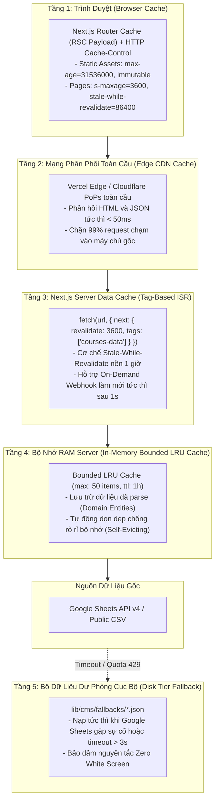

# Thiết Kế Kiến Trúc: Caching Đa Tầng & Giải Pháp Chống Rò Rỉ Bộ Nhớ (Multi-Tier Caching & Memory Leak Prevention)

- **Mục đích:** Đặc tả toàn diện chiến lược Caching 5 tầng "Đúng Chỗ — Đúng Nơi", phân định rõ ràng 7 điểm dữ liệu Real-time vs Cached, và thiết lập các quy chuẩn kỹ thuật ngăn ngừa triệt để hiện tượng rò rỉ bộ nhớ (Memory Leak) cho nền tảng **DataWithLy**.
- **Trạng thái:** Sẵn sàng triển khai (Approved for Implementation)
- **Người duyệt:** TechLead & Client Review
- **Ngày cập nhật:** 2026-11-04
- **Nguồn tham khảo:** 
  - [Thiết kế API & Swagger OpenAPI](api-design.md)
  - [Hệ thống bối cảnh C4 & Mẫu thiết kế](system-context.md)
  - [Module Nền tảng M00](../03-modules/M00-setup-and-connectivity/README.md)
  - [Module Quản lý nội dung M05](../03-modules/M05-content-management/README.md)
  - [Nguồn chân lý dữ liệu Database Schema SQL](../references/database-schema.sql)

---

## 1. Phân Tích Bài Toán: Đặc Thù Dữ Liệu DataWithLy (The Read-Heavy Reality)

### 1.1. Bối cảnh Vận hành & Giới hạn Kỹ thuật
Nền tảng đào tạo DataWithLy có đặc thù vận hành mang tính tương phản rõ nét:
1. **Lưu lượng Đọc vượt trội (95%+ Read Traffic):**
   - Hàng chục ngàn lượt xem từ các chiến dịch quảng cáo Facebook, LinkedIn, TikTok và tìm kiếm tự nhiên (SEO).
   - Độc giả chủ yếu đọc thông tin khóa học, đề cương từng buổi, bài viết blog, và hồ sơ giảng viên.
2. **Tần suất Sửa đổi cực thấp (Infrequent Writes):**
   - Nội dung trên Google Sheets chỉ thay đổi khi Founder Hứa Thảo Ly điều chỉnh học phí, cập nhật lịch học hoặc mở đợt tuyển sinh mới (khoảng 1-2 lần/tuần).
3. **Giới hạn Hạn ngạch Google Sheets API (Rate Limits & Quota):**
   - Google Sheets API v4 giới hạn khoảng **300 requests/phút/project** và **60 requests/phút/user**.
   - Độ trễ mạng của Google Sheets tương đối lớn (500ms - 1.500ms).
   - Nếu mỗi người dùng truy cập web đều kích hoạt request đọc Sheets, hạn ngạch API sẽ cạn kiệt chỉ sau vài phút chạy chiến dịch quảng cáo, dẫn tới mã lỗi HTTP 429 và làm sập website.

### 1.2. Triết lý Thiết kế Caching Cốt lõi
> **"Cache Aggressively at the Edge, Stale-While-Revalidate, Invalidate On-Demand"**  
> *(Lưu đệm tối đa tại mạng phân phối Edge CDN, phục vụ nội dung có sẵn kèm làm mới ngầm, và chỉ xóa cache tức thì khi có tín hiệu chỉnh sửa thực tế).*

---

## 2. Ma Trận Đối Soát: 7 Điểm Dữ Liệu Real-Time vs Cached Trong Dự Án

Để đảm bảo **Caching đúng chỗ — Không cache nhầm dữ liệu giao dịch và không lãng phí tài nguyên máy chủ**, toàn bộ các điểm dữ liệu trong hệ thống được phân định rõ ràng:

| STT | Điểm Dữ Liệu & Tính Năng | Bản chất Nghiệp Vụ | Cơ Chế Caching Chuẩn Xác | Tác Động Tới Server Next.js |
|:---:|---|:---:|---|---|
| **1** | **Nộp Form Tư Vấn (`POST /api/leads` - M04)** | **100% Real-time (Write Path)** | **BẮT BUỘC: NO-CACHE** (`Cache-Control: no-store, no-cache`). Dữ liệu được xác thực, rate limit và đẩy thẳng sang Google Apps Script. | Nhẹ, không lưu state trong RAM, giải phóng bộ nhớ ngay sau khi phản hồi HTTP 200. |
| **2** | **Giám Sát Kết Nối (`GET /api/health/sheets` - M00)** | **100% Real-time (Observability)** | **BẮT BUỘC: NO-CACHE** (`Cache-Control: no-store`). Mỗi lần gọi qua Swagger UI `/api-docs` hoặc Uptime Monitor, server phải live ping Sheets và đọc RAM thực tế. | Trả về JSON đo lường độ trễ mạng và heap memory tức thời. |
| **3** | **Webhook Làm Mới Cache (`POST /api/revalidate`)** | **100% Real-time (Invalidation Trigger)** | **BẮT BUỘC: NO-CACHE**. Tiếp nhận tín hiệu từ Chị Ly khi bấm *"Đồng Bộ Lên Website"*, lập tức gọi `revalidateTag()` / `revalidatePath()` để xóa Edge Cache trong < 1s. | Thực thi xóa cache tức thì, không tốn tài nguyên. |
| **4** | **Đồng Hồ Đếm Ngược Flash Sale (`top_banner_deadline` - BR-10)** | **Real-time Từng Giây (Client Hydrated)** | **CACHE TĨNH TẠI EDGE + ĐẾM NGƯỢC CLIENT**. Thời điểm kết thúc (Deadline) là cấu hình tĩnh từ Sheets. Việc đếm ngược từng giây (`Days:Hours:Mins:Secs`) chạy 100% trên trình duyệt bằng React hook `useEffect`. | **0% tải server!** Trang web vẫn là Static HTML phản hồi < 50ms, không phát sinh request mỗi giây. |
| **5** | **Tham Số Tiếp Thị (UTM Tracking) & Form Backup** | **Dynamic Theo Phiên Người Dùng** | **XỬ LÝ 100% TẠI TRÌNH DUYỆT (Client-side)**. Đọc từ `window.location.search` và lưu `sessionStorage`. | **0% tải server!** Trang HTML mẹ vẫn được cache tĩnh tại Edge, script client tự đính kèm UTM khi submit. |
| **6** | **Trạng Thái Tuyển Sinh / Suất Ưu Đãi ("Chỉ còn 5 suất")** | **Bán Thời Gian Thực (Semi-Realtime)** | **EVENT-DRIVEN ON-DEMAND CACHE**. Chị Ly sửa nhãn `badge_label` trên Sheets tab `courses` và bấm nút Đồng Bộ. Edge Cache làm mới sau 1 giây. | Không cần WebSocket hay Polling gây nặng server; phục vụ từ cache tĩnh với tốc độ < 50ms. |
| **7** | **Bộ Lọc Thể Loại Bài Viết Blog (M03)** | **Tương Tác Tức Thì (Instant UI)** | **IN-MEMORY CLIENT FILTERING**. Toàn bộ bài viết blog đã nạp sẵn trong payload trang (Server Component có Cache). Người dùng bấm tab lọc tức thì (0ms). | **0% tải server!** Chuyển tab lọc mượt mà không phát sinh request mạng. |

---

## 3. Kiến Trúc Caching 5 Tầng Chi Tiết (5-Tier Caching Architecture)



### 3.1. Tầng 1: Trình Duyệt (Browser Cache & Router Cache)
- **Tài nguyên tĩnh (Static Assets - Hình ảnh, Phông chữ, CSS, JavaScript Bundle):**
  - Header: `Cache-Control: public, max-age=31536000, immutable`.
  - Trình duyệt lưu trữ vĩnh viễn trong 1 năm và không bao giờ gửi lại request kiểm tra, giảm tải băng thông 100%.
- **Trang HTML & RSC Payloads (Router Cache):**
  - Header: `Cache-Control: public, s-maxage=3600, stale-while-revalidate=86400`.
  - Khi người dùng bấm chuyển qua lại giữa các menu (*Khóa học ➔ Về Mentor ➔ Góc chia sẻ*), Next.js Router Cache giữ lại cây giao diện trong RAM trình duyệt, giúp chuyển trang tức thì < 10ms.

### 3.2. Tầng 2: Mạng Phân Phối Toàn Cầu (Edge CDN Cache)
- Toàn bộ trang Trang chủ (`/`), Chi tiết khóa học (`/courses/[slug]`), và Blog (`/blog`) được biên dịch tĩnh (SSG/ISR) và lưu trữ tại các trạm Edge CDN của Vercel/Cloudflare.
- Người dùng truy cập từ Hà Nội, TP.HCM, Đà Nẵng hay nước ngoài đều nhận được phản hồi HTML trong vòng **dưới 50ms (TTFB < 50ms)**.
- Khi có đột biến lưu lượng (Traffic Spike từ chiến dịch quảng cáo 10.000 clicks/giờ), máy chủ gốc và Google Sheets hoàn toàn không bị ảnh hưởng vì 99% request được Edge CDN đáp ứng trực tiếp.

### 3.3. Tầng 3: Next.js Server Data Cache & Hệ Thống Cache Tags
Sử dụng cơ chế Fetch Cache gắn nhãn (Tag-based Invalidation) của Next.js:

```typescript
// lib/cms/content-fetcher.ts
export async function getCourses(): Promise<CourseEntity[]> {
  const res = await fetch(GOOGLE_SHEETS_CSV_URL, {
    next: {
      revalidate: 3600, // Tự động làm mới nền sau mỗi 1 giờ (Stale-While-Revalidate)
      tags: ['courses-data'] // Gắn nhãn để xóa cache chọn lọc
    }
  });
  return parseCoursesCsv(await res.text());
}
```

#### Bảng danh mục Cache Tags toàn hệ thống:
| Cache Tag | Phạm vi dữ liệu bao bọc | Khi nào cần làm mới? |
|---|---|---|
| `courses-data` | Tab `courses`, `curriculum`, `packages_pricing` | Khi Chị Ly thêm/sửa khóa học hoặc đề cương |
| `blog-data` | Tab `blog_posts` | Khi Chị Ly đăng hoặc sửa bài viết blog |
| `site-config` | Tab `site_settings`, `mentor_profile`, `testimonials`, `faq` | Khi thay đổi hotline, banner flash sale, feedback |
| `all-content` | Toàn bộ 9 tab | Khi thực hiện tổng đồng bộ lại toàn trang |

### 3.4. Tầng 4: In-Memory Bounded LRU Cache (Application Tier)
Trong cùng một tiến trình Serverless/Node.js, để tránh việc parse lại chuỗi CSV thô thành JavaScript Object nhiều lần cho các request liên tiếp:
- Sử dụng cấu trúc **Bounded LRU Cache (Least Recently Used)**:
  - Giới hạn cứng: `max: 50 items` (chỉ lưu tối đa 50 tập dữ liệu đã parse).
  - Thời gian sống: `ttl: 3600000` (1 giờ).
  - Tự động loại bỏ (Evict) các phần tử cũ nhất khi chạm trần, ngăn chặn phình to RAM.

### 3.5. Tầng 5: Static Fallback Snapshot (Disk Tier)
Lớp phòng thủ an toàn tuyệt đối đặt tại thư mục `lib/cms/fallbacks/` (`homepage.json`, `courses.json`, `blog.json`):
- Nếu Google Sheets bị gián đoạn mạng, lỗi 5xx hoặc hết quota API (> 3.000ms timeout), hệ thống tự động đọc dữ liệu snapshot cục bộ từ đĩa.
- Website đảm bảo **Zero White Screen**: Người dùng vẫn xem được khóa học và nộp form bình thường.

---

## 4. Chiến Lược Chống & Giải Quyết Triệt Để Rò Rỉ Bộ Nhớ (Memory Leak Prevention)

Rò rỉ bộ nhớ (Memory Leak) trong Node.js xảy ra khi các đối tượng trong heap không còn được ứng dụng sử dụng nhưng Garbage Collector (GC) không thể thu hồi vì vẫn còn tham chiếu tồn tại. Dưới đây là 4 giải pháp kỹ thuật triệt để:

### 4.1. Giải pháp 1: Kiểm soát Bộ Giới Hạn Tần Suất (Bounded Self-Evicting Rate Limiter)
- **Nguy cơ tiềm ẩn:** Một hàm Rate Limiter lưu IP vào `Map<string, number>` toàn cục. Khi có hàng trăm ngàn lượt quét bot mỗi ngày, biến `Map` này sẽ tăng kích thước liên tục, gây tràn bộ nhớ RAM (OOM Crash).
- **Quy chuẩn bắt buộc:**
  ```typescript
  // lib/security/rate-limiter.ts
  import { LRUCache } from 'lru-cache';

  // BẮT BUỘC: Giới hạn cứng số lượng phần tử và TTL tự dọn dẹp
  export const rateLimitCache = new LRUCache<string, { count: number; resetTime: number }>({
    max: 3000,           // Tối đa 3.000 IP gần nhất trong RAM
    ttl: 10 * 60 * 1000, // Tự động xóa sạch IP quá 10 phút (Self-Evicting)
    allowStale: false,
    updateAgeOnGet: false
  });
  ```
  *Bộ nhớ RAM cho Rate Limiter luôn được kiểm soát chặt chẽ dưới 5MB.*

### 4.2. Giải pháp 2: Quản lý Vòng đời Chuỗi Dữ liệu Lớn & Giải phóng Closures
- **Nguy cơ:** Khi fetch dữ liệu CSV từ 9 tab của Google Sheets, chuỗi văn bản thô có thể chiếm dung lượng lớn nếu bị lưu giữ trong closure của hàm hoặc biến phạm vi toàn cục.
- **Quy chuẩn bắt buộc:**
  - Chuyển đổi (Parse) chuỗi thô thành các Object Domain Entities gọn nhẹ ngay lập tức.
  - Không gán chuỗi thô vào biến toàn cục (`global` / `globalThis`).
  - Để biến thô ra khỏi phạm vi hàm (Scope Out) sau khi parse để Garbage Collector thu hồi RAM ngay lập tức.

### 4.3. Giải pháp 3: Dọn dẹp Tuyệt đối Event Listeners & Timers trên Client Components
- **Nguy cơ:** Các Client Component như `TopBannerCountdown`, `ReadingProgressBar`, `HeaderSticky` đăng ký lắng nghe sự kiện (`window.addEventListener('scroll')`, `setInterval`) nhưng quên gỡ bỏ khi component unmount.
- **Quy chuẩn bắt buộc:** Mọi hook `useEffect` có timer hoặc listener bắt buộc phải có cleanup function:
  ```typescript
  // components/common/TopBannerCountdown.tsx
  useEffect(() => {
    const timer = setInterval(() => {
      calculateTimeRemaining();
    }, 1000);

    // BẮT BUỘC: Dọn dẹp timer khi component bị hủy
    return () => clearInterval(timer);
  }, [deadline]);
  ```

### 4.4. Giải pháp 4: Giám sát Sức khỏe RAM Thời Gian Thực (Memory Health SLA)
Tích hợp trực tiếp vào endpoint `GET /api/health/sheets` (Module M00):
```typescript
// app/api/health/sheets/route.ts
const memoryUsage = process.memoryUsage();
const heapUsedMB = Math.round((memoryUsage.heapUsed / 1024 / 1024) * 100) / 100;
const heapTotalMB = Math.round((memoryUsage.heapTotal / 1024 / 1024) * 100) / 100;
const rssMB = Math.round((memoryUsage.rss / 1024 / 1024) * 100) / 100;

const isMemoryDegraded = heapUsedMB > 250; // Ngưỡng cảnh báo an toàn 250MB
```

#### Phân cấp Ngưỡng Cảnh báo Bộ nhớ (Memory SLA Thresholds):
- **Khỏe mạnh (Healthy):** `heapUsed < 120MB`.
- **Cảnh báo (Degraded):** `120MB - 250MB` (Hệ thống vẫn phục vụ bình thường nhưng ghi log cảnh báo).
- **Nguy hiểm (Critical):** `> 250MB` (Kích hoạt cảnh báo tới đội ngũ kỹ thuật để kiểm tra rò rỉ RAM trước khi chạm trần 1024MB của Serverless).

---

## 5. Bảng Quy Tắc Lập Trình Cho Coding Agent ("6 Nên & 6 Cấm")

Để bảo đảm mã nguồn toàn dự án luôn sạch sẽ, hiệu năng cao và không rò rỉ RAM:

| STT | ✅ NÊN LÀM (Best Practices) | ❌ CẤM KỴ (Anti-Patterns) |
|:---:|---|---|
| **1** | Luôn dùng **Bounded LRU Cache** có `max` và `ttl` khi cần lưu trữ tạm thời trong RAM. | CẤM lưu dữ liệu động vào `Map`, `Set`, hoặc `Object` toàn cục không có giới hạn dung lượng. |
| **2** | Luôn gắn nhãn `tags: ['tag-name']` khi gọi hàm `fetch` đọc dữ liệu Google Sheets. | CẤM gọi `fetch` không có cấu hình cache (`cache: 'no-store'`) cho các trang nội dung tĩnh. |
| **3** | Luôn có hàm cleanup (`return () => clearInterval(...)`) trong mọi hook `useEffect`. | CẤM đăng ký `window.addEventListener` hoặc `setInterval` mà không gỡ bỏ khi unmount. |
| **4** | Luôn giải phóng chuỗi dữ liệu thô (Raw CSV/JSON) ngay sau khi chuyển đổi thành Domain Entities. | CẤM lưu giữ chuỗi dữ liệu thô trong biến toàn cục hoặc đóng gói trong closures hàm kéo dài. |
| **5** | Đặt `Cache-Control: no-store` cho 2 API: `/api/leads` và `/api/health/sheets`. | CẤM cache các API nhận Lead hoặc API kiểm tra sức khỏe hệ thống. |
| **6** | Xử lý đếm ngược Flash sale và tham số UTM **100% tại Client Component**. | CẤM render lại trang HTML trên Server mỗi giây chỉ để cập nhật đồng hồ đếm ngược. |

---

[Quay về Kiến trúc Tổng thể](system-context.md) | [Đến Thiết kế API](api-design.md)

