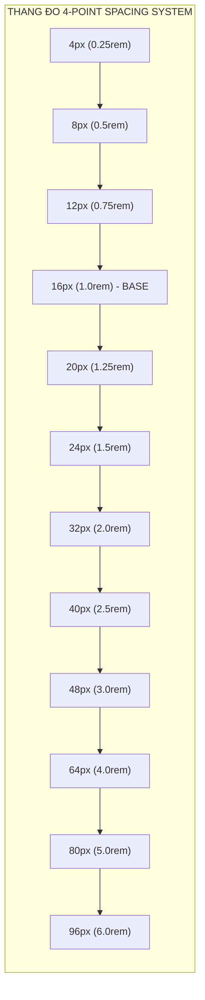
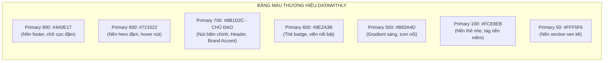

# Quy tắc thiết kế giao diện & Hệ thống 4-point Spacing (Design System Rules)

- **Mục đích:** Thiết lập bộ quy chuẩn thiết kế giao diện (Design System Tokens), chuẩn hóa **Hệ thống khoảng cách 4-point Spacing System**, bảng màu nhận diện thương hiệu **DataWithLy** (tone Đỏ Mận / Crimson) và các quy tắc cấu hình Tailwind CSS để Agent Code áp dụng chính xác 100%.
- **Trạng thái:** Approved — đã thống nhất theo yêu cầu của Chủ dự án ngày 2026-11-03.
- **Người duyệt:** Chủ dự án & TechLead.
- **Ngày cập nhật:** 2026-11-03.
- **Nguồn tham khảo:** 
  - Slide bài giảng chính thức: `[LYDATA] Data Analytics Courses.pptx.pdf`;
  - Yêu cầu thiết kế trong `Website LY DATA - content to fill.xlsx` (chuyển sang màu đỏ);
  - Figma Design Tokens kết nối qua Figma MCP (`https://mcp.figma.com/mcp`).

---

## 1. Hệ thống khoảng cách 4-point Spacing System (4px Grid)

Toàn bộ bố cục trang web, khoảng cách lề (margin), đệm trong (padding), khoảng cách giữa các phần tử (gap), chiều cao thành phần (height) và bán kính bo góc (border radius) đều **bắt buộc tuân thủ theo thang bội số của 4px**.



### 1.1. Bảng quy đổi Tokens khoảng cách & Mục đích sử dụng

| Token Name | Kích thước (px) | Giá trị Rem (Base 16px) | Class Tailwind CSS | Trường hợp áp dụng chuẩn |
|:---|:---:|:---:|:---|:---|
| `space-0.5` | **2px** | `0.125rem` | `p-0.5`, `gap-0.5` | Viền cực nhỏ, khoảng cách icon phụ, vi lề nút bấm |
| `space-1` | **4px** | `0.25rem` | `p-1`, `m-1`, `gap-1` | Đệm badge tag, khoảng cách icon và text ngắn |
| `space-2` | **8px** | `0.5rem` | `p-2`, `m-2`, `gap-2` | Khoảng cách các phần tử con trong list, padding ô input nhỏ |
| `space-3` | **12px** | `0.75rem` | `p-3`, `m-3`, `gap-3` | Đệm trong của nút bấm vừa, khoảng cách heading và subheading |
| `space-4` | **16px** | `1.0rem` | `p-4`, `m-4`, `gap-4` | **Base Spacing:** Đệm thẻ card nhỏ, padding modal form, gap lưới |
| `space-5` | **20px** | `1.25rem` | `p-5`, `m-5`, `gap-5` | Đệm thẻ card tiêu chuẩn (CourseCard, TestimonialCard) |
| `space-6` | **24px** | `1.5rem` | `p-6`, `m-6`, `gap-6` | Khoảng cách giữa các cột lớn, padding thẻ tính năng USP |
| `space-8` | **32px** | `2.0rem` | `p-8`, `m-8`, `gap-8` | Khoảng cách giữa các nhóm nội dung trong một section |
| `space-10` | **40px** | `2.5rem` | `py-10`, `my-10` | Đệm dọc section nhỏ trên mobile, khoảng cách tiêu đề lớn |
| `space-12` | **48px** | `3.0rem` | `py-12`, `my-12` | Đệm dọc section tiêu chuẩn trên tablet |
| `space-16` | **64px** | `4.0rem` | `py-16`, `my-16` | Đệm dọc (Section Padding) tiêu chuẩn trên Desktop |
| `space-20` | **80px** | `5.0rem` | `py-20`, `my-20` | Đệm dọc các section nổi bật (Hero Section, CTA Banner) |
| `space-24` | **96px** | `6.0rem` | `py-24`, `my-24` | Khoảng cách giữa các đại phân khu trên màn hình lớn (1440px+) |

---

## 2. Bảng màu nhận diện thương hiệu DataWithLy (Brand Color Palette)

Được chuyển đổi từ màu xanh tím cũ sang **Màu Đỏ Mận (Crimson / Wine Red)** đồng bộ chuẩn xác với slide thuyết trình và nhận diện giảng viên:



### 2.1. Mã màu Hex & Khai báo Tokens

```typescript
// tailwind.config.ts brand colors
export const brandColors = {
  primary: {
    50: '#FFF5F6',   // Nền section sáng, hover nhẹ
    100: '#FCE8EB',  // Nền badge, tag khóa học
    200: '#F9D1D7',  // Viền thẻ phụ
    300: '#F2A3AE',  // Đường kẻ phân cách mềm
    400: '#E3697A',  // Màu icon phụ
    500: '#B83A4D',  // Đỏ sáng chuyển tiếp
    600: '#9E2A3B',  // Đỏ mận tươi
    700: '#8B1D2C',  // PRIMARY BRAND COLOR (Đỏ Mận thương hiệu DataWithLy)
    800: '#721522',  // Hover trạng thái nút chính
    900: '#4A0E17',  // Header chữ đậm, Footer background
  },
  neutral: {
    50: '#F8FAFC',   // Nền toàn trang (Slate Light)
    100: '#F1F5F9',  // Nền card phụ
    200: '#E2E8F0',  // Viền ô input, border card
    300: '#CBD5E1',  // Placeholder text
    500: '#64748B',  // Text mô tả phụ, metadata ngày tháng
    700: '#334155',  // Text nội dung bài viết
    900: '#0F172A',  // Headline H1, H2 (Đen than sang trọng)
  },
  accent: {
    gold: '#D97706', // Huy hiệu "Bán chạy nhất", rating 5 sao
    emerald: '#059669', // Icon tick xanh tính năng được học
    rose: '#E11D48',    // Nhãn giảm giá Flash Sale
  }
};
```

---

## 3. Quy tắc Typography theo 4px Baseline

Mọi kích thước font chữ (font-size) đều đi kèm chiều cao dòng (line-height) là bội số của **4px** để đảm bảo nhịp điệu thị giác (Vertical Rhythm) hoàn hảo:

| Cấp bậc | Font Size | Line Height | Tailwind Class | Sử dụng cho |
|:---|:---:|:---:|:---|:---|
| **Display H1** | `48px` (3.0rem) | `56px` (3.5rem - chia hết cho 4) | `text-4xl lg:text-5xl leading-tight` | Tiêu đề chính Hero Section Trang chủ |
| **Heading H2** | `36px` (2.25rem) | `44px` (2.75rem - chia hết cho 4) | `text-3xl lg:text-4xl leading-snug` | Tiêu đề các Section lớn (Khóa học, USP, Review) |
| **Heading H3** | `24px` (1.5rem) | `32px` (2.0rem - chia hết cho 4) | `text-2xl leading-normal` | Tiêu đề thẻ khóa học, tiêu đề buổi học Accordion |
| **Heading H4** | `20px` (1.25rem) | `28px` (1.75rem - chia hết cho 4) | `text-xl leading-normal` | Tiêu đề bài viết Blog, tên học viên Review |
| **Body Large** | `18px` (1.125rem)| `28px` (1.75rem - chia hết cho 4) | `text-lg leading-relaxed` | Lời dẫn Sub-headline, đoạn trích dẫn nổi bật |
| **Body Base** | `16px` (1.0rem) | `24px` (1.5rem - chia hết cho 4) | `text-base leading-normal` | Nội dung văn bản chính, ô nhập liệu form |
| **Body Small** | `14px` (0.875rem)| `20px` (1.25rem - chia hết cho 4) | `text-sm leading-normal` | Ghi chú phụ, nhãn badge, ngày tháng, footer |
| **Caption** | `12px` (0.75rem) | `16px` (1.0rem - chia hết cho 4) | `text-xs leading-tight` | Thẻ tag nhỏ, nhãn đếm ngược Flash sale |

---

## 4. Bán kính bo góc (Border Radius) theo 4px Grid

- `rounded-none`: `0px`
- `rounded-sm`: `4px` (`rounded-sm`) — Dùng cho badge nhỏ, tag kỹ năng.
- `rounded-md`: `8px` (`rounded-md`) — Dùng cho ô nhập liệu form (`input`, `textarea`).
- `rounded-lg`: `12px` (`rounded-lg`) — Dùng cho nút bấm CTA (`button`), thanh Top Banner.
- `rounded-xl`: `16px` (`rounded-xl`) — Dùng cho thẻ Card khóa học, Accordion item, Testimonial card.
- `rounded-2xl`: `24px` (`rounded-2xl`) — Dùng cho Modal Popup, Hero container lớn.
- `rounded-full`: `9999px` — Dùng cho nút tròn, avatar học viên.

---

## 5. Quy tắc mẫu áp dụng cho Component Button CTA

```tsx
// Ví dụ chuẩn hóa Button theo 4-point spacing và Brand Color
export function PrimaryButton({ children, onClick }: { children: React.ReactNode; onClick?: () => void }) {
  return (
    <button
      onClick={onClick}
      className="
        inline-flex items-center justify-center
        h-12 px-6 gap-2 rounded-lg
        bg-primary-700 hover:bg-primary-800 active:bg-primary-900
        text-white font-semibold text-base
        shadow-sm hover:shadow-md
        transition-all duration-200
        focus:outline-none focus:ring-2 focus:ring-primary-500 focus:ring-offset-2
      "
    >
      {children}
    </button>
  );
}
```

---

[Điểm bắt đầu của bộ docs](../README.md)

