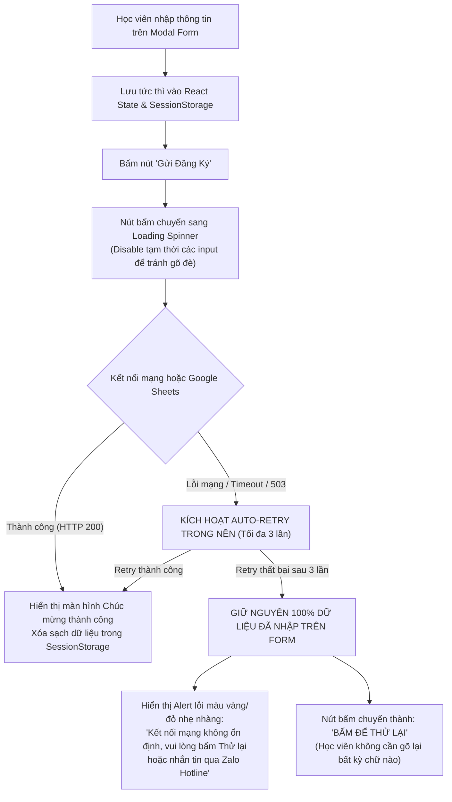
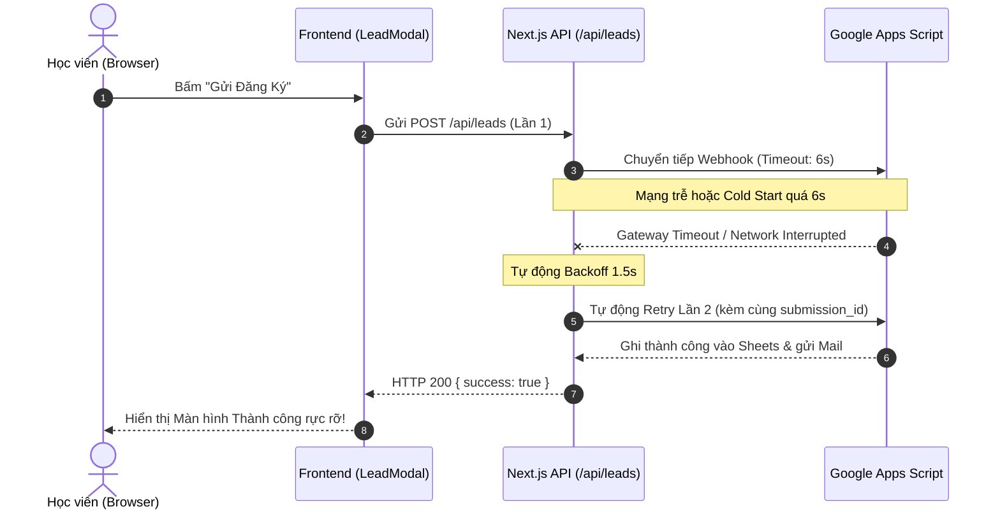
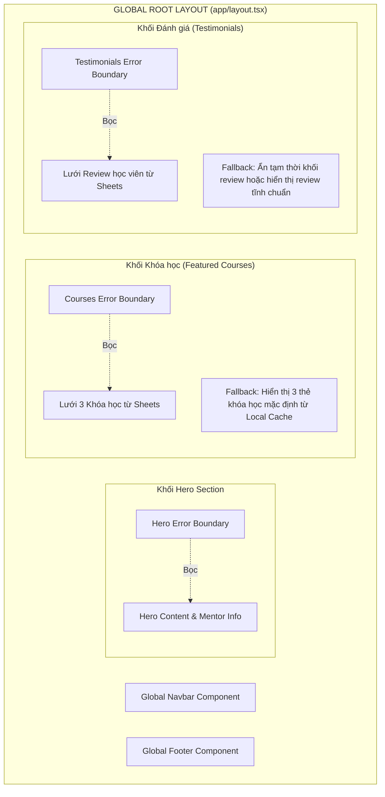

# Bảo toàn Lead, Xử lý lỗi & Giám sát hệ thống (Lead Protection & Error Handling)

- **Mục đích:** Đặc tả cơ chế bảo toàn dữ liệu form người dùng, thuật toán tự động thử lại (Auto-retry), cơ chế cô lập lỗi giao diện (Error Boundaries), trang 404 thân thiện và hệ thống quan sát lỗi (Observability) theo đúng cam kết trong [Additional Requirements](../references/additional-requirements.md) và [Q&A dự án](../references/project-qa.md).
- **Trạng thái:** Approved — đã thống nhất theo kế hoạch kiến trúc ngày 2026-11-03.
- **Người duyệt:** Chủ dự án & TechLead.
- **Ngày cập nhật:** 2026-11-03.
- **Nguồn tham khảo:** 
  - [Additional Requirements](../references/additional-requirements.md);
  - [Q&A dự án](../references/project-qa.md);
  - [Customer Requirements Notes](../08-project/customer-requirements-notes.md);
  - Next.js Error Handling Documentation (`node_modules/next/dist/docs/01-app/01-getting-started/10-error-handling.md`).

---

## 1. Cơ chế bảo toàn dữ liệu Form (Form State Preservation)

Một trong những trải nghiệm gây khó chịu nhất cho học viên khi đăng ký khóa học là điền xong form, bấm gửi nhưng gặp mạng chậm hoặc lỗi kết nối, toàn bộ nội dung đã gõ bị xóa trắng (reset form) và bắt người dùng phải nhập lại từ đầu.

DataWithLy giải quyết triệt để vấn đề này bằng **Cơ chế giữ Form đa tầng (Multi-tier Form State Retention)**:

### Quy tắc bảo toàn dữ liệu:
1. **Lưu trữ tạm thời trong phiên (Session Retention):** Toàn bộ dữ liệu người dùng đang nhập được lưu trong `React State` và đồng bộ vào `sessionStorage` của trình duyệt. Dữ liệu này chỉ bị xóa khi học viên hoàn tất nộp form thành công hoặc chủ động đóng tab trình duyệt.
2. **Không tự ý Reset Form khi có lỗi:** Bất kể mã lỗi là `400`, `429`, `500`, hay lỗi mất mạng cục bộ (`Network Error / Offline`), các trường Họ tên, Số điện thoại, Email, Khóa học quan tâm và Ghi chú **luôn được giữ nguyên vẹn**.
3. **Trải nghiệm Thử lại 1-Click (1-Click Retry):** Học viên chỉ cần chạm vào nút *"Thử lại"* để hệ thống thực hiện nộp lại form với cùng mã `submission_id` mà không mất thêm thời gian gõ lại.

---

## 2. Thuật toán tự động thử lại trong nền (Auto-retry with Exponential Backoff)

Khi học viên bấm nộp form, nếu máy chủ Next.js hoặc Google Apps Script Webhook bị chậm (thường xảy ra do hiện tượng Cold Start của serverless hoặc Google Sheets phản hồi trễ > 5 giây):

### Thông số kỹ thuật của thuật toán Retry:
- **Số lần thử lại tối đa (Max Retries):** `3 lần`.
- **Khoảng thời gian chờ (Exponential Backoff Delay):**
  - Lần 1 thất bại -> Chờ `1.000 ms` -> Thử lại lần 2.
  - Lần 2 thất bại -> Chờ `2.500 ms` -> Thử lại lần 3.
  - Lần 3 thất bại -> Báo lỗi thân thiện cho học viên và giữ lại form.
- **Đảm bảo tính Idempotency:** Mọi lần retry đều mang cùng mã `submission_id`. Khi Google Apps Script nhận được request retry, cơ chế kiểm tra trùng lặp sẽ đảm bảo **tuyệt đối không bao giờ ghi đúp 2 dòng giống nhau** vào Google Sheets.

---

## 3. Cơ chế cô lập lỗi (Error Boundaries & Graceful Fallbacks)

Để hiện thực hóa tiêu chuẩn trong [Additional Requirements](../references/additional-requirements.md): *"Nếu một thành phần nhỏ bị lỗi (ví dụ một ảnh bị mất link hoặc tab Google Sheets bị lỗi định dạng), hệ thống tự động dùng dữ liệu dự phòng mà tuyệt đối không làm sập toàn bộ trang web (Zero White Screen)"*.

Hệ thống Next.js áp dụng **Cấu trúc bọc Error Boundary theo khối (Modular Component Isolation)**:

### Các nguyên tắc xử lý Fallback:
1. **Lỗi hình ảnh (Broken Image Fallback):** Tất cả các thẻ hình ảnh đại diện (Next.js `<Image>`) đều được bọc trong Component `SafeImage`. Nếu link CDN bị lỗi hoặc không tải được ảnh, component tự động thay thế bằng ảnh placeholder mặc định mang nhận diện thương hiệu DataWithLy mà không để lại biểu tượng icon ảnh lỗi (dấu X đỏ).
2. **Lỗi nạp dữ liệu Google Sheets CMS:** Nếu Google Sheets API bị lỗi kết nối hoặc dữ liệu một dòng bị sai định dạng Zod Schema, hệ thống ghi log cảnh báo ngầm và tự động nạp bản sao tĩnh hợp lệ gần nhất được lưu đệm trong cache cục bộ (`data/homepage/...`).
3. **Cô lập sự cố:** Một lỗi phát sinh tại khối Testimonial tuyệt đối không làm ảnh hưởng đến khả năng xem khóa học hay nộp form đăng ký tư vấn của học viên.

---

## 4. Xử lý Trang 404 tùy biến thương hiệu (Custom Branded 404 Page)

Khi học viên gõ sai đường dẫn URL hoặc truy cập vào một bài viết/khóa học cũ không còn tồn tại:
- **Trạng thái HTTP chuẩn:** Trả về đúng mã trạng thái HTTP `404 Not Found` (ngăn chặn tình trạng Soft 404 gây hại cho SEO Google).
- **Thiết kế đồng bộ thương hiệu:** Trang 404 được thiết kế theo đúng nhận diện màu Đỏ Mận của DataWithLy với hình ảnh minh họa sinh động, thông điệp nhẹ nhàng: *"Trang bạn đang tìm kiếm không tồn tại hoặc đã được cập nhật lộ trình mới"*.
- **Giữ chân học viên:** Cung cấp 2 nút điều hướng nổi bật:
  + Nút chính: `[Quay về Trang chủ]`
  + Nút phụ: `[Khám phá các khóa học DataWithLy]`

---

## 5. Phân cấp Observability & Nơi đọc lỗi (Logging & Diagnostics)

Để đội ngũ kỹ thuật dễ dàng phát hiện, phân loại và xử lý sự cố trong quá trình vận hành:

| Tầng phát sinh lỗi | Hiện tượng đối với Học viên | Nơi Developer đọc lỗi & Khắc phục | Mã lỗi chuẩn hóa |
|---|---|---|:---:|
| **Lỗi nhập liệu Form** (Số điện thoại sai, thiếu trường) | Hiển thị dòng chữ đỏ báo lỗi ngay dưới ô nhập liệu tương ứng | Mở DevTools Console / Tab Network kiểm tra request payload | `VALIDATION_ERROR` |
| **Lỗi tần suất gửi** (Gửi > 3 lần/phút) | Báo thông báo: *"Bạn đang gửi quá nhanh, vui lòng chờ 1 phút"* | Log server Next.js với Client IP và mã giới hạn | `RATE_LIMITED` |
| **Lỗi kết nối Sheets Webhook** (Apps Script timeout) | Giữ nguyên form, hiển thị nút *"Bấm để thử lại"* | - Local: Terminal chạy `next dev` - Production: Vercel Runtime Logs - Google Apps Script: Tab `Executions` | `SHEETS_UNAVAILABLE` |
| **Lỗi gửi Email thông báo** | Học viên vẫn thấy màn hình nộp form thành công bình thường | Tab `Executions` trong Google Apps Script Editor; log chi tiết lỗi MailApp | `EMAIL_DISPATCH_FAILED` |
| **Lỗi Render Component UI** | Component hiển thị giao diện fallback nhẹ nhàng | Browser Console (phía Client); Next.js Server Console (phía Server) | `RENDER_FALLBACK_TRIGGERED` |

> [!NOTE]
> **Nguyên tắc Log an toàn:**
> Mỗi lượt gửi form đều được gắn một mã `request_id` duy nhất. Trong các bản ghi log hệ thống chỉ ghi nhận: `timestamp`, `request_id`, `submission_id`, `status_code`, `duration_ms` và `error_code`. Tuyệt đối không in số điện thoại hoặc email học viên vào các file log công khai.

---

[Điểm bắt đầu của bộ docs](../README.md)
