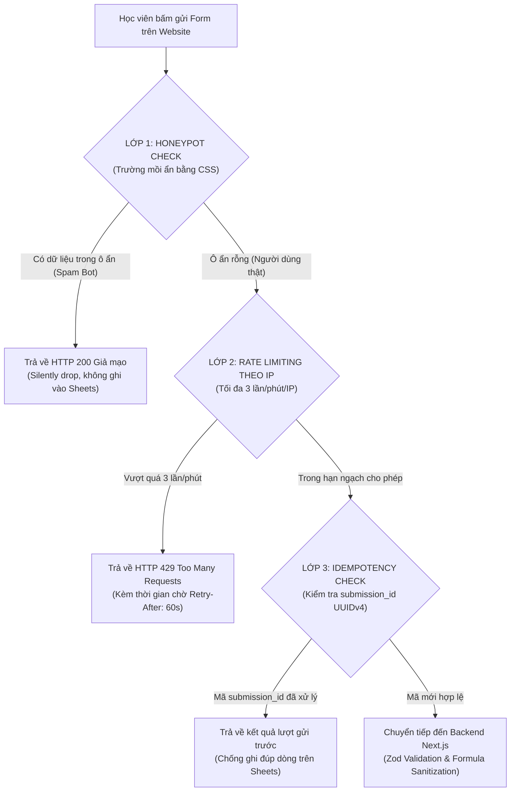
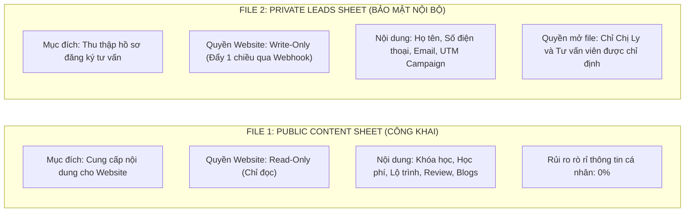

# Thiết kế bảo mật — DataWithLy (Security Design)

- **Mục đích:** Đặc tả toàn diện kiến trúc an ninh thông tin, các lớp phòng vệ chống spam, cơ chế bảo vệ dữ liệu học viên (PII), chống tấn công Formula Injection và phân quyền truy cập Google Sheets theo đúng yêu cầu tại [Additional Requirements](../references/additional-requirements.md) và [Q&A dự án](../references/project-qa.md).
- **Trạng thái:** Approved — đã thống nhất theo kế hoạch kiến trúc ngày 2026-11-03.
- **Người duyệt:** Chủ dự án & TechLead.
- **Ngày cập nhật:** 2026-11-03.
- **Nguồn tham khảo:** 
  - [Additional Requirements](../references/additional-requirements.md);
  - [Q&A dự án](../references/project-qa.md);
  - [Báo cáo giải pháp](../references/solution-and-scope-report.md);
  - Nghị định 13/2023/NĐ-CP về Bảo vệ dữ liệu cá nhân;
  - Mã nguồn: `lib/google-sheets/sanitizer.ts`, `lib/modules/leads/validator.ts`, `app/api/leads/route.ts`.

---

## 1. Mô hình bảo vệ 3 lớp chống Spam & Lạm dụng (Anti-Spam Defense-in-Depth)

Hệ thống biểu mẫu đăng ký tư vấn được trang bị 3 lớp phòng vệ chuyên nghiệp để ngăn chặn tự động hóa độc hại mà vẫn đảm bảo trải nghiệm người dùng thật mượt mà, không gây phiền phức bởi các câu đố CAPTCHA phức tạp:

### Chi tiết 3 lớp bảo vệ:

1. **Lớp 1 — Honeypot Anti-Bot:**
   - **Cơ chế:** Đặt một ô nhập liệu ẩn mang tên kỹ thuật hấp dẫn đối với crawler/bot tự động (ví dụ: `website_url_check` hoặc `honeypot`). Trường này bị ẩn hoàn toàn khỏi mắt người dùng thật bằng CSS (`display: none !important; opacity: 0; position: absolute; pointer-events: none; tabIndex: -1`).
   - **Phản ứng:** Người dùng bình thường sẽ không bao giờ điền vào ô này. Nếu bot tự động quét mã HTML và điền bất kỳ ký tự nào vào ô này, hệ thống Next.js API lập tức phát hiện bot.
   - **Chiến thuật "Silent Drop":** Trả về HTTP 200 `{ success: true }` giả mạo để bot tưởng đã gửi thành công và rút lui, nhưng máy chủ tuyệt đối **không ghi dữ liệu vào Google Sheets** và không kích hoạt email.

2. **Lớp 2 — Rate Limiting theo IP:**
   - **Cơ chế:** Giới hạn mỗi địa chỉ IP chỉ được gửi tối đa **3 lần trong vòng 60 giây**.
   - **Nhận diện IP an toàn:** Lấy địa chỉ IP từ header `x-forwarded-for` (phần tử IP đầu tiên do Vercel Edge Proxy kiểm chứng) hoặc `x-real-ip`.
   - **Phản ứng khi vi phạm:** Trả về mã lỗi HTTP `429 Too Many Requests` kèm thông điệp thân thiện: *"Bạn đã gửi thông tin quá nhanh, vui lòng chờ 1 phút hoặc liên hệ Hotline/Zalo để được hỗ trợ"*.

3. **Lớp 3 — Chống gửi trùng lặp (Deduplication / Idempotency Token):**
   - **Cơ chế:** Mỗi khi Modal đăng ký được mở ra trên trình duyệt, ứng dụng tự động sinh một mã định danh duy nhất chuẩn UUIDv4: `submission_id = "sub_xxxxxxxx-xxxx-4xxx-yxxx-xxxxxxxxxxxx"`.
   - **Ngăn chặn Double-click:** Nếu học viên lỡ tay bấm liên tiếp 2 - 3 lần vào nút *"Gửi đăng ký"* khi đường truyền mạng chậm, toàn bộ các request này đều mang chung một `submission_id`.
   - **Xử lý tại Backend & Apps Script:** Apps Script kiểm tra trong bộ nhớ đệm hoặc đối chiếu dòng gần nhất; nếu `submission_id` đã tồn tại, hệ thống lập tức bỏ qua thao tác chèn dòng mới, chỉ ghi nhận duy nhất 1 dòng trên Google Sheets.

---

## 2. Nguyên tắc bảo mật 2 tệp dữ liệu độc lập (Two-File Data Isolation)

Để tuân thủ Nghị định 13/2023/NĐ-CP về bảo vệ dữ liệu cá nhân và phòng tránh hoàn toàn nguy cơ rò rỉ danh sách học viên:

### Các quy tắc cốt lõi:
- **Nguyên tắc "No Read Access":** Ứng dụng website tuyệt đối **không có quyền đọc** đối với file `Private Leads Sheet`. Trong mã nguồn Frontend hay Next.js Backend hoàn toàn không tồn tại bất kỳ API nào cho phép query danh sách học viên ra ngoài.
- **Kênh đẩy dữ liệu một chiều (One-Way Push via Webhook):** Dữ liệu được mã hóa bằng HTTPS POST đẩy sang Google Apps Script. 
- **Xác thực Webhook bằng Shared Secret:** Header request bắt buộc phải có `X-Webhook-Secret: Bearer <GOOGLE_APPS_SCRIPT_SECRET>`. Nếu thiếu hoặc sai token bí mật, Apps Script từ chối xử lý và trả về HTTP 401.

---

## 3. Chống tấn công Formula Injection / CSV Injection

Khi dữ liệu từ biểu mẫu người dùng được ghi vào Google Sheets, nếu học viên (hoặc kẻ tấn công) nhập vào các ký tự đặc biệt ở đầu ô, Google Sheets có thể tự động hiểu đó là công thức tính toán hoặc hàm thực thi mã độc (ví dụ: `=IMPORTXML()`, `=HYPERLINK()`, `@SUM()`).

### Quy tắc khử trùng dữ liệu (Sanitization Rule):
Trước khi gửi dữ liệu sang Google Apps Script, tầng `lib/google-sheets/sanitizer.ts` duyệt qua toàn bộ các trường chuỗi và thực hiện khử trùng:
- **Ký tự nguy hiểm:** Bất kỳ giá trị nào bắt đầu bằng một trong các ký tự: `=`, `+`, `-`, `@`, `\t`, `\r`.
- **Biện pháp xử lý:** Tự động chèn thêm dấu nháy đơn `'` ở đầu chuỗi (ví dụ: `=SUM(A1)` chuyển thành `'=SUM(A1)`). Dấu nháy đơn này báo hiệu cho Google Sheets rằng đây là chuỗi ký tự thuần túy (Plain Text), vô hiệu hóa hoàn toàn việc thực thi công thức, bảo vệ an toàn cho bảng tính của khách hàng.

---

## 4. Bảo vệ thông tin định danh cá nhân (PII Protection)

Tuân thủ nghiêm ngặt nguyên tắc bảo mật thông tin học viên:
1. **Không đưa PII vào Analytics:** Tuyệt đối không gửi số điện thoại, địa chỉ email, hoặc họ tên học viên vào các sự kiện Google Analytics 4 (GA4) hay Meta Pixel. Chỉ bắn các thông số phi định danh như `course_id`, `package_id`, `value`.
2. **Không đưa PII vào URL:** Khi chuyển hướng sau khi nộp form thành công, hệ thống không đính kèm thông tin cá nhân lên thanh địa chỉ trình duyệt (`query params`), tránh việc thông tin bị lưu trong lịch sử duyệt web hoặc rò rỉ qua header `Referer`.
3. **Không ghi log thông tin cá nhân ra Console:** Trong môi trường production, các lệnh `console.log` chỉ ghi nhận mã `request_id`, mã `submission_id` và mã trạng thái; không in nội dung nhạy cảm của học viên ra nhật ký console.

---

## 5. Thẩm định dữ liệu chặt chẽ 2 tầng (Two-Tier Validation)

- **Tầng 1 (Client-side Inline Validation):** Kiểm tra tức thì khi người dùng rời ô nhập liệu (onBlur) để hỗ trợ trải nghiệm người dùng, hiển thị thông báo lỗi rõ ràng dưới từng trường:
  + Họ tên: Từ 2 đến 50 ký tự, không chứa ký tự đặc biệt.
  + Số điện thoại: Chuẩn Regex số di động Việt Nam 10 chữ số (`^(0|\+84)[3|5|7|8|9][0-9]{8}$`).
  + Email: Định dạng email hợp lệ RFC 5322.
- **Tầng 2 (Server-side Zod Schema Validation):** Là chốt chặn bảo mật cuối cùng bắt buộc trên Next.js Server. Mọi request nộp lên đều phải đi qua `LeadSubmissionSchema.safeParse()`. Nếu dữ liệu không hợp lệ, API lập tức từ chối và trả về HTTP 400 Bad Request kèm chi tiết lỗi từng trường, không bao giờ chuyển tiếp dữ liệu rác sang Google Sheets.

---

[Điểm bắt đầu của bộ docs](../README.md)
