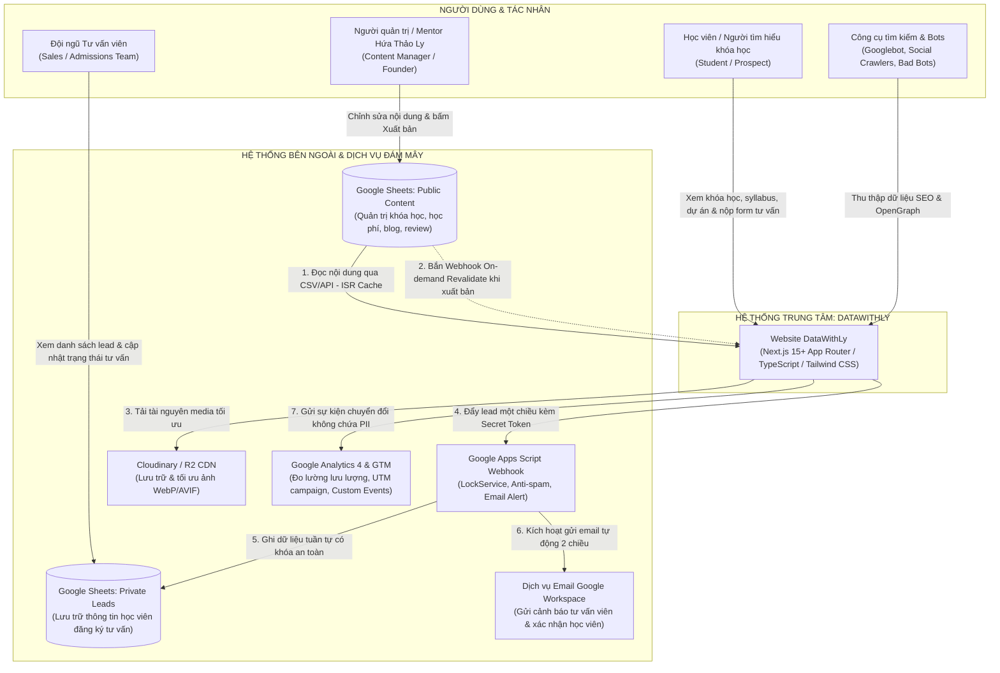
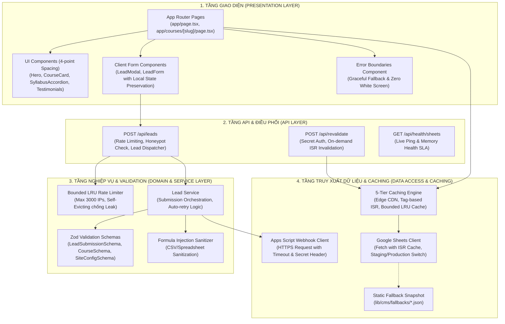
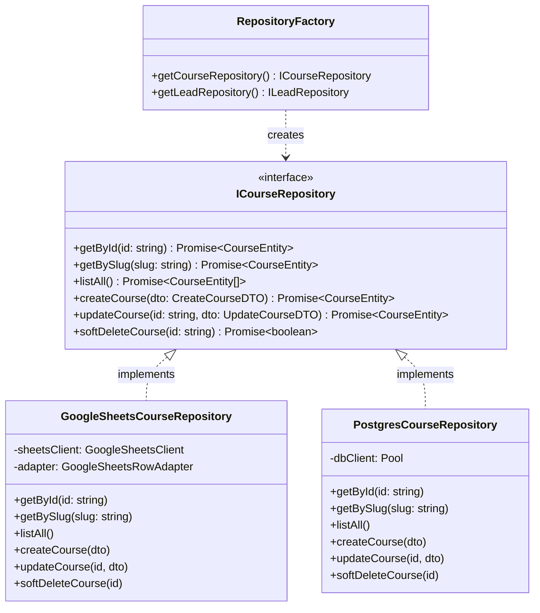

# Bối cảnh hệ thống — DataWithLy (System Context)

- **Mục đích:** Đặc tả kiến trúc tổng thể, sơ đồ bối cảnh C4 (Context & Container Diagram), ranh giới hệ thống và các luồng giao tiếp giữa DataWithLy Web Application với các hệ thống bên ngoài.
- **Trạng thái:** Approved — đã thống nhất theo kế hoạch kiến trúc ngày 2026-11-03.
- **Người duyệt:** Chủ dự án & TechLead.
- **Ngày cập nhật:** 2026-11-03.
- **Nguồn tham khảo:** 
  - [Product Overview](../01-product/product-overview.md);
  - [Product Scope](../01-product/product-scope.md);
  - [Yêu cầu bổ sung](../references/additional-requirements.md);
  - [Q&A dự án](../references/project-qa.md);
  - Mã nguồn: Next.js App Router (`app/`), Google Sheets Client (`lib/google-sheets/`).

---

## 1. Sơ đồ bối cảnh hệ thống (C4 Context Diagram)

Sơ đồ thể hiện vị trí trung tâm của nền tảng **DataWithLy Website**, các nhóm tác nhân tương tác và các hệ thống dịch vụ bên ngoài:

---

## 2. Ranh giới hệ thống & Phân định trách nhiệm (System Boundaries)

| Thành phần / Phân hệ | Vai trò & Trách nhiệm chính | Giao thức truyền thông | Cơ chế bảo vệ & Ràng buộc |
|---|---|:---:|---|
| **DataWithLy Web Frontend** | Render giao diện người dùng (Server Components & Client Components), phục vụ bản sao tĩnh (ISR) dưới 1.2s, xử lý responsive theo 4-point spacing system. | HTTPS / TLS 1.3 | Error Boundary cô lập lỗi từng component, CSP Header, Zod Schema validation ở client. |
| **Next.js Server / API Routes** | Tiếp nhận form nộp lead (`POST /api/leads`), kiểm tra Honeypot, kiểm tra Rate Limit, chuyển tiếp dữ liệu an toàn sang Google Apps Script; tiếp nhận Webhook làm mới cache (`POST /api/revalidate`). | Server-to-Server HTTPS | Token xác thực bí mật (`X-Webhook-Secret`), biến môi trường phía server (`.env.local`), không để lộ PII. |
| **Google Sheets Public Content** | Hoạt động như một **Headless CMS** thân thiện. Quản lý 9 tab dữ liệu công khai (Courses, Curriculum, Packages_Pricing, Mentors, Testimonials, StudentProjects, Blogs, Partners, SiteConfig). | HTTPS (CSV Export / Sheets API v4) | Quyền truy cập: Chỉ Đọc (`Viewer`) đối với hệ thống website. Không chứa bất kỳ dữ liệu nhạy cảm nào. |
| **Google Apps Script Webhook** | Đóng vai trò là **Bộ điều phối trung tâm (Central Controller)** cho luồng nộp lead: kiểm tra token bí mật, khử trùng dữ liệu chống Formula Injection, điều phối khóa luồng hàng đợi (`LockService`). | HTTPS POST (`doPost(e)`) | Quyền thực thi: `Execute as: Me`, `Access: Anyone`. Xác thực bằng shared secret header. |
| **Google Sheets Private Leads** | Cơ sở dữ liệu lưu trữ hồ sơ học viên đăng ký tư vấn nội bộ (Họ tên, SĐT, Email, Khóa học quan tâm, Khung giờ hẹn, UTM campaign). | Internal Spreadsheet Append | **Tuyệt đối không mở API đọc công khai**. Chỉ có Founder và tư vấn viên được chỉ định mới có quyền mở tệp. |
| **Media CDN (Cloudinary / R2)** | Phân phối hình ảnh đại diện, avatar giảng viên, ảnh chụp Dashboard học viên ở định dạng WebP/AVIF tối ưu. | HTTPS CDN URL | Tránh bẫy nghẽn băng thông của Google Drive; tối ưu chỉ số LCP của Core Web Vitals. |
| **Email Service** | Tự động gửi email cảnh báo tức thì cho tư vấn viên và gửi thư cảm ơn tự động cho học viên. | Google Workspace MailApp / Gmail API | Chạy bất đồng bộ, có nhật ký riêng, không làm chặn luồng submit form của học viên. |
| **Analytics (GA4 / GTM)** | Đo lường hiệu quả chiến dịch marketing, lượt click CTA, lượt xem lộ trình học và tỷ lệ gửi form thành công. | Client-side Beacon HTTPS | Tuân thủ quyền riêng tư: **Tuyệt đối không gửi PII** (Email, SĐT) vào các thông số sự kiện. |

---

## 3. Kiến trúc Container chi tiết của Next.js Application

Hệ thống Next.js 15+ App Router được tổ chức theo kiến trúc phân tầng sạch (Clean Layered Architecture):

---

## 4. Các quyết định kiến trúc ranh giới (Architectural Boundary Decisions)

1. **Tách biệt hoàn toàn Môi trường Staging và Production ở tầng Webhook:**
   - Trong giai đoạn Đợt 1 (MVP), biến môi trường `GOOGLE_APPS_SCRIPT_URL` trỏ vào Webhook của tệp **Google Sheets Staging (Test)**.
   - Khi chuyển sang Đợt 4 (Production), chỉ cần cập nhật URL và Secret Token sang tệp **Private Leads Production** của Chị Hứa Thảo Ly mà không cần sửa đổi bất kỳ dòng mã logic nào.
2. **Loại bỏ trạng thái phiên (Stateless Architecture):**
   - Ứng dụng Next.js hoạt động hoàn toàn dưới dạng phi trạng thái (Stateless), giúp hệ thống dễ dàng triển khai trên mạng lưới Vercel Edge Serverless mà không bị phụ thuộc vào Server Memory giữa các request.
   - Trạng thái điền form dở dang của học viên được lưu giữ cục bộ tại trình duyệt (`React State / SessionStorage`) để đảm bảo khả năng phục hồi dữ liệu khi mạng chập chờn.

---

## 5. Quy chuẩn Thiết kế Mã Nguồn & Các Mẫu Thiết Kế (Design Patterns)

Để đảm bảo mã nguồn có tính mở rộng cao (Extensibility), dễ dàng bảo trì và sẵn sàng cho việc nâng cấp cơ sở dữ liệu từ Google Sheets sang PostgreSQL trong tương lai, hệ thống áp dụng các mẫu thiết kế hướng đối tượng chuẩn mực:

### Chi tiết 4 Mẫu thiết kế nòng cốt:
1. **Repository Pattern (`ICourseRepository`, `ILeadRepository`):**
   - Đặt tại `lib/domain/repositories/`. Tầng Presentation và Business Logic chỉ giao tiếp qua Interface, hoàn toàn độc lập với chi tiết kỹ thuật của Google Sheets hay PostgreSQL.
2. **Adapter Pattern (`GoogleSheetsRowAdapter`):**
   - Đảm nhận việc chuyển đổi linh hoạt giữa dữ liệu mảng chuỗi thô của Google Sheets và các Domain Entities chuẩn hóa.
3. **Strategy Pattern (`INotificationStrategy`):**
   - Tách biệt cơ chế gửi email thông báo: `AppsScriptMailStrategy` (cho Google Workspace), `ResendEmailStrategy` (khi cần tăng tải), và `MockEmailStrategy` (cho kiểm thử tự động).
4. **Factory Pattern (`RepositoryFactory`):**
   - Tự động quyết định khởi tạo Repository phù hợp dựa trên biến môi trường `DATA_SOURCE_MODE`.

---

[Điểm bắt đầu của bộ docs](../README.md)
