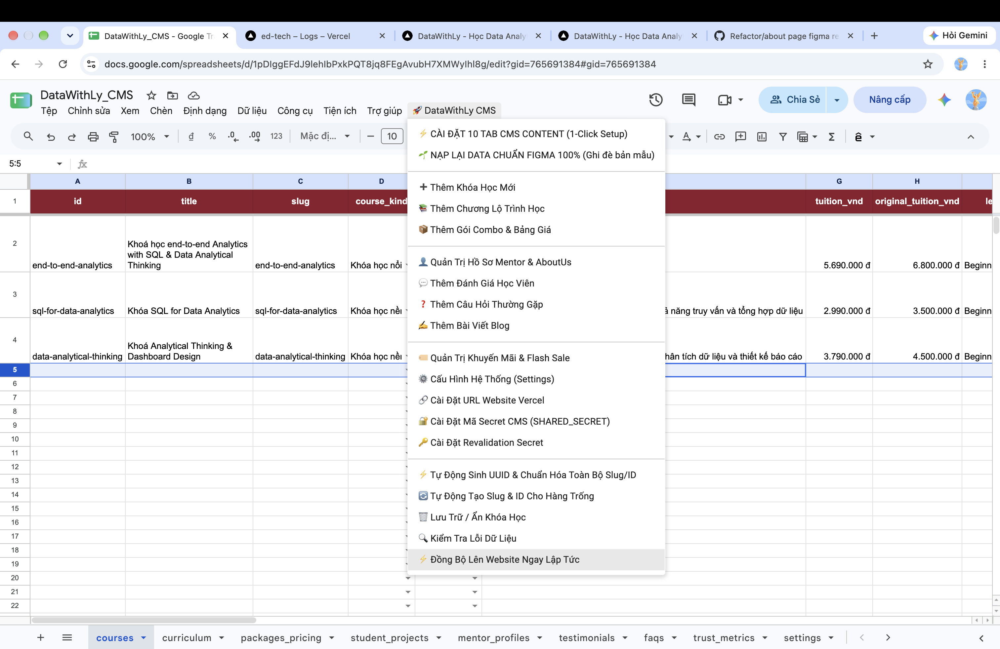
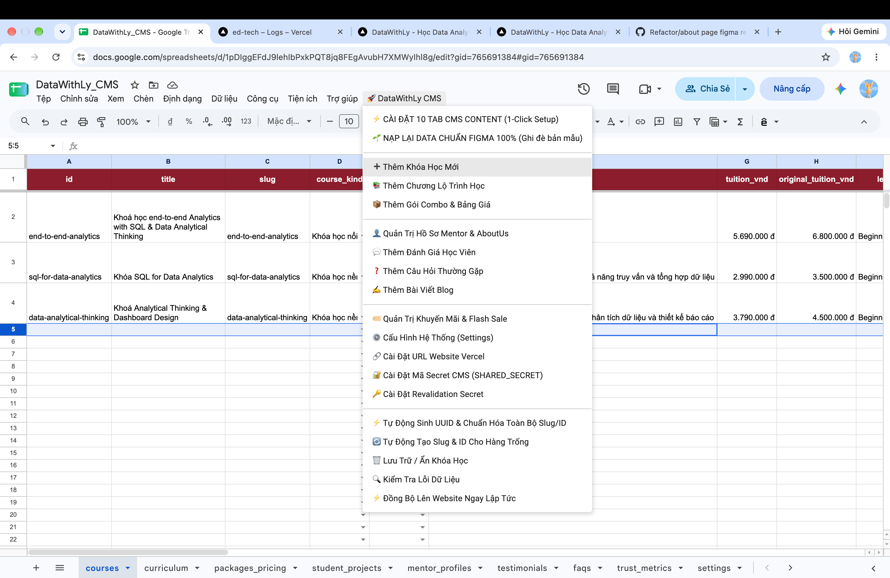
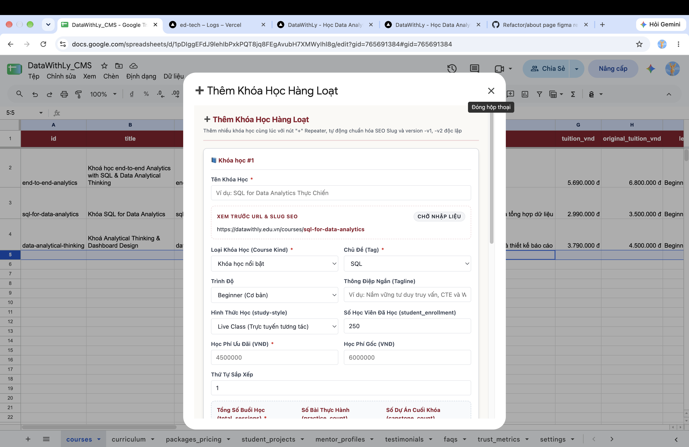
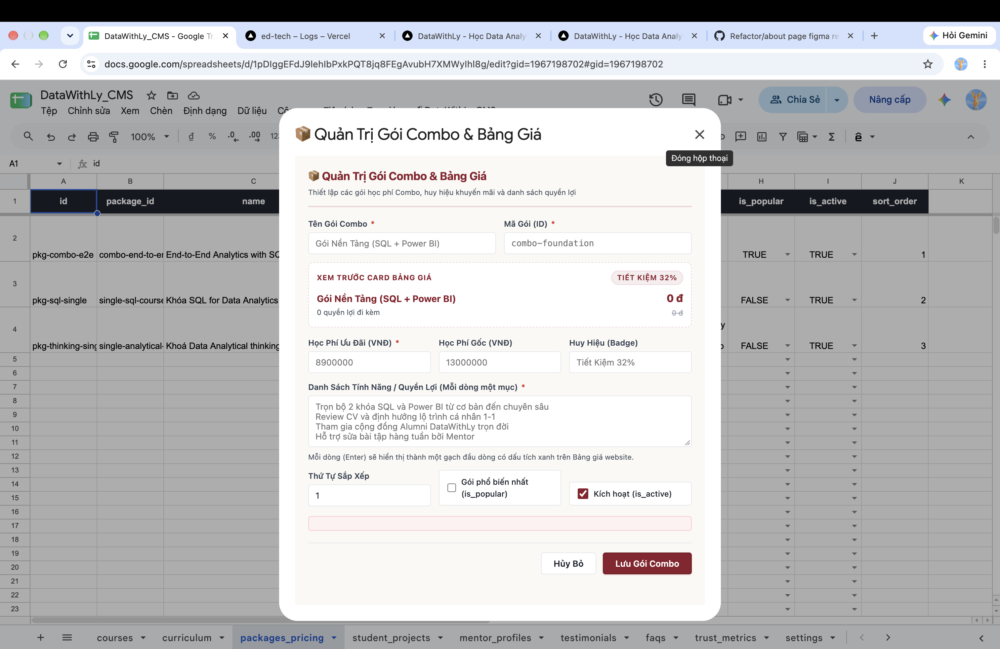
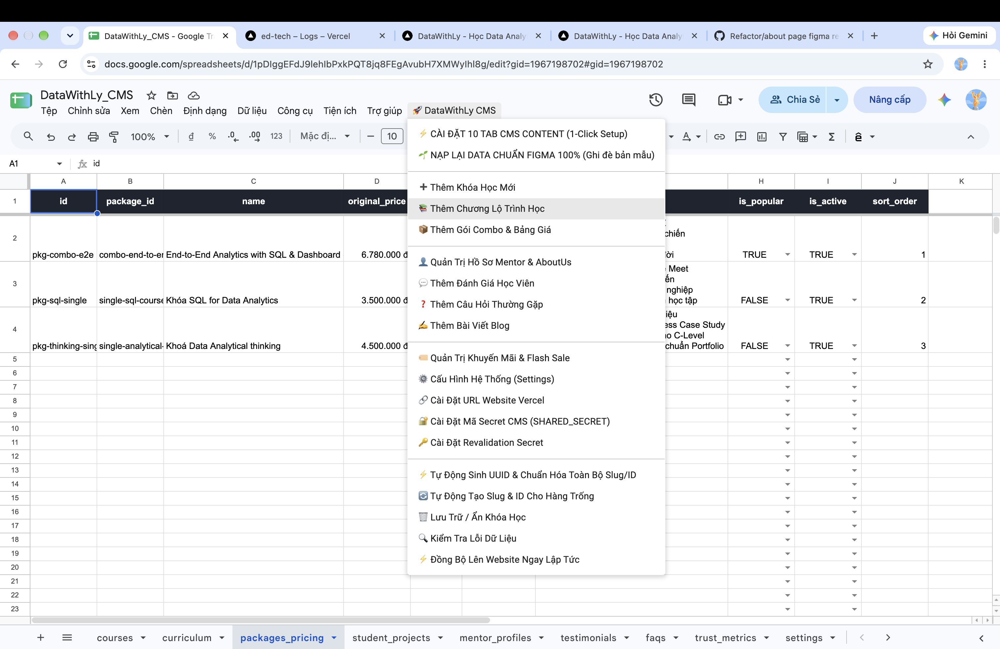
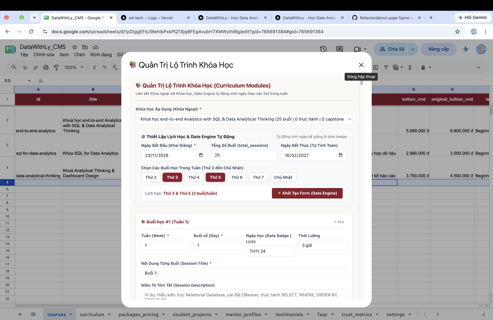

# Sổ Tay Vận Hành & Hướng Dẫn Sử Dụng Dành Cho Khách Hàng (Client Operations Guide)

- **Dành riêng cho:** Founder Mentor Hứa Thảo Ly & Đội ngũ Vận hành / Tư vấn viên DataWithLy
- **Mục đích:** Hướng dẫn chi tiết từng bước (Step-by-step) cách quản lý nội dung khóa học, đề cương, bài viết, gói combo và xử lý thông tin học viên đăng ký tư vấn một cách dễ dàng, nhanh chóng và an toàn nhất.
- **Trạng thái:** Chính thức bàn giao
- **Ngày phát hành:** 2026-11-22
- **Hệ thống áp dụng:** Website DataWithLy & File Google Sheets Quản trị CMS Master

---

## 1. Danh sách các Tài nguyên & Quyền hạn Cần Bàn giao

Dưới đây là danh mục toàn bộ tài nguyên tài khoản mà chị Ly và đội ngũ tiếp nhận để toàn quyền làm chủ hệ thống:

| STT | Tài nguyên bàn giao | Loại tài nguyên | Mục đích sử dụng | Quyền hạn bàn giao |
|:---:|:---|:---|:---|:---:|
| 1 | **Google Sheets Master CMS** | Bảng tính Google | Quản lý toàn bộ nội dung hiển thị: Khóa học, Đề cương, Giảng viên, Combo gói học, Đánh giá, FAQ, Cài đặt hệ thống | **Chủ sở hữu (Owner)** |
| 2 | **Google Sheets Leads CRM** | Bảng tính Google (Riêng tư) | Lưu trữ thông tin học viên đăng ký tư vấn, trạng thái liên hệ, ghi chú chăm sóc | **Chủ sở hữu (Owner)** |
| 3 | **Google Apps Script Web App** | Script tự động hóa | Webhook tiếp nhận Lead và điều khiển Menu `[🚀 DataWithLy CMS]` trên Sheets | **Deployer (Execute as Me)** |
| 4 | **Thư mục Google Drive Media** | Google Drive Folder | Lưu trữ ảnh chân dung Mentor, ảnh bìa khóa học, avatar học viên để lấy link public | **Chủ sở hữu (Owner)** |
| 5 | **Vercel Project Dashboard** | Nền tảng Cloud Hosting | Theo dõi trạng thái hoạt động của Website, quản lý Domain, cấu hình biến môi trường | **Team Member / Admin** |
| 6 | **Tài khoản Quản lý Domain & DNS** | Nhà đăng ký tên miền | Quản lý tên miền chính thức (`lydata.vn` hoặc `datawithly.edu.vn`) | **Tài khoản quản trị DNS** |
| 7 | **Hòm thư nhận Lead** | Gmail (`lyhuathithao@gmail.com`) | Hòm thư chính thức nhận thông báo tức thì (< 2s) khi có học viên gửi đơn tư vấn | **Email chính chủ** |

---

## 2. Rà soát Các Vị trí Hard Code trong Giao diện & Hướng dẫn Chỉnh sửa

Một số thông tin tĩnh hiện được cấu hình trực tiếp trong mã nguồn giao diện để đảm bảo tốc độ nạp trang tức thì (Zero Cumulative Layout Shift - CLS) và giữ độ sắc nét theo thiết kế Figma.

### 2.1. Bảng tra cứu các vị trí Hard Code:

| Trang / Khối giao diện | Tệp mã nguồn | Dòng code | Nội dung hiện tại | Khi nào cần chỉnh sửa? |
|:---|:---|:---:|:---|:---|
| **Trang Giới thiệu (Hero)** | `components/about/AboutHero.tsx` | `L15-L42`<br/>`L78-L88` | Liên kết MXH (TikTok, Instagram, Threads, Facebook, Zalo)<br/>Câu chào: *"Xin chào, mình là Lý..."* | Khi đổi username mạng xã hội hoặc muốn đổi câu chào mở đầu |
| **Trang Giới thiệu (Kinh nghiệm)** | `components/about/AboutExperience.tsx` | `L31-L135` | Mảng `EXPERIENCE_DATA`:<br/>- 5 năm kinh nghiệm (MoMo, Tiki, ACB)<br/>- 4 giải thưởng & thành tích chuyên môn<br/>- Các cột mốc đồng hành & truyền cảm hứng | Khi chị Ly đạt thêm giải thưởng mới hoặc cập nhật số năm kinh nghiệm |
| **Trang Giới thiệu (Câu chuyện Founder)** | `components/about/AboutFounder.tsx` | `L178-L194`<br/>`L9-L33` | Đoạn văn tự sự của chị Ly (xuất phát điểm FTU2, tư duy kinh doanh, câu chuyện số liệu...) và dòng thời gian sự nghiệp | Khi muốn cập nhật tiểu sử hoặc bổ sung các mốc sự nghiệp mới |
| **Trang Giới thiệu (Giá trị & Lộ trình)** | `components/about/AboutCoreValues.tsx`<br/>`components/about/AboutJourney.tsx` | `L10-L35` | 3 giá trị đào tạo cốt lõi & 4 giai đoạn lộ trình học viên | Khi cải tiến phương pháp giảng dạy |
| **Chân trang (Footer)** | `components/layout/Footer.tsx` | `L35-L125` | Danh mục menu chân trang, Hotline, Zalo, địa chỉ | Khi đổi địa chỉ văn phòng hoặc kênh hỗ trợ |

### 2.2. Hướng dẫn sửa nội dung Hard Code:
* **Cách 1 (Nhờ Kỹ thuật qua GitHub Pull Request)**: Chị Ly gửi yêu cầu theo mẫu PR Template bên dưới, đội kỹ thuật chỉ mất 2 phút để merge và website tự động cập nhật lên Vercel.
* **Cách 2 (Lộ trình tương lai)**: Đội ngũ kỹ thuật có thể chuyển các mục tĩnh này vào tab `settings` trên Google Sheets để chị Ly chỉnh sửa 100% không cần chạm code.

### 2.3. Mẫu PR Template chuẩn mực cho Yêu cầu Cập nhật Nội dung:

Chị Ly hoặc biên tập viên chỉ cần sao chép mẫu sau và gửi cho lập trình viên:

```markdown
### 📝 Yêu Cầu Cập Nhật Nội Dung Website

- **Người yêu cầu:** Hứa Thảo Ly
- **Ngày yêu cầu:** [DD/MM/YYYY]
- **Trang cần sửa:** [Ví dụ: Trang Giới thiệu / Chân trang Footer]

---

#### 1. Vị trí đã cập nhật (File & Dòng)
- File: `components/about/AboutHero.tsx` (Dòng 86-88)

#### 2. Nội dung cập nhật chi tiết
- **Nội dung cũ:**
  > "Mình giúp người mới bắt đầu trở thành Data Analyst bằng phương pháp học thực chiến và dễ hiểu nhất."
- **Nội dung mới:**
  > "Đồng hành cùng bạn chinh phục nghề Data Analyst từ con số 0 với tư duy kinh doanh thực chiến."

#### 3. Kiểm tra hiển thị
- [ ] Đã kiểm tra không bị vỡ dòng trên Mobile.
- [ ] Đã kiểm tra chính tả tiếng Việt.
```

---

## 3. Hướng dẫn Chi tiết 5 Nghiệp vụ Vận hành Cốt lõi

---

### a. Đồng bộ Nội dung lên Website (1-Click Revalidation)
* **Mục đích**: Bất kỳ khi nào chị sửa học phí, sửa tên bài học, thêm khóa mới hay đổi số điện thoại trên Google Sheets, tính năng này sẽ đẩy nội dung mới lên website ngay trong 1-2 giây mà không cần deploy lại mã nguồn.
* **Các bước thao tác**:
  1. Mở file Google Sheets Quản trị DataWithLy.
  2. Trên thanh công cụ trên cùng, bấm vào menu **`[🚀 DataWithLy CMS]`**.
  3. Chọn mục **`⚡ Đồng Bộ Lên Website`**.
  4. Đợi 1 giây, màn hình hiển thị thông báo pop-up: *"✅ Đồng bộ thành công! Nội dung mới đã hiển thị trên web."*
  5. Mở website và bấm F5 để thấy ngay kết quả mới.


---

### b. Thêm Khóa học Mới
* **Mục đích**: Đăng tuyển sinh một khóa học mới lên website.
* **Cách 1 — Dùng Form giao diện (Khuyến nghị)**:
  1. Trên Google Sheets, chọn menu **`[🚀 DataWithLy CMS] > ➕ Thêm Khóa Học Mới`**.
  2. Điền các trường trong bảng popup:
     * **Tên khóa học:** Tên chính thức (vd: `SQL for Data Analytics`).
     * **Mã URL (Slug):** Viết thường, không dấu, nối bằng gạch ngang (vd: `sql-for-data-analytics`). Hệ thống sẽ tự động cảnh báo nếu mã này bị trùng.
     * **Học phí gốc & Học phí ưu đãi:** Nhập số nguyên không dấu chấm (vd: `3500000` và `2990000`).
     * **Số buổi học:** Nhập số buổi (vd: `12 buổi`).
     * **Cấp độ:** `Cơ bản` / `Trung cấp` / `Nâng cao`.
  3. Bấm nút **[Lưu Khóa Học]**.

* **Cách 2 — Gõ trực tiếp vào Tab `courses`**:
  1. Mở tab `courses`.
  2. Thêm một dòng mới ở dưới cùng với các cột: `course_id`, `title`, `price_original`, `price_sale`, `total_sessions`, `badge`, `is_active` (`TRUE`).
  3. Bấm **`[🚀 DataWithLy CMS] > ⚡ Đồng Bộ Lên Website`**.




### c. Quản trị Combo Package (Gói Học Tiết Kiệm)
* **Mục đích**: Bán theo gói combo nhiều khóa học với mức giá ưu đãi (ví dụ: *Combo Nhập Môn: SQL + PowerBI*, tiết kiệm 25%).
* **Các bước thao tác**:
  1. Mở tab `packages`.
  2. Nhập các cột thông tin:
     * `package_id`: Mã gói duy nhất (vd: `combo-data-starter`).
     * `name`: Tên gói hiển thị (vd: `Combo Chuyển Ngành Toàn Diện`).
     * `course_ids`: Danh sách mã khóa học gộp trong gói, phân tách bằng dấu phẩy (vd: `sql-for-data-analytics, data-analytical-thinking`).
     * `original_price` & `package_price`: Học phí gốc và học phí ưu đãi gói combo (vd: `7000000` và `5250000`).
     * `discount_percent`: Tỷ lệ giảm giá hiển thị (vd: `25%`).
     * `badge`: Nhãn nổi bật (vd: `Khuyên Dùng` hoặc `Tiết Kiệm 25%`).
     * `is_popular`: Đặt `TRUE` nếu muốn thẻ combo này nổi bật hơn các thẻ khác.
     * `is_active`: Đặt `TRUE` để cho phép đăng ký trên web.
  3. Bấm **`[🚀 DataWithLy CMS] > ⚡ Đồng Bộ Lên Website`**.



---

### d. Quản trị Nội dung Đề cương Buổi học (Curriculum / Syllabus)
* **Mục đích**: Cập nhật chi tiết từng chương học, từng buổi học và nội dung thực hành hiển thị trong Accordion trên trang chi tiết khóa học.
* **Các bước thao tác**:
  1. Mở tab `curriculum`.
  2. Nhập `course_id` tương ứng với khóa học cần soạn đề cương (vd: `sql-for-data-analytics`).
  3. Nhập số thứ tự chương (`module_number`), tên chương (`module_title`), số buổi (`session_number`) và tên buổi học (`session_title`).
  4. **Quy tắc vàng gõ các gạch đầu dòng (`bullets`)**:
     > [!IMPORTANT]
     > Trong ô `bullets`, khi muốn xuống dòng để tạo một gạch đầu dòng mới, chị hãy nhấn tổ hợp phím:
     > * Trên máy tính **Windows**: nhấn **`Alt + Enter`**
     > * Trên máy tính **MacBook**: nhấn **`Option + Enter`**
     >
     > *Ví dụ nội dung chuẩn trong 1 ô:*
     > ```text
     > • Cài đặt PostgreSQL và DBeaver
     > • Kỹ thuật truy vấn nâng cao: CTE và Window Functions
     > • Bài tập thực chiến giải quyết bài toán Retention Rate của MoMo
     > ```
     > Khi đưa lên website, hệ thống sẽ tự động tách thành 3 dòng riêng biệt có icon tích xanh sắc nét.
  5. Bấm **`[🚀 DataWithLy CMS] > ⚡ Đồng Bộ Lên Website`**.



---

## 4. Hướng dẫn Tiếp nhận & Xử lý Leads Học Viên

Mỗi khi có học viên điền form đăng ký tư vấn trên website:
1. **Học viên nhận được**: Email xác nhận tức thì từ Mentor Hứa Thảo Ly kèm mã nút bấm kết nối trực tiếp vào Zalo cá nhân của chị Ly (`0769 361 960`).
2. **Chị Ly nhận được**:
   * Email cảnh báo tức thì gửi về **`lyhuathithao@gmail.com`** với đầy đủ: Họ tên, Số điện thoại, Email, Khóa học quan tâm, Nhu cầu cụ thể và Mã đơn Lead.
   * Dòng dữ liệu mới tự động ghi vào tab **`leads`** trong file Google Sheets Private Leads CRM.
3. **Quy trình tư vấn**:
   * Chị Ly mở file Sheets Leads, xem thông tin học viên.
   * Tại cột `status`, chuyển từ `NEW` ➔ `CONTACTED` ➔ `ENROLLED` (Đã nhập học) để theo dõi tiến độ chăm sóc.

---

[Quay lại Mục lục Bàn giao](README.md) | [Đến Checklist Kỹ thuật](technical-handover-checklist.md)
