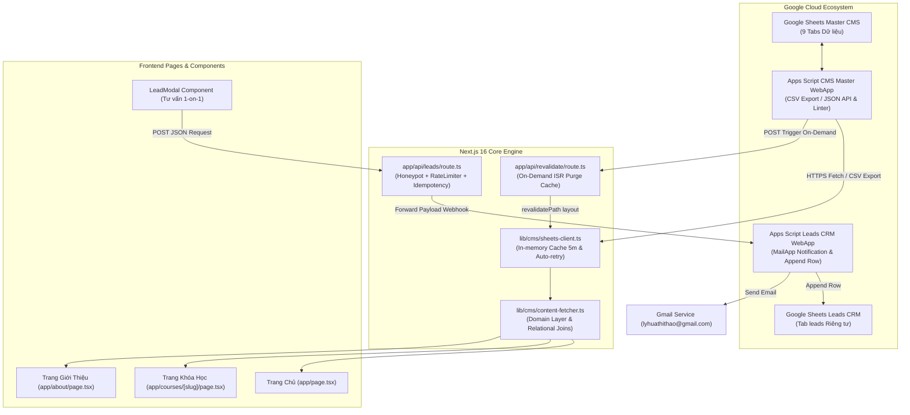

# Tài Liệu Bàn Giao Kỹ Thuật & Cấu Trúc Mã Nguồn (Technical Architecture & Handover Checklist)

- **Mục đích:** Đặc tả chi tiết toàn bộ danh mục mã nguồn làm việc với Google Sheets, các mô-đun quản trị quan trọng, cơ chế bộ nhớ đệm (ISR Caching), bảo mật chống spam và quy trình bảo trì cho lập trình viên tiếp quản hệ thống **DataWithLy**.
- **Đối tượng sử dụng:** TechLead, DevOps Engineer, Fullstack / Backend Developer tiếp quản
- **Trạng thái:** Sẵn sàng nghiệm thu kỹ thuật (Production Ready)
- **Ngày cập nhật:** 2026-11-22
- **Phiên bản hệ thống:** Next.js 16+ (App Router) & Google Apps Script Engine v2.2.0

---

## 1. Sơ Đồ Kiến Trúc Luồng Dữ Liệu (Data Flow Architecture)



---

## 2. Danh Mục Toàn Bộ Mã Nguồn Làm Việc Với Google Sheets

Dưới đây là chi tiết từng tệp mã nguồn trong dự án trực tiếp giao tiếp hoặc điều khiển dữ liệu Google Sheets:

### 2.1. Tầng Next.js Backend & API Client

| STT | Tệp mã nguồn | Đường dẫn file | Chức năng chi tiết |
|:---:|:---|:---|:---|
| 1 | **Sheets Core Client** | `lib/cms/sheets-client.ts` | **Trái tim giao tiếp dữ liệu**: <br/>• Tự động chuyển đổi giữa chế độ đọc Web App API JSON và Google Sheets CSV Export công khai.<br/>• Tích hợp bộ đệm In-Memory Cache (TTL: 5 phút) giảm tải 95% request đến Google API.<br/>• Cơ chế Snapshot Fallback: Khi mất mạng hoặc Google Sheets gián đoạn, tự động nạp dữ liệu từ `database/seeders/snapshot.json`, đảm bảo website **Zero-Downtime**.<br/>• Cơ chế Exponential Backoff Auto-Retry (tối đa 3 lần). |
| 2 | **Content Fetcher** | `lib/cms/content-fetcher.ts` | **Tầng logic nghiệp vụ (Domain Layer)**: <br/>• Lọc bỏ các bản ghi `is_active === false`.<br/>• Ghép nối quan hệ (Relational Joins): Nối `curriculum` vào từng `course` thông qua `course_id`.<br/>• Tự động format hiển thị tiền tệ VNĐ (`3.500.000 đ`).<br/>• Quản trị các trường `total_sessions`, danh sách `packages` và `promotions`. |
| 3 | **CMS Data API Route** | `app/api/cms/sheets-data/route.ts` | **REST API Endpoint**: Cung cấp toàn bộ payload dữ liệu CMS đã parse cho phía client-side hoặc preview tool. |
| 4 | **Leads API Route** | `app/api/leads/route.ts` | **Endpoint tiếp nhận đơn Lead**: <br/>• Kiểm tra bẫy Honeypot `website_hp` (chống bot tự động submit).<br/>• Áp dụng Rate Limiter `lib/security/rate-limiter.ts` (tối đa 3 lần/phút/IP).<br/>• Chống trùng đơn (Idempotency Token UUID).<br/>• Chống chèn công thức độc hại (Formula Sanitization: thêm `'` trước `=`, `+`, `-`, `@`).<br/>• Chuyển tiếp payload an toàn sang Web App Apps Script. |
| 5 | **Revalidate API Route** | `app/api/revalidate/route.ts` | **Endpoint xóa cache On-Demand ISR**: Tiếp nhận tín hiệu từ nút bấm trên Sheets của chị Ly, kích hoạt `revalidatePath('/', 'layout')` làm mới toàn bộ trang tĩnh ngay lập tức (< 1 giây). Bảo vệ bằng mã bí mật `REVALIDATION_SECRET`. |
| 6 | **Health Check Sheets** | `app/api/health/sheets/route.ts` | **Health check endpoint**: Kiểm tra độ trễ (latency), trạng thái kết nối tới Google Sheets và phản hồi mã HTTP 200 (healthy) hoặc 503 (unhealthy). |

---

### 2.2. Tầng Google Apps Script (Serverless trên Google Workspace)

Mã nguồn được phân tách module rõ ràng trong thư mục `apps-script/` và được đóng gói tự động thành file bundle duy nhất bằng lệnh `npm run bundle:gas`:

#### A. Phân hệ CMS Master (`apps-script/cms/`) ➔ Đóng gói thành `Code.cms.bundle.gs`:
1. `00_Config.gs`: Khai báo hằng số hệ thống, Secret Key, môi trường kích hoạt (PROD / LOCAL).
2. `01_MenuSetup.gs`: Thiết lập thanh menu `[🚀 DataWithLy CMS]` khi mở bảng tính.
3. `02_RevalidationWebhook.gs`: Gọi Webhook sang Next.js server để xóa cache ISR.
4. `03_CmsTablesSetup.gs`: Tự động khởi tạo cấu trúc và header cho 9 tabs dữ liệu.
5. `04_DataLinter.gs`: Bộ kiểm tra tính toàn vẹn dữ liệu (Validate URL, học phí âm, slug trùng, email không hợp lệ).
6. `05_ModalsController.gs`: Điều khiển hiển thị các popup HTML nhập liệu trên Sheets.
7. `06_ModalsHtmlTemplates/`: Gồm 10 tệp giao diện nhập liệu cho từng tab: `CourseModal.html`, `CurriculumModal.html`, `PackageModal.html`, `MentorModal.html`, `PromotionsModal.html`, `TestimonialModal.html`, `FaqModal.html`, `SettingsModal.html`, `BlogModal.html`.

#### B. Phân hệ Leads CRM (`apps-script/leads/`) ➔ Đóng gói thành `Code.leads.bundle.gs`:
1. `00_LeadsConfig.gs`: Cấu hình danh sách email nhận thông báo: `lyhuathithao@gmail.com`.
2. `01_LeadsDoPost.gs`: Nhận POST request từ Next.js API, ghi dòng dữ liệu mới vào tab `leads`.
3. `04_LeadsNotifications.gs`: Kích hoạt dịch vụ `MailApp`:
   * Email 1: Thông báo tức thì cho Mentor Ly kèm thông tin chi tiết của học viên.
   * Email 2: Thư cảm ơn học viên kèm nút liên kết Zalo cá nhân của Mentor.

---

### 2.3. Tầng Helper Scripts & Testing CLI (`scripts/`)

| Lệnh / File | Đường dẫn file | Công dụng |
|:---|:---|:---|
| `npm run bundle:gas` | `scripts/bundle-apps-script.js` | Tự động quét và đóng gói các module nhỏ trong `apps-script/` thành file bundle duy nhất sẵn sàng nạp vào Google Sheets. |
| `npm run db:seed` | `scripts/seed-sheets.js` | Nạp toàn bộ dữ liệu mẫu từ snapshot lên file Google Sheets mới. |
| `npm run db:reset` | `scripts/reset-db.js` | Xóa sạch dữ liệu mẫu và đưa bảng tính về trạng thái ban đầu. |
| `npm test` | `package.json` | Chạy toàn bộ 4 bộ test tự động CI/CD (`test:gas`, `test:lead`, `test:rate`, `test:email`). |

---

## 3. Các Mã Nguồn & Kiến Trúc Quản Trị Quan Trọng

### 3.1. Chiến Lược Bộ Nhớ Đệm (ISR Caching & Stale-While-Revalidate)
* Để đạt điểm số Google PageSpeed 95+ và tải trang trong < 0.5 giây, tất cả các trang nội dung chính đều được cấu hình Incremental Static Regeneration (ISR):
  * `app/page.tsx`: `export const revalidate = 300;` (5 phút)
  * `app/courses/[slug]/page.tsx`: `export const revalidate = 300;`
  * `app/about/page.tsx`: `export const revalidate = 300;`
  * `app/blog/page.tsx`: `export const revalidate = 300;`
* **On-Demand Purge**: Khi chị Ly bấm nút **`⚡ Đồng Bộ Lên Website`**, Google Apps Script sẽ gửi POST request kèm secret key sang `https://lydata.vn/api/revalidate`. Next.js sẽ kích hoạt:
  ```typescript
  revalidatePath("/", "layout");
  ```
  Lệnh này xóa toàn bộ cache tĩnh của website ngay lập tức mà không làm gián đoạn người dùng đang truy cập.

---

### 3.2. Kiến Trúc Bảo Mật & Chống Spam Đa Lớp (Anti-Spam Triad)
Hệ thống tiếp nhận Lead được bảo vệ nghiêm ngặt chống lại tấn công DDOS, Spam bot và SQL/Formula Injection:
1. **Honeypot Trap**: Trường `website_hp` ẩn đối với người dùng thật nhưng bot tự động sẽ điền. Nếu trường này có dữ liệu, hệ thống trả về mã 200 giả mạo (Silent Reject) và không ghi vào Sheets.
2. **In-Memory Rate Limiter ([lib/security/rate-limiter.ts](file:///Users/hientruongthmh/Documents/Web_Jobs/ed_da_tech/lib/security/rate-limiter.ts))**: Chặn mỗi IP không được gửi quá 3 lần / phút. Lần thứ 4 sẽ nhận lỗi HTTP 429 Too Many Requests.
3. **Idempotency UUID Token**: Mỗi form khi mở ra sẽ sinh một mã `submission_id` duy nhất dạng UUID. Nếu người dùng bấm liên tục nút gửi, chỉ có đơn đầu tiên được ghi nhận, loại bỏ 100% tình trạng trùng đơn.
4. **Formula Sanitization**: Ngăn chặn tấn công khai thác mã độc trên bảng tính. Tất cả các chuỗi bắt đầu bằng `=`, `+`, `-`, `@` sẽ tự động được thêm dấu nháy đơn `'` ở đầu.

---

### 3.3. Ma Trận Biến Môi Trường (Environment Variables Matrix)

| Tên biến môi trường | Môi trường Staging | Môi trường Production | Phạm vi & Ghi chú bảo mật |
|:---|:---|:---|:---|
| `NEXT_PUBLIC_APP_URL` | `https://staging.datawithly.edu.vn` | `https://lydata.vn` | **Client-Safe**: Dùng cho Canonical SEO và chia sẻ mạng xã hội. |
| `GOOGLE_SHEETS_CONTENT_ID` | ID Google Sheets Staging | ID Google Sheets Production | **Server-Only**: ID bảng tính CMS Master đọc dữ liệu. |
| `GOOGLE_SHEETS_LEADS_ID` | ID Google Sheets Leads Test | ID Google Sheets Leads Thật | **Server-Only (Tuyệt mật)**: Không bao giờ lộ ra trình duyệt. |
| `APPS_SCRIPT_LEADS_WEBHOOK_URL`| URL Web App Apps Script Test | URL Web App Apps Script Thật | **Server-Only**: Endpoint tiếp nhận và gửi mail lead. |
| `REVALIDATION_SECRET` | `staging_secret_key_123` | Chuỗi 64 ký tự ngẫu nhiên | **Server-Only**: Khóa bảo vệ API xóa cache. |
| `CLIENT_NOTIFICATION_EMAILS`| `lyhuathithao@gmail.com` | `lyhuathithao@gmail.com` | **Server-Only**: Email nhận thông báo Lead mới. |

---

## 4. Hướng Dẫn Deploy & Chuyển Giao Quyền Sở Hữu (Ownership Transfer)

### Bước 1: Bàn giao Bảng tính Google Sheets
1. Mở file Google Sheets CMS Master & Leads CRM.
2. Bấm nút **Chia sẻ (Share)** ở góc trên bên phải.
3. Thêm tài khoản Google của chị Ly (`lyhuathithao@gmail.com`), phân quyền **Chủ sở hữu (Transfer Ownership)**.

### Bước 2: Deploy lại Google Apps Script dưới quyền Chị Ly
1. Dùng tài khoản của chị Ly mở file Sheets lên.
2. Vào **Tiện ích mở rộng (Extensions) > Apps Script**.
3. Bấm **Deploy (Triển khai) > New Deployment (Tùy chọn triển khai mới)**.
4. Cấu hình:
   * Loại: **Web App (Ứng dụng web)**.
   * Execute as: **Tôi (lyhuathithao@gmail.com)**.
   * Who has access: **Bất kỳ ai (Anyone)**.
5. Bấm Deploy và tiến hành cấp quyền (Authorize) lần đầu tiên cho tài khoản của chị Ly.
6. Copy Web App URL mới thu được và cập nhật vào biến `APPS_SCRIPT_LEADS_WEBHOOK_URL` trên Vercel.

---

[Quay lại Sổ tay Khách hàng](client-operations-guide.md) | [Quay lại Mục lục](README.md)
