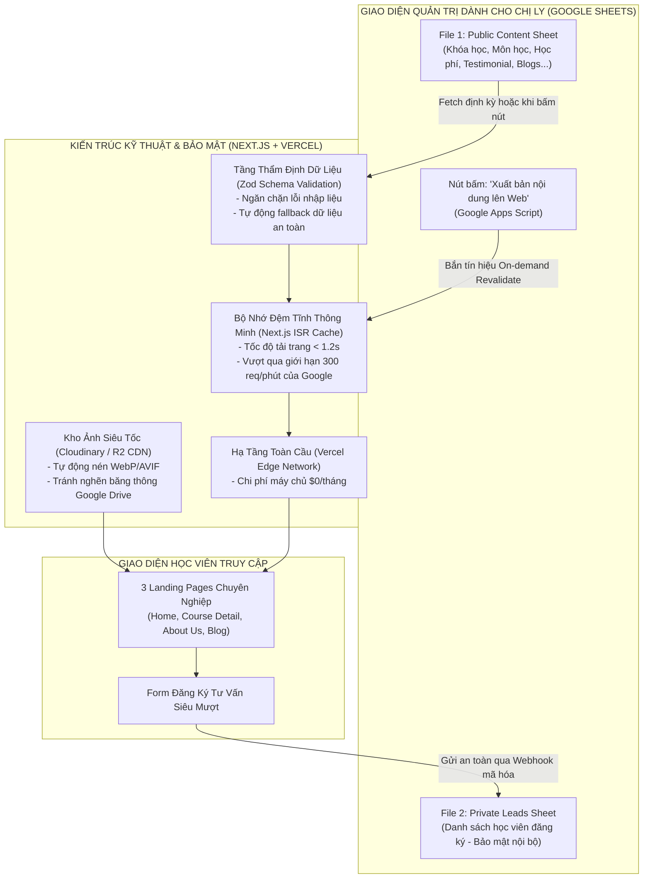
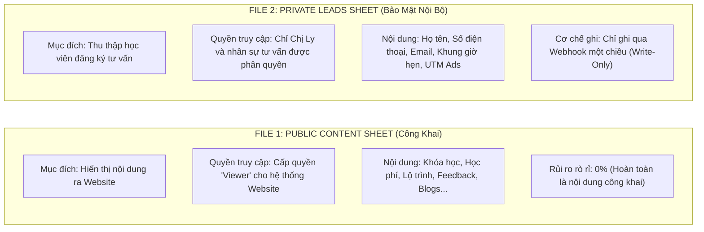
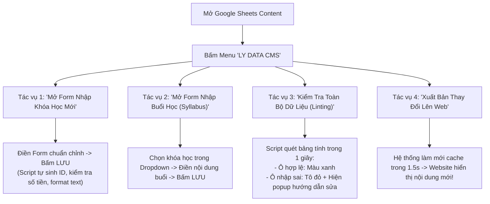

# BÁO CÁO GIẢI PHÁP KỸ THUẬT & PHẠM VI DỰ ÁN
## HỆ THỐNG WEBSITE KHÓA HỌC THƯƠNG HIỆU LY DATA
* **Chủ nhiệm dự án (Client / Stakeholder):** Chị Hứa Thảo Ly (Founder LY DATA)
* **Đơn vị tư vấn & phát triển:** Trương Hoàng Minh Hiển & Tech Lead Agent Antigravity
* **Mục tiêu báo cáo:** Làm rõ phạm vi tính năng, giải trình cơ chế vận hành CMS bằng Google Sheets (Ưu - Nhược điểm & Giải pháp kỹ thuật), hướng dẫn thao tác thực tế và thống nhất yêu cầu (Requirements Sign-off) trước khi chuyển sang giai đoạn tạo PRD và sinh mã nguồn tự động.

---

---

## 1. ĐẶC TẢ TỔNG QUÁT DỰ ÁN (PROJECT OVERVIEW & VISION)

### 1.1. Tầm nhìn & Mục tiêu sản phẩm
Website LY DATA được định vị là cổng thông tin đào tạo thực chiến hàng đầu trong lĩnh vực **Data Analysis (DA) & Business Analysis (BA)** tại Việt Nam. Không chỉ là một trang giới thiệu đơn thuần, website được thiết kế xoay quanh **mục tiêu tối ưu hóa tỷ lệ chuyển đổi (High-Converting Conversion Funnel)**:
1. **Trang chủ (Homepage):** Định vị thương hiệu giảng viên Hứa Thảo Ly (Ex Senior DA tại MoMo, Tiki, ACB), khẳng định uy tín thông qua số liệu thực tế, giải thưởng, dải logo đối tác (Google, Microsoft, Samsung...) và thư viện Dashboard dự án thực tế của học viên.
2. **Trang chi tiết khóa học (Course Detail):** Cung cấp giáo trình trực quan dạng Accordion (Syllabus chi tiết đến từng buổi học), bảng học phí minh bạch, chính sách học tập qua Zoom Meeting và các cam kết đầu ra rõ ràng.
3. **Trang Giới thiệu (About Us / About Me):** Kể câu chuyện truyền cảm hứng, phương pháp đào tạo thực chiến "học đúng - làm được" từ người trong ngành.
4. **Trang Bài viết chia sẻ (Blog Detail):** Phục vụ SEO tự nhiên (Organic Traffic), chia sẻ mẹo SQL, tư duy phân tích và giữ chân học viên tiềm năng.

### 1.2. Định hướng công nghệ & Chi phí vận hành tối ưu (~$0/tháng)
* **Frontend:** Framework **Next.js (App Router)** kết hợp **Tailwind CSS**, thiết kế chuẩn responsive cho cả máy tính (Desktop) và điện thoại di động (Mobile).
* **Hiệu năng vượt trội:** Áp dụng kỹ thuật **Incremental Static Regeneration (ISR)** giúp trang web được sinh sẵn dưới dạng HTML tĩnh trên CDN toàn cầu. Tốc độ tải trang đạt chuẩn Google PageSpeed (> 90 điểm, thời gian mở trang < 1.2 giây).
* **Chi phí hạ tầng:** Tận dụng gói miễn phí của Vercel / Cloudflare Pages + Google Sheets API + Cloudinary CDN. Doanh nghiệp chỉ chi trả chi phí duy nhất là tên miền hàng năm (~250.000 VNĐ - 300.000 VNĐ/năm).

---

## 2. PHẠM VI DỰ ÁN: CÁC CHỨC NĂNG QUẢN TRỊ NỘI DUNG (CRUD QUA GOOGLE SHEETS)

Thay vì phải đầu tư xây dựng một trang quản trị (Admin Dashboard) tốn kém hàng chục triệu đồng và mất thời gian đào tạo nhân sự sử dụng, toàn bộ thao tác quản lý nội dung (CRUD: **Thêm - Xem - Sửa - Xóa**) được thực hiện 100% trên giao diện Google Sheets quen thuộc mà Chị Ly và cộng sự đã sử dụng hàng ngày:

### 2.1. Danh mục tính năng quản trị phía Client
| Phân hệ tính năng | Thao tác tương đương trên Google Sheets | Hiển thị thực tế trên Website |
| :--- | :--- | :--- |
| **1. Quản lý Khóa học (Courses)** | Thêm dòng mới hoặc chỉnh sửa tên khóa, mô tả ngắn, mô tả chi tiết, hình ảnh minh họa, thời lượng, số lượng học viên, link học thử. | Cập nhật tức thì trên Slider/Carousel trang chủ và Trang chi tiết khóa học. |
| **2. Quản lý Lộ trình (Curriculum)** | Nhập danh sách các tuần học (Week 1 -> Week 6), số thứ tự buổi, thẻ ngày tháng khai giảng (`TH10 03`, `TH10 26`), tiêu đề module và các gạch đầu dòng nội dung chi tiết. | Hiển thị dạng **Accordion đóng/mở mượt mà** với nút *"Expand all lessons"*. |
| **3. Quản lý Giảng viên (Mentors)** | Chỉnh sửa ảnh chân dung, chức danh Founder, triết lý đào tạo, danh sách cột mốc làm việc tại MoMo, Tiki, ACB và các giải thưởng đạt được. | Hiển thị tại khối Giảng viên ở Course Detail và toàn bộ trang About Us. |
| **4. Quản lý Giá & Combo (Packages_Pricing)** | Cập nhật giá bán lẻ, giá gốc gạch ngang, giá COMBO ưu đãi tiết kiệm, danh sách gạch đầu dòng ưu/nhược điểm (tick xanh/gạch chéo đỏ). | Hiển thị bảng so sánh giá thông minh *"Đầu tư thông minh cho sự nghiệp"*. |
| **5. Quản lý Đánh giá học viên (Testimonials)** | Thêm lời nhận xét mới, tên học viên, vị trí công tác, tag khóa học, link ảnh avatar và số sao đánh giá (1 - 5 sao). Đánh dấu `TRUE/FALSE` để chọn review xuất hiện trên trang chủ. | Hiển thị trên lưới 9 đánh giá uy tín (3x3) tại trang chủ. |
| **6. Quản lý Dự án học viên (StudentProjects)** | Nhập tên dự án (Cohort Analysis, Ecommerce Retention...), link ảnh chụp Dashboard thực tế, link tương tác trực tiếp. | Hiển thị tại khối thư viện *"Dự án của học viên qua các khóa học tại Lydata"*. |
| **7. Quản lý Bài viết chia sẻ (Blogs)** | Đăng bài viết mới, chọn chuyên mục (`Series học SQL`), tiêu đề, ngày đăng, lượt xem, ảnh bìa và nội dung bài viết hỗ trợ định dạng **Markdown** (in đậm, danh sách, đoạn code SQL). | Hiển thị tại cụm 3 bài viết trang chủ và toàn bộ trang đọc bài viết chi tiết. |
| **8. Quản lý Đối tác (Partners)** | Thêm tên công ty/trường đại học, link logo SVG/WebP (Google, Tokopedia, Microsoft, Samsung...). | Hiển thị thanh chạy logo học viên trúng tuyển (Trust Bar). |
| **9. Cấu hình chung & Khuyến mãi (SiteConfig)** | Bật/tắt thanh banner flash sale trên cùng (`75% OFF`, `4 days only!`), thiết lập đồng hồ đếm ngược, thay đổi số hotline, email liên hệ và các link mạng xã hội (TikTok, Facebook, LinkedIn, Zalo). | Cập nhật toàn bộ Header, Top Bar và Footer của tất cả các trang. |

---

## 3. NGUYÊN TẮC BẢO MẬT: PHÂN TÁCH 2 TỆP DỮ LIỆU ĐỘC LẬP

Để đảm bảo tuyệt đối an toàn thông tin theo quy định pháp lý (Nghị định 13/2023/NĐ-CP về bảo vệ dữ liệu cá nhân) và phòng tránh rò rỉ thông tin khách hàng, hệ thống tách biệt thành **2 file Google Sheets hoàn toàn độc lập**:

> [!IMPORTANT]
> **Lợi ích chiến lược của việc phân tách 2 file:**
> 1. Website chỉ có quyền **đọc file Public Content**, hoàn toàn **không có bất kỳ liên kết trực tiếp nào để đọc file Private Leads**. Ngay cả khi hacker cố gắng kiểm tra mã nguồn trang web, họ cũng không bao giờ có thể thấy danh sách số điện thoại hay email của học viên đã đăng ký.
> 2. Chị Ly có thể thoải mái chia sẻ file Content cho cộng tác viên viết bài/chỉnh sửa lộ trình mà không sợ họ xem được dữ liệu khách hàng nhạy cảm.

---

## 4. PHÂN TÍCH CHUYÊN SÂU: NHỮNG BẤT CẬP KHI DÙNG SHEETS LÀM CMS & GIẢI PHÁP KỸ THUẬT CỦA TECH TEAM

Việc sử dụng Google Sheets làm CMS mang lại sự tiện lợi vượt trội cho Client, nhưng về mặt kỹ thuật, Google Sheets vốn là phần mềm bảng tính chứ không phải một hệ quản trị cơ sở dữ liệu chuyên nghiệp (Database). Dưới đây là 4 bất cập cốt lõi và cách đội ngũ kỹ thuật giải quyết triệt để:

### 4.1. Bất cập 1: Không lưu trữ trực tiếp file Media (Ảnh/Video) & Bẫy "Google Drive Link"
* **Nguyên nhân & Rủi ro:** 
  Rất nhiều người có thói quen tải ảnh lên Google Drive, lấy link chia sẻ rồi dán vào trang web. Tuy nhiên, Google Drive sinh ra để lưu trữ tệp cá nhân, **không phải mạng phân phối nội dung (CDN)**. Khi có từ vài chục đến vài trăm người cùng xem trang web, cơ chế bảo vệ của Google Drive sẽ ngay lập tức kích hoạt tính năng **Bandwidth Throttling (bóp nghẹt băng thông)**. Hậu quả là toàn bộ ảnh đại diện, avatar và hình ảnh khóa học trên web sẽ bị lỗi dấu `X` đỏ (Broken images), website tải chậm như rùa và đánh mất sự tin tưởng của học viên.
* **Giải pháp kỹ thuật của Tech Team:**
  * Thiết lập một kho lưu trữ media chuyên nghiệp miễn phí trên nền tảng **Cloudinary** hoặc **Cloudflare R2**.
  * Chị Ly chỉ cần tải ảnh lên kho lưu trữ (thao tác kéo thả đơn giản), hệ thống sẽ tự động chuyển đổi ảnh sang định dạng chuẩn web thế hệ mới (**WebP / AVIF** - giảm 70% dung lượng nhưng giữ nguyên độ nét chuẩn Retina).
  * Chị Ly copy đường dẫn ảnh siêu nhẹ này dán vào Google Sheets. Website cam kết hiển thị ảnh sắc nét, tải tức thì dưới 0.3 giây và không bao giờ bị Google chặn băng thông.

### 4.2. Bất cập 2: Thiếu Data Validation (Kiểm duyệt dữ liệu) & Giải Pháp Nhập Liệu Chuẩn Hóa Qua Google Apps Script
* **Nguyên nhân & Rủi ro:**
  Trên Google Sheets, bất kỳ ai có quyền sửa đều có thể vô tình xóa nhầm một cột tiêu đề, gõ nhầm chữ vào ô giá tiền (ví dụ: gõ `năm triệu` thay vì `5000000`), hoặc để trống một trường thông tin quan trọng. Trong các hệ thống thông thường, dữ liệu lỗi này sẽ khiến mã nguồn gặp lỗi `Uncaught TypeError: Cannot read properties of undefined`, dẫn đến hiện tượng **Crash trắng trang (White Screen of Death)**, học viên không thể mở được website.

* **Giải pháp kỹ thuật:** 
    1. *Lớp phòng thủ 1 (Ngay trên Google Sheets):* Thiết lập sẵn các bộ lọc **Data Validation**: Cột số chỉ cho nhập số, cột trạng thái chỉ cho chọn Dropdown (`TRUE/FALSE`), cột định dạng ngày bắt buộc theo lịch.
    2. *Lớp phòng thủ 2 (Tầng Zod Schema trên Next.js):* Toàn bộ dữ liệu trước khi được vẽ lên màn hình đều phải đi qua bộ lọc kiểm duyệt **Zod Schema**. Nếu có một ô bị nhập sai, hệ thống sẽ tự động kích hoạt cơ chế **Safe Fallback** (sử dụng dữ liệu mặc định chuẩn hoặc bỏ qua phần tử lỗi một cách mượt mà), đảm bảo trang web vẫn vận hành 100% ổn định trước mắt học viên.
    3. Google Apps Script cho phép xây dựng một **Thanh biểu mẫu nhập liệu chuyên dụng (Custom Sidebar / Modal Dialog)** chạy trực tiếp ngay bên trong màn hình Google Sheets. Chị Ly và nhân sự không cần nhìn vào ma trận hàng chục cột phức tạp, mà sẽ nhập liệu qua các form chuẩn có kiểm soát tự động.

* **SO SÁNH 2 MÔ HÌNH VẬN HÀNH ĐỂ CLIENT LỰA CHỌN:**

| Tiêu chí | Mô hình 1: Bắt buộc 100% qua Apps Script Form (Locked Sheet) | Mô hình 2: Mô hình Lai Thông Minh (Hybrid Model - ĐỀ XUẤT) |
| :--- | :--- | :--- |
| **Cách thức thao tác** | Khóa cứng trang tính (Protected Sheet). Mọi thao tác Thêm/Sửa đều phải mở Form Popup của Apps Script để nhập. | **Thêm mới:** Dùng Form Apps Script để sinh ID và chuẩn hóa trường. **Sửa văn bản nhanh:** Click đúp sửa trực tiếp trên ô tính. |
| **Độ an toàn dữ liệu** | Tuyệt đối 100%, không ai có thể xóa nhầm cột hay nhập sai kiểu dữ liệu. | Rất cao (> 99%), có cơ chế quét lỗi tự động (**Data Linting**) trước khi xuất bản. |
| **Độ tiện lợi & Tốc độ** | Hơi rườm rà khi chỉ muốn sửa một lỗi chính tả nhỏ (phải mở form chọn dòng để sửa). | **Cực kỳ tiện lợi:** Sửa chữ nhanh trong 2 giây, nhưng vẫn chặn đứng 100% lỗi hệ thống. |
| **Cơ chế chốt chặn** | Form tự validate chặn nút bấm "Lưu". | 1. Data Validation cột. 2. Nút "Kiểm tra lỗi dữ liệu" quét tô đỏ ô sai. 3. Chặn xuất bản nếu còn lỗi. |

---

### 4.3. Bất cập 3: Ràng buộc quan hệ dữ liệu (Relational Data 1-Nhiều)
* **Nguyên nhân & Rủi ro:**
  Một khóa học bao gồm 12 buổi học nằm trong 6 tuần khác nhau; một giảng viên có thể phụ trách nhiều khóa học. Trong database chuẩn (SQL), các bảng được nối với nhau bằng khóa chính và khóa ngoại tự động. Trên Google Sheets, nếu nhét chung toàn bộ nội dung 12 buổi học vào một ô khóa học thì ô đó sẽ dài hàng nghìn ký tự, cực kỳ khó đọc và không thể format đẹp mắt.
* **Giải pháp kỹ thuật của Tech Team:**
  * Thiết kế tách biệt thành tab `Courses` (Khóa học tổng quan) và tab `Curriculum` (Chi tiết lộ trình từng buổi).
  * Thiết lập cột định danh liên kết dạng chuỗi không dấu (Slug ID) chuẩn mực: Ví dụ cột `course_id = "sql-for-data-analytics"`.
  * Trên tab `Curriculum`, mỗi buổi học chỉ cần điền mã `course_id` tương ứng. Khi website nạp dữ liệu, thuật toán của Next.js sẽ tự động thực hiện phép ghép (Mapping & Grouping) theo từng Tuần (Week 1 -> Week 6) và từng Buổi để vẽ nên giao diện Accordion chuẩn xác 100% như trên Figma.

### 4.4. Bất cập 4: Giới hạn Rate Limit của Google Sheets API (300 requests/phút)
* **Nguyên nhân & Rủi ro:**
  Google Sheets API giới hạn tối đa 300 lượt yêu cầu/phút trên toàn dự án. Nếu chạy một chiến dịch quảng cáo Facebook/TikTok thu hút hàng nghìn người truy cập đồng thời, nếu mỗi lượt truy cập đều gửi yêu cầu vào Google Sheets để lấy dữ liệu, API sẽ lập tức báo lỗi `429 Too Many Requests` và làm tê liệt website.
* **Giải pháp kỹ thuật của Tech Team (Công nghệ ISR):**
  * Áp dụng cơ chế **Incremental Static Regeneration (ISR)** của Next.js.
  * Hàng nghìn hay hàng triệu học viên truy cập vào website thực chất chỉ đang đọc bản sao tĩnh (Static HTML) siêu tốc được lưu đệm trên máy chủ Vercel Edge CDN.
  * Google Sheets chỉ bị gọi duy nhất 1 lần khi hết hạn bộ nhớ đệm (chu kỳ 1 giờ) hoặc khi Chị Ly chủ động bấm nút "Xuất bản". Do đó, lượng request thực tế chỉ tốn chưa tới 1% hạn ngạch của Google!

---

## 5. CẨM NANG HƯỚNG DẪN THAO TÁC DÀNH CHO CLIENT QUA GOOGLE APPS SCRIPT

Để Chị Ly và đội ngũ có thể làm chủ hoàn toàn hệ thống CMS, đội ngũ phát triển tích hợp thanh menu tùy chỉnh mang tên **`LY DATA CMS`** nằm ngay trên thanh công cụ của Google Sheets.

### 5.1. Hướng dẫn từng bước cách nhập liệu qua Biểu mẫu Apps Script Form
1. **Bước 1 (Mở Form):** Trên thanh menu Google Sheets, bấm vào **`LY DATA CMS`** -> Chọn mục cần nhập (ví dụ: **`Thêm Khóa học mới`** hoặc **`Thêm Buổi học vào Lộ trình`**).
2. **Bước 2 (Điền thông tin trên Form):**
   * Một thanh Sidebar tiện dụng sẽ hiện ra ở cạnh phải màn hình.
   * Giao diện Form được thiết kế thân thiện với đầy đủ các trường: Ô nhập tên, ô nhập tiền (tự định dạng dấu phẩy), ô chọn ngày tháng (Calendar Picker), ô chọn dropdown môn học liên kết.
   * *Tính năng tự động hóa:* Khi Chị Ly gõ tiêu đề khóa học *"SQL for Data Analytics"*, Form sẽ tự động sinh mã `course_id = "sql-for-data-analytics"`, loại bỏ hoàn toàn nguy cơ gõ sai chính tả hay gõ tiếng Việt có dấu.
3. **Bước 3 (Kiểm duyệt trước khi lưu):**
   * Nếu Chị Ly quên nhập một trường bắt buộc, hoặc nhập chữ vào ô học phí, form sẽ **báo đỏ ngay lập tức** và không cho phép bấm Lưu.
   * Nếu hợp lệ, bấm **`LƯU VÀO BẢNG TÍNH`**. Google Apps Script sẽ tự động chèn dữ liệu vào đúng dòng, đúng cột với đầy đủ định dạng font chữ chuẩn.
4. **Bước 4 (Rà soát lỗi với tính năng Data Linting 1-Click):**
   * Trước khi xuất bản lên website, Chị Ly chỉ cần bấm: **`LY DATA CMS` -> `Kiểm tra toàn bộ dữ liệu (Data Linting)`**.
   * Script sẽ tự động duyệt qua tất cả các tab. Nếu phát hiện ô nào bị thiếu dữ liệu hoặc sai định dạng, ô đó sẽ được **tô đỏ nổi bật** kèm lời nhắc cụ thể: *"Tab Courses - Dòng 3: Cột sale_price không được để trống"*.
5. **Bước 5 (Xuất bản lên Web):**
   * Sau khi dữ liệu hoàn toàn sạch, Chị Ly bấm: **`LY DATA CMS` -> `Xuất bản thay đổi lên Web`**.
   * Script sẽ kích hoạt Webhook làm mới bộ nhớ đệm Next.js ISR. Chỉ sau 1-2 giây, mở trang web là toàn bộ nội dung mới đã xuất hiện rực rỡ trước mắt học viên!

---

### 5.2. Tại sao nhất thiết phải sử dụng Google Apps Script trong dự án này?
Google Apps Script không chỉ là công cụ hỗ trợ giao diện, mà đóng vai trò là **Bộ điều phối trung tâm (Central Controller)** của toàn bộ giải pháp:
1. **Cầu nối kích hoạt Webhook (On-demand Revalidation):** Giúp Website biết chính xác khi nào Chị Ly vừa sửa nội dung để làm mới bộ nhớ đệm tức thì mà không cần quản trị viên phải vào máy chủ Vercel thao tác.
2. **Cánh cổng bảo mật cho tệp Leads:** Tab lưu trữ học viên đăng ký cần bảo mật tuyệt đối. Nhờ Apps Script đóng vai trò máy chủ tiếp nhận (Webhook Receiver), học viên điền form từ website sẽ được đẩy thẳng vào Google Sheets mà không cần cấp quyền truy cập mở tệp ra bên ngoài.
3. **Cơ chế khóa an toàn (LockService Concurrency):** Khi có nhiều học viên cùng bấm nút đăng ký tư vấn trong cùng 1 giây, Apps Script sử dụng thuật toán khóa luồng hàng đợi (`LockService.getScriptLock()`) để ghi dữ liệu tuần tự, đảm bảo **không bao giờ bị mất dữ liệu hay ghi đè trùng lặp**.

---

### 5.3. Bộ quy tắc vàng khi làm việc với Google Sheets CMS: "3 NÊN" & "3 KHÔNG"
> [!TIP]
> **3 NÊN:**
> 1. **NÊN ưu tiên thêm mới bằng Form `LY DATA CMS`:** Giúp dữ liệu chuẩn chỉnh 100%, không lo thiếu sót các mã ID liên kết.
> 2. **NÊN bấm phím Alt + Enter để xuống dòng trong một ô:** Khi viết các gạch đầu dòng (mục tiêu khóa học, nội dung chi tiết buổi học), phím `Alt + Enter` sẽ tạo dòng mới. Website sẽ tự động chuyển các dòng này thành từng bullet point đẹp mắt trên Accordion.
> 3. **NÊN chạy tính năng "Kiểm tra dữ liệu" trước khi bấm "Xuất bản":** Giúp Chị Ly hoàn toàn an tâm rằng website của mình luôn hiển thị hoàn hảo nhất.

> [!CAUTION]
> **3 KHÔNG:**
> 1. **KHÔNG đổi tên hoặc xóa dòng tiêu đề số 1 của bất kỳ Tab nào:** Dòng 1 chứa tên trường kỹ thuật (ví dụ: `course_id`, `sale_price`...). Đổi tên sẽ khiến hệ thống không tìm thấy dữ liệu.
> 2. **KHÔNG lấy link ảnh trực tiếp từ Google Drive:** Hãy tải ảnh lên kho Cloudinary/R2 và dán đường link chuẩn CDN để tránh bị Google chặn hiển thị ảnh.
> 3. **KHÔNG gộp ô (Merge Cells):** Tính năng gộp ô làm sai lệch chỉ số dòng và cột của API đọc dữ liệu.

---

## 6. KẾ HOẠCH BÀN GIAO & CÁC BƯỚC HÀNH ĐỘNG TIẾP THEO

1. **Thống nhất nội dung báo cáo với Client (Chị Ly):** 
   * Trình bày các điểm cốt lõi trong báo cáo này để Chị Ly nắm rõ phạm vi và cảm thấy an tâm với phương án kỹ thuật.
   * Chốt danh mục các trường thông tin cần quản lý.
2. **Khởi tạo 2 File Google Sheets Template Mẫu:**
   * Xuất bản 2 file bảng tính hoàn chỉnh với đầy đủ màu sắc nhận diện tím/đỏ mận chuẩn Figma, các cột dữ liệu đã khóa định dạng và nhập sẵn dữ liệu mẫu cho khóa học *"SQL for Data Analytics"* và *"Analytical Thinking & Dashboard Design"*.
3. **Hoàn thiện PRD Kỹ Thuật (Product Requirements Document):**
   * Chuyển hóa toàn bộ báo cáo này thành tài liệu đặc tả chuẩn cho Agent AI tạo mã nguồn (Codegen Agent), bao gồm đầy đủ Zod Schema, TypeScript Interface và API Routes.
4. **Tiến hành Code & Bàn giao sản phẩm hoàn thiện:**
   * Triển khai code các component Next.js khớp 100% bản vẽ Figma Prototype và kết nối API Google Sheets.
