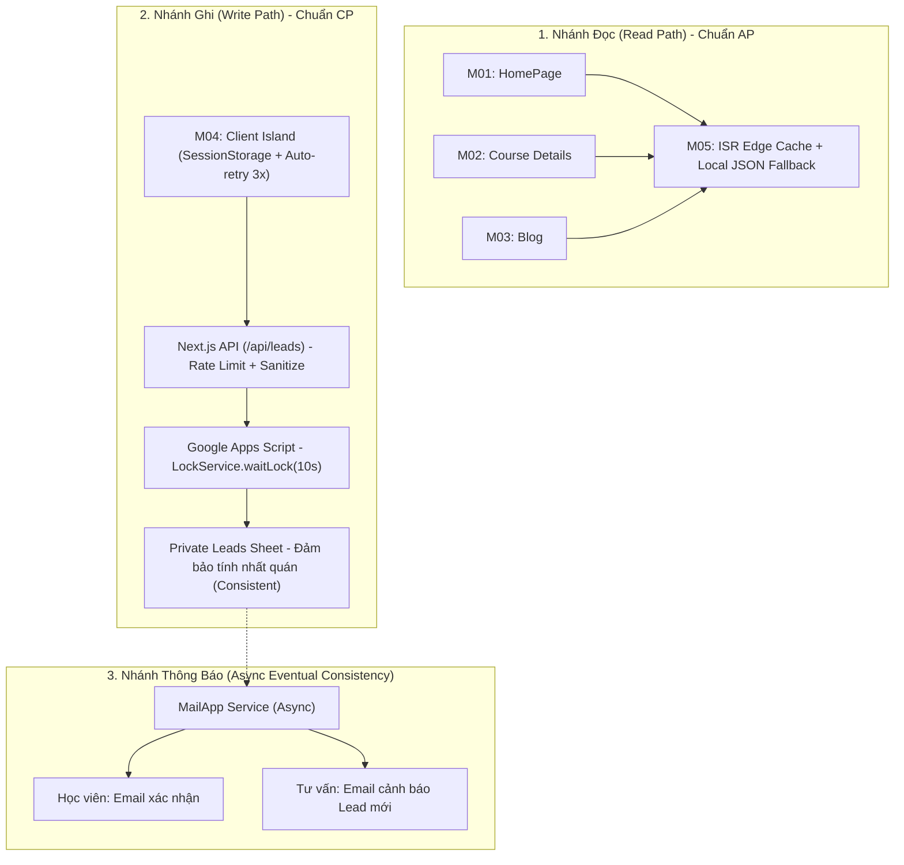

# Báo Cáo Kỹ Thuật (Local PR) #02: Đặc Tả Yêu Cầu Chi Tiết Các Phân Hệ (Modules PRD Specifications)

- **Mã báo cáo:** `PR-02-MODULES-PRD-SPECIFICATIONS`
- **Tên nhánh giả định:** `feature/modules-prd-and-specs`
- **Trạng thái:** Sẵn sàng triển khai (Ready for Review & Coding)
- **Tác giả:** TechLead & Project Assistant
- **Ngày lập:** 2026-11-03
- **Thư mục liên quan:** `docs/03-modules/`, `docs/07-architecture/`, `docs/04-workflows/`

---

## 1. Tổng quan & Mục tiêu đợt cập nhật

Báo cáo PR này ghi nhận việc hoàn thiện toàn diện bộ tài liệu đặc tả sản phẩm (PRD) và hướng dẫn kỹ thuật cho tất cả 5 module nghiệp vụ cốt lõi của website **DataWithLy** (`docs/03-modules/`).

Mọi tài liệu đã được chuyển từ trạng thái sơ khai (Draft / TBD) sang trạng thái **Đặc tả chi tiết sẵn sàng cho Agent lập trình (Ready for Implementation)**, đồng bộ 100% với:
- Dữ liệu slide bài giảng và hồ sơ Mentor Hứa Thảo Ly (`[LYDATA] Data Analytics Courses.pptx.pdf`).
- Bảng yêu cầu nội dung và danh mục 3 khóa học thực tế (`Website LY DATA - content to fill.xlsx`).
- Bản vẽ thiết kế Figma chính thức (`epfQwa5s3iMO6toM4Fmmpu:0:1`).
- Các yêu cầu bổ sung về bảo mật, chống spam 3 lớp và CAP Theorem.

---

## 2. Danh mục tài liệu đã hoàn thiện (Checklist of Modules & Foundations)

| Phân hệ / Tài liệu | Đường dẫn chi tiết | Trọng tâm đặc tả | Trạng thái |
|---|---|---|:---:|
| **M00 — Hạ Tầng & Kết Nối** | [`README.md`](../03-modules/M00-setup-and-connectivity/README.md) [`prd.md`](../03-modules/M00-setup-and-connectivity/prd.md) | Cấu hình biến môi trường Staging/Prod; Endpoint `GET /api/health/sheets` đo lường độ trễ (latency SLA < 800ms); Swagger OpenAPI UI (`/api-docs`); Bộ kịch bản CRUD Khóa học & Lộ trình (có Soft Delete `is_active = FALSE`, status `ARCHIVED`). | ✅ Hoàn thành |
| **M01 — HomePage** | [`README.md`](../03-modules/M01-homepage/README.md) [`prd.md`](../03-modules/M01-homepage/prd.md) | Bố cục 8 phần; Hero H1 chuẩn Figma; 3 Card USP; Lưới 3 khóa học cốt lõi kèm 2 CTA; Khối 4 dự án học viên (2x2 grid / mobile carousel); Hồ sơ Mentor Ly (xóa bỏ claim ảo); 5 UI states; 8 tiêu chí nghiệm thu (AC-M01-01 -> AC-M01-08); Nút gọi Hotline & Zalo trên Mobile Drawer. | ✅ Hoàn thành |
| **M04 — Lead Capture** | [`README.md`](../03-modules/M04-lead-capture/README.md) [`prd.md`](../03-modules/M04-lead-capture/prd.md) | Hàng rào chống spam 3 lớp (Honeypot `website_hp`, Idempotency UUID `submission_id`, Rate Limiting IP 3 req/10m); Chống chèn công thức (Formula Sanitization); Chịu lỗi Client (SessionStorage backup + 3x auto-retry exponential backoff); Gửi mail 2 chiều (Demo: `hientruongthmh@gmail.com` -> `hien0934752432@gmail.com`, `hien.truong230214@vnuk.edu.vn`); 9 tiêu chí nghiệm thu (AC-M04-01 -> AC-M04-09). | ✅ Hoàn thành |
| **M05 — Content Management** | [`README.md`](../03-modules/M05-content-management/README.md) [`prd.md`](../03-modules/M05-content-management/prd.md) | Schema chi tiết 9 tab Google Sheets (`courses`, `curriculum`, `packages_pricing`, `student_projects`, `mentor_profile`, `testimonials`, `blog_posts`, `site_settings`, `faq`); On-demand ISR Revalidation Webhook (`POST /api/revalidate`); 1-Click Data Linter (LINT-01 -> LINT-05); Xử lý `Alt+Enter` đa dòng; SafeImage Fallback; 7 tiêu chí nghiệm thu (AC-M05-01 -> AC-M05-07). | ✅ Hoàn thành |
| **M02 — Course Details** | [`README.md`](../03-modules/M02-course-details/README.md) [`prd.md`](../03-modules/M02-course-details/prd.md) | Route động `/courses/[slug]` cho 3 khóa học thực tế; Sơ đồ tư duy 5 bước (`Business Problem -> Metrics -> SQL -> Insight -> Dashboard`); Đề cương tương tác 12-25 buổi kèm [Mở rộng/Thu gọn tất cả]; Bảng Combo End-to-End Upsell; Form nhúng & Modal trigger; 8 tiêu chí nghiệm thu (AC-M02-01 -> AC-M02-08). | ✅ Hoàn thành |
| **M03 — Blog** | [`README.md`](../03-modules/M03-blog/README.md) [`prd.md`](../03-modules/M03-blog/prd.md) | Trang danh sách `/blog` với bộ lọc thể loại tức thì; Trang chi tiết `/blog/[slug]` với Reading Progress Bar, Mục lục tự động (TOC), Trình đọc Markdown có tô màu cú pháp (Syntax Highlighting) cho SQL/Python/DAX kèm nút Sao chép mã; 8 tiêu chí nghiệm thu (AC-M03-01 -> AC-M03-08). | ✅ Hoàn thành |
| **Nguồn Chân Lý Dữ Liệu** | [`database-schema.sql`](../references/database-schema.sql) | Bản thiết kế hoàn chỉnh 10 bảng dữ liệu chuẩn PostgreSQL DDL + Prisma ORM schema phụ lục, định nghĩa đầy đủ khóa chính, khóa ngoại, ràng buộc và chỉ mục tối ưu truy vấn. | ✅ Hoàn thành |
| **Bàn Giao & Vận Hành** | [`client-operations-guide.md`](../09-handover/client-operations-guide.md) [`technical-handover-checklist.md`](../09-handover/technical-handover-checklist.md) | Sổ tay vận hành bằng tiếng Việt cho Founder Chị Ly (quy trình thêm khóa học, quy tắc `Alt+Enter`, kiểm tra lead, xử lý sự cố) và Checklist bàn giao kỹ thuật (biến môi trường, tài khoản GCP, DNS). | ✅ Hoàn thành |
| **Quy Tắc Nghiệp Vụ BR-13** | [`business-rules.md`](../02-domain/business-rules.md) | Quy định vận hành song song Apps Script Custom Menu `[DataWithLy CMS]` + Direct Cell Edit (có Data Linter đối soát) và Soft Delete an toàn. | ✅ Hoàn thành |
| **Kiến Trúc Caching & Chống Memory Leak** | [`caching-and-memory-optimization.md`](../07-architecture/caching-and-memory-optimization.md) | Chiến lược Caching 5 tầng (Browser ➔ Edge CDN ➔ Next.js Data Cache ➔ In-Memory LRU ➔ Disk Fallback), ma trận 7 điểm dữ liệu Real-time vs Cached, Bounded LRU Cache chống phình to RAM, và giám sát Heap Memory SLA (< 250MB). | ✅ Hoàn thành |
| **Tiêu Chuẩn NFR (Nhóm 05)** | [`05-non-functional-requirements/`](../05-non-functional-requirements/README.md) | Hoàn thiện trọn bộ 8 tài liệu NFR (`usability`, `performance`, `reliability`, `security`, `seo`, `observability`, `deployment`): Chuẩn Core Web Vitals khắt khe (LCP < 1.2s, INP < 100ms, CLS < 0.05) và công thái học quản trị "Dễ xài - Dễ hiểu - Logic - Thân thiện" cho Chị Ly. | ✅ Hoàn thành |

---

## 3. Đối chiếu Chiến lược CAP Theorem trong từng Phân hệ

### Các đánh đổi kỹ thuật (Trade-offs & Rationale):
1. **Nhánh Đọc (AP - Availability & Partition Tolerance):**
   - *Ưu tiên:* Tốc độ tải trang tức thì (< 1.2s), điểm số Core Web Vitals (LCP < 2.5s, CLS < 0.1), khả năng chịu tải cao khi chạy quảng cáo Facebook/LinkedIn.
   - *Đánh đổi:* Chấp nhận độ trễ vài giây (Eventual Consistency) khi nội dung trên Sheets thay đổi cho đến khi Webhook Revalidate được kích hoạt hoặc cache hết hạn (`revalidate = 3600`).
2. **Nhánh Ghi (CP - Consistency & Partition Tolerance):**
   - *Ưu tiên:* Tuyệt đối không để mất Lead, không ghi trùng dữ liệu vào Sheets khi người dùng bấm liên tục.
   - *Bảo vệ:* Sử dụng `LockService.waitLock(10000)` để tuần tự hóa các thao tác ghi đồng thời.
   - *Khắc phục nhược điểm Availability của CP:* Trang bị lớp phòng thủ phía Client (Client-Side Resilience) với việc lưu tạm vào `sessionStorage` và tự động retry 3 lần có độ trễ lũy thừa (1s, 2s, 4s). Nếu mạng lỗi hoàn toàn, người dùng vẫn bấm nút `[Thử lại]` mà không mất dữ liệu đã nhập.
3. **Nhánh Thông báo Email (Async Eventual Consistency):**
   - *Quy tắc:* Tác vụ gửi email chạy ngầm sau khi dòng Lead đã được ghi thành công vào Sheet. Việc hết quota Gmail không được phép làm fail lượt đăng ký của học viên.

---

## 4. Tuân thủ Quy chuẩn Thiết kế (Design System & 4-Point Spacing)

Toàn bộ các phân hệ tuân thủ nghiêm ngặt các quy tắc đã được duyệt:
- **Tone màu chủ đạo:**
  - `Crimson-700` (`#8B1D2C`): Màu nhận diện thương hiệu DataWithLy, dùng cho nút bấm chính (Primary CTA), tiêu đề nổi bật, dải Reading Progress Bar.
  - `Wine-Purple` (`#784080`): Màu phối hợp trong linear gradient Hero section.
  - `Slate Scale` (`slate-50` đến `slate-900`): Màu trung tính cho nền, văn bản và đường kẻ phân cách.
- **Hệ thống Spacing 4-point:**
  - Tất cả padding, margin, gap, kích thước nút bấm tuân thủ bội số của 4px (`spacing-1` = 4px, `spacing-2` = 8px, `spacing-4` = 16px, `spacing-6` = 24px, `spacing-8` = 32px, `spacing-16` = 64px).
  - Tuyệt đối không dùng các giá trị lẻ không thuộc hệ 4-point (như `p-[13px]`, `gap-[7px]`).
- **Nâng cấp trải nghiệm Mobile:**
  - Bổ sung 2 nút gọi điện thoại trực tiếp (`tel:0934752432`) và Chat Zalo vào Mobile Drawer theo đúng phản hồi từ chủ dự án.
  - Khối Dự án học viên hiển thị dạng lưới 2x2 trên Desktop và chuyển sang vuốt ngang (Scroll Snap) trên Mobile.

---

## 5. Ma trận Truy vết Tiêu chí Nghiệm thu (Acceptance Criteria Matrix)

| Mã AC | Phân hệ | Tóm tắt kịch bản kiểm thử | Trạng thái sẵn sàng test |
|---|---|---|:---:|
| **AC-M01-01** | HomePage | Mở Mobile Drawer -> Kiểm tra nút Gọi Hotline & Chat Zalo | Sẵn sàng |
| **AC-M01-04** | HomePage | Hiển thị 3 khóa học thực tế kèm học phí công khai | Sẵn sàng |
| **AC-M01-05** | HomePage | Bấm [Tư vấn ngay] trên card -> Mở Modal ghim sẵn khóa học | Sẵn sàng |
| **AC-M01-07** | HomePage | Khối 4 dự án học viên tiêu biểu qua SafeImage | Sẵn sàng |
| **AC-M01-08** | HomePage | Kiểm tra không chứa claim ảo về offer tại Harvard/Google | Sẵn sàng |
| **AC-M04-01** | Lead Capture | Bỏ trống form bấm Gửi -> Báo lỗi tiếng Việt theo Zod schema | Sẵn sàng |
| **AC-M04-02** | Lead Capture | Nhập số điện thoại sai định dạng -> Báo lỗi số VN hợp lệ | Sẵn sàng |
| **AC-M04-03** | Lead Capture | Honeypot `website_hp` bị điền -> Silent Reject (giả lập 200) | Sẵn sàng |
| **AC-M04-04** | Lead Capture | Gửi quá 3 lần/10 phút -> HTTP 429 Too Many Requests | Sẵn sàng |
| **AC-M04-05** | Lead Capture | Tải lại trang (F5) khi đang điền -> Tự khôi phục từ sessionStorage | Sẵn sàng |
| **AC-M04-06** | Lead Capture | Giả lập rớt mạng -> Tự động thử lại 3 lần và hiện nút Thử lại | Sẵn sàng |
| **AC-M04-07** | Lead Capture | Nhập chuỗi `=SUM(A1:B1)` -> Tự động thêm dấu nháy đơn `'` | Sẵn sàng |
| **AC-M04-08** | Lead Capture | Gửi thành công -> Phát sinh email 2 chiều tới học viên và admin | Sẵn sàng |
| **AC-M05-01** | CMS | Thêm khóa học trên Sheets -> Gọi Revalidate -> Web cập nhật ngay | Sẵn sàng |
| **AC-M05-03** | CMS | Nhập `Alt+Enter` trong ô bullets -> Render thành các thẻ `<li>` | Sẵn sàng |
| **AC-M05-04** | CMS | Link ảnh ngoài bị hỏng (404) -> Kích hoạt SafeImage Fallback | Sẵn sàng |
| **AC-M05-05** | CMS | Sheets API lỗi -> Tự động nạp dữ liệu từ local JSON dự phòng | Sẵn sàng |
| **AC-M02-01** | Course Details | Truy cập 3 slug khóa học -> Render đầy đủ số buổi và học phí | Sẵn sàng |
| **AC-M02-03** | Course Details | Bấm [Mở rộng tất cả] -> Mở đồng loạt các thanh Accordion | Sẵn sàng |
| **AC-M02-06** | Course Details | Xem trang khóa lẻ -> Hiển thị gợi ý nâng cấp Combo tiết kiệm | Sẵn sàng |
| **AC-M03-02** | Blog | Chọn tab phân loại -> Lọc danh sách bài viết theo thể loại tức thì | Sẵn sàng |
| **AC-M03-04** | Blog | Cuộn đọc bài viết -> Reading Progress Bar chạy từ 0% đến 100% | Sẵn sàng |
| **AC-M03-05** | Blog | Khối code SQL -> Tô màu cú pháp và có nút Sao chép mã | Sẵn sàng |
| **AC-M03-06** | Blog | Nhấn vào mục lục (TOC) -> Cuộn mượt đến tiêu đề H2/H3 tương ứng | Sẵn sàng |

---

## 6. Kế hoạch tiếp theo (Next Action Items)

Sau khi bộ PRD của cả 5 modules được duyệt:
1. Tiến hành rà soát `08-project/` (cập nhật lộ trình phân kỳ Delivery Process và đóng các câu hỏi đã có lời giải).
2. Sẵn sàng bàn giao tài liệu cho Coding Agent tiến hành triển khai Phase 1: Hoàn thiện Server Layer CMS Fetcher (`lib/cms/`), API Routes (`/api/leads`, `/api/revalidate`) và Giao diện HomePage (`app/page.tsx`).

---

[Quay lại Mục lục Báo cáo](README.md) | [Đến Module 01](../03-modules/M01-homepage/README.md)

